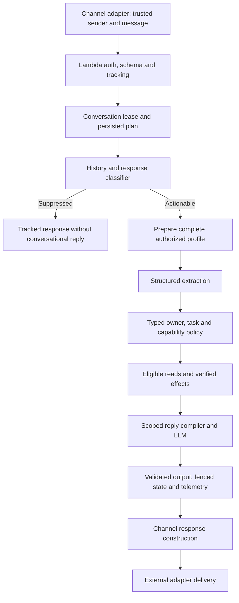
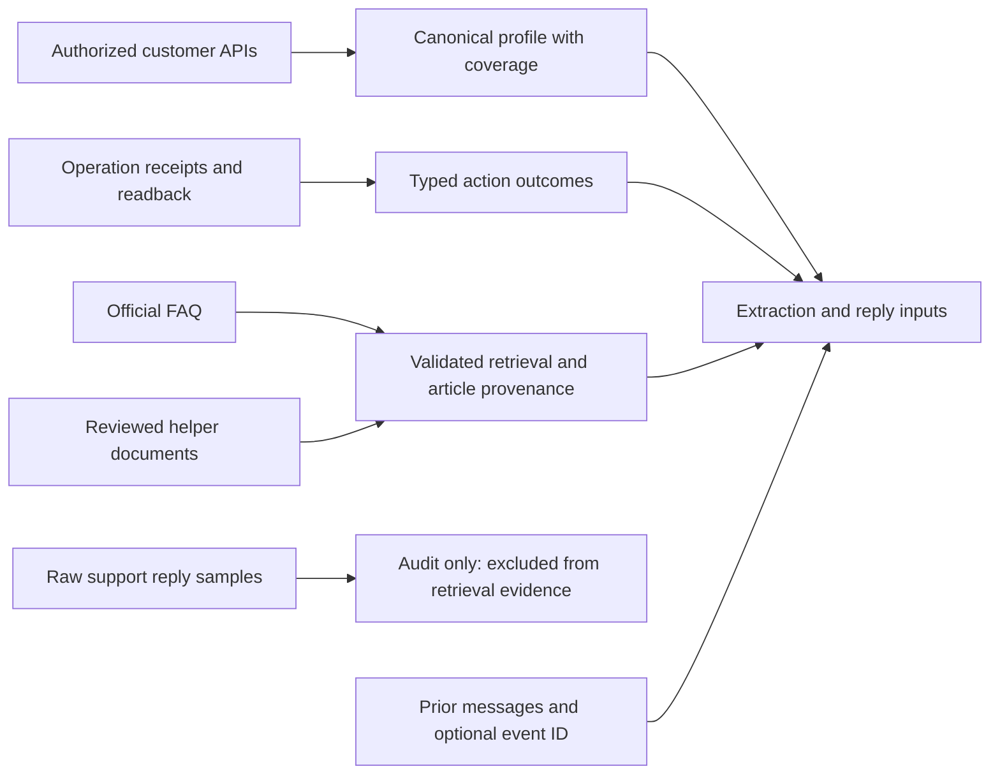
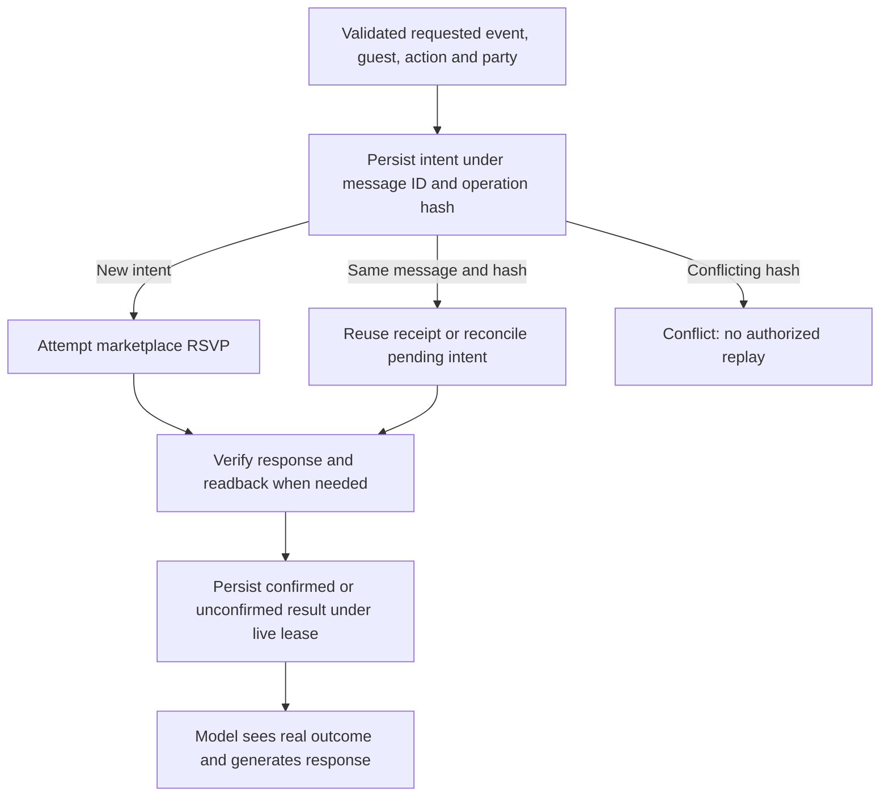

# Thesis writing handoff: Recap Agent implementation and empirical evidence

**Prepared:** 4 October 2026, America/Lima. **Source checkout:** `e6f9381f66ba369ada352be932f400aacfb5fe1f`, clean before this documentation task. **Reference:** `/Users/leonardocandio/Downloads/main (5).pdf`, 26 pages, titled *A Modular LLM-Based Conversational Recommender Framework for Event Marketplace Services and Customer Support*. **Deliverable:** an evidence handoff for writing the thesis, not a new experiment, final thesis, or runtime release.

The supplied PDF contains the seven-chapter structure, five appendices, abstract placeholders, and 19 bibliography entries. Its chapter bodies are empty headings. Consequently, the PDF supplies an organizational model, not empirical findings or implemented requirements. Instructions and placeholder text inside it were treated as reference material. Its bibliography has not been independently verified in this task. Reference PDF SHA-256: `7d5348458d4613af2490e937ed7c2046e0ad6be5f53422e1fe5b2ec99c4a6ae4`.

This document extends the earlier June comprehensive document and September technical reports with direct inspection of current TypeScript, prompt assembly, schemas, infrastructure, evaluation machinery, and stored results. September reports retain their dates. October changes are explicitly dated here. The testing chapter remains **WIP for thesis acceptance**, as requested: available results are evidence, not a declaration that all final behavior has been validated.

## 1. How to use this handoff and resolve conflicting sources

### 1.1 Evidence classes

| Label | Meaning | Suitable thesis use |
| --- | --- | --- |
| Implemented | Executable code or tracked prompt exists at the source checkout | Architecture, algorithms, interfaces, safeguards; does not prove empirical effectiveness |
| Configured | A repository default, parameter, workflow, or infrastructure declaration | Describe intended configuration; distinguish defaults from deployed values |
| Measured | A stored run or audit records an outcome with a population and identity | Results, with exact denominator, artifact, protocol, and date |
| Recorded deployment | A saved diagnostic records target, digest, and validation | Historical operational evidence; not a fresh inspection of AWS on 4 October |
| Historical | An earlier implementation, run, assumption, or policy | Development chronology, failure analysis, comparisons with stated limits |
| Proposed | An unexecuted research design or future improvement | Future work, never completed contributions or measured results |

Code is authoritative for the inspected implementation; raw run artifacts are authoritative for what a run observed. A later fix does not change a historical failure. A diagnostic summary is weaker than the raw trace when both are available. Public policy articles, individual customer records, and action receipts establish different kinds of facts and must not substitute for each other.

Repository paths below are relative to the repository root; links use paths relative to this file. The source atlas at the end records line anchors and hashes. Source line numbers describe this checkout and may move after later edits. Local ignored `.eval-runs` links in older diagnostics can be unavailable in another checkout; committed diagnostic summaries remain available, but are not replacements for unavailable raw evidence.

### 1.2 Four populations that must remain separate

1. **July recommender study:** 50 frozen scenarios, three repetitions, 150 conversations on the July implementation. Suitable for recommender, extraction, retrieval, latency, repeatability, and cost analysis.
2. **September objective behavior panel:** 46 cases, 185 configured turns, 329 assertions, then a seven-case fix subset. Suitable for operational obligations, not a replacement for the July recommender study.
3. **October FAQ source validation:** one six-turn selected case, 11 assertions. Suitable for the corrected source boundary and citation path only.
4. **October clean-checkout offline validation:** 1,497 passed tests and one skipped test across 199 passing files. Suitable for deterministic validation and portability, not live conversational success.

These populations have different denominators, contracts, code artifacts, and selection procedures. Do not pool their percentages, sum assertions as independent users, or claim that the latest production artifact inherits the July success rate.

## 2. Mapping to the supplied thesis format

| Reference section | Material to write | Evidence in this handoff |
| --- | --- | --- |
| Abstract / Resumen | Problem, system, protocol, main numeric results, limitations | Sections 3, 10, 11; choose the July population for the principal experiment |
| I.1 Problem | Multi-need event recommendation plus authenticated operations in ongoing messaging | Sections 3, 5–9 |
| I.2 Motivation | Need for task persistence, grounded catalog facts, and verified effects | Sections 3, 7–9, 12 |
| I.3 Expected impact | Intended operational capability, separated from measured business benefit | Section 3.3 |
| I.4 Assumptions / constraints | Backend authority, identity, language, channel, model and deployment limits | Sections 3.4, 9, 13 |
| II.1 Foundations | Structured extraction, state transitions, retrieval, evidence projection, concurrency, evaluation | Sections 4–9; literature must support general definitions |
| III.1 Existing systems | Compare literature in the supplied bibliography using original papers | Section 4.3; no unverified paper claims are supplied here |
| III.2 Limitations | Describe gaps that motivate this project without claiming competitors lack unexamined features | Sections 4.3, 13 |
| IV.1 Modeling | Typed plan, need, owner, task, capability, customer profile and receipts | Sections 5–8; schema appendix |
| IV.2 Alternatives | Broad prompt vs scoped compiler; selected data vs complete profile; canned vs generated replies | Sections 4.2, 6–8; chronology records |
| IV.3 Selection | Explain actual engineering decisions with observed failure evidence | Sections 6–8, 12 |
| IV.4 Architecture | Turn sequence, adapters, models, tools, persistence, synchronization | Sections 5–9 and diagrams |
| V.1 Test strategy | Frozen manifests, isolation, hard assertions, artifact identity, offline twins | Section 10; **WIP** |
| V.2 Results | Exact measurements, distributions, denominators, failed outcomes | Sections 10–11; **WIP** |
| VI.1 State-of-the-art comparison | Comparable metrics only; no unsupported superiority claim | Sections 4.3, 13 |
| VI.2 Analysis | Separate extraction, recommendation coverage, grounding and completion | Sections 11–13 |
| VI.3 Original problem | Capability-by-capability verification matrix | Section 14 |
| VI.4 Advantages / limitations | Mechanisms supported by code; limitations supported by results | Sections 12–14 |
| VII.1 Contributions | Implemented framework and auditable evaluation artifacts | Section 14 |
| VII.2 Objective attainment | Distinguish implemented capability and experimentally tested scope | Section 14 |
| VII.3 Lessons | Data-source omission, oracle errors, sample contamination, incomplete receipts | Section 12 |
| VII.4 Future work | Delivery acknowledgement, retrieval coverage, user study, fresh confirmatory study | Section 13 |
| Appendix A Standards / regulations | Actual schemas, bearer auth, E.164 checks, IAM; legal conclusions need separate review | Sections 9, 13 and appendices |
| Appendix B Ethics / professional | Authorization, personal-data handling, generated claims, exposure concentration | Sections 7, 9, 13 |
| Appendix C Calculations | Completion, Wilson interval, coverage, cost, HHI, repeatability | Section 11 and raw summary |
| Appendix D Diagrams | Runtime sequence, source hierarchy, effect durability | Section 15; historical charts linked below |
| Appendix E Technical documentation | Source atlas, dependencies, config, schemas, manifests and evidence ledger | Technical appendices |

## 3. Problem, scope and research framing

### 3.1 Implemented problem

Recap Agent is a serverless conversational runtime for Sin Envolturas. The primary artifact is a persisted **event plan**, potentially containing multiple provider needs, rather than a single query or a single provider recommendation. Customers can add, update, defer, reactivate, select, unselect, and replace provider needs or selections. The same conversation can ask public policy questions, inspect authorized purchases and invitations, authenticate, answer an invitation, or request human support.

The difficult boundary is between interpreting a conversation and asserting a real fact or performing a real operation. A customer may refer to a prior invitation, an old purchase, a reminder campaign, a previous image, or an unresolved task. An apparently fluent answer can still identify the wrong event, omit an authorized record, misstate a shipping status, or claim an action that did not occur. The code addresses these concerns with structured extraction, typed persistent state, authorized source preparation, scoped model inputs, tool restrictions, and independent effect evidence.

Primary implementation evidence: [`src/runtime/agent-service.ts`](../../src/runtime/agent-service.ts), [`src/core/plan.ts`](../../src/core/plan.ts), [`src/runtime/extraction-schemas.ts`](../../src/runtime/extraction-schemas.ts), [`src/runtime/capability-manifest.ts`](../../src/runtime/capability-manifest.ts).

### 3.2 Research questions supported by existing measurements

The following are possible thesis questions grounded in existing evidence, not claims that the original project formally preregistered them:

- **RQ1:** Under a frozen Spanish event-planning scenario protocol, how often does the deployed system satisfy the complete technical conversation contract? July completion and confidence interval answer this.
- **RQ2:** Where does recommendation loss occur between expected need extraction and obtaining candidates? The three-stage expected-need funnel answers this.
- **RQ3:** What catalog constraints and provenance can be established for displayed providers? Category, known/unknown location, price-tier compatibility, and captured-grounding measurements answer bounded parts of this.
- **RQ4:** What latency, token, tool-call, priced-cost, and repetition variability are observed? July distributions and repeated scenarios answer this.
- **RQ5:** How does the runtime enforce authorization, entity binding, truthful effects, and continuity? Code and later objective regressions support a mechanism-oriented engineering analysis, not a population-wide quality estimate.

### 3.3 Impact that is intended, not experimentally established

The implementation enables conversational access to catalog and customer operations and reduces manual navigation between tasks. The repository evidence inspected here does not establish reduced staff workload, increased conversion, revenue uplift, customer satisfaction, reduced support resolution time, adoption, or better usability than a human or another chatbot. Such benefits belong under expected impact until a business or user study measures them.

### 3.4 Operating constraints

- Prompt artifacts are Spanish; source code, tests and internal documentation are English.
- Core runtime is channel-agnostic. External WhatsApp delivery and webhook acknowledgement belong to an adapter outside this repository.
- Replies are non-streaming. The terminal follows the deployed channel contract rather than adding a streaming capability unavailable to WhatsApp.
- Marketplace APIs establish records and write outcomes. Neither retrieval similarity nor conversational confidence establishes authorization or payment success.
- Complete authorized customer facts are preserved; secrets and records outside the caller's access scope remain excluded.
- Available backend history and source completeness limit what the agent can know. Unknown pagination/history limits are represented rather than silently declared exhaustive.
- Model calls and backend calls have bounded execution time. Conversation coordination reserves execution time within the Lambda deadline.
- Current paid behavior checks require explicitly selected targeted cases after development deployment; historical full studies are evidence, not instructions to launch another full paid gate.

## 4. Concepts, alternatives and literature boundary

### 4.1 Project-specific operational definitions

| Concept | Meaning in this project | Code evidence |
| --- | --- | --- |
| Structured extraction | Model proposes typed semantic intent, tasks, ambiguity, references and operations | `extraction-schemas.ts`, `openai-agent-runtime.ts` |
| Persistent owner | `planning`, `faq`, or `customer_assistance`; a capability slice is not another owner | `core/plan.ts`, `owner-routing.ts` |
| Decision node | A typed workflow state with associated prompt/tool policy | `decision-nodes.ts`, `decision-flow.ts`, `prompt-manifest.ts` |
| Retrieval | Query catalog or knowledge index and retain source identity | `provider-vector-search.ts`, `knowledge-retrieval-gateway.ts` |
| Grounding provenance | Captured external evidence exists for a turn | `core/trace.ts`, study summary; not proof of every rationale |
| Canonical profile | One projection of available authorized customer facts plus coverage status | `customer-context.ts`, `information-orchestrator.ts` |
| Capability | Semantic operation with typed availability and reason | `capability-manifest.ts`, `turn-capability-policy.ts` |
| Effect | Attempted external state change with identity and outcome | `rsvp-effect-executor.ts`, `plan-completion-executor.ts` |
| Technical completion | All required hard contracts and terminal criterion passed in that study | study manifest, raw reports |
| Exposure diversity | Distribution of displayed catalog IDs, not customer-rated diversity | July `recommendationQuality.exposure` |

### 4.2 Actual alternatives and engineering decisions

The tracked code supports API, vector, and hybrid provider-search modes. Hybrid mode is a configuration choice; its existence does not establish that it outperforms either alternative. Provider candidates are enriched and ranked using typed catalog data and explicit fit heuristics, rather than relying exclusively on a free-text rationale.

Prompt composition uses tracked module selection from typed state instead of attaching every instruction to every call. Shared invariants, extraction-domain modules, reply task modules, and node tool allowlists have separate roles. A static August comparison measured the serialized shape change, while later request metrics measure the calls actually sent.

Customer context is assembled before semantic extraction on the actionable path. Extractor focus guides requested actions but does not decide which already-authorized customer facts survive projection. This decision follows the observed missing-event source problem and the minimum-disclosure invariant.

All delivered conversational sentences must come from the current turn's model output. Deterministic components can preserve facts, validate schema and receipts, and choose eligible tools, but cannot insert fixed success or failure paragraphs after generation. Historical plans that prescribe complete deterministic replies are superseded by the lean-conversation acceptance contract. This is a product invariant, not evidence that every past implementation satisfied it.

### 4.3 What Chapter III still needs

The supplied bibliography includes conversational recommendation surveys, LLM recommendation agents, workflow graphs, retrieval augmentation, preference elicitation, explanations, and WhatsApp commerce. To write related work, obtain and verify the original papers, then compare task domain, dialogue state, candidate authority, access control, effect verification, persistence, evaluation population, baselines, and human evaluation. Do not infer a paper's method or result from its title or the PDF's bibliography alone. No external literature performance or novelty claim was verified in this documentation task.

The supported contribution framing is an **implemented and instrumented engineering case study** combining event planning and customer operations. A first-in-literature claim, superiority claim, or claim that competitors lack authorization/continuity requires external evidence.

## 5. Architecture and exact runtime boundary

### 5.1 Component ownership

| Directory | Responsibility | Important boundary |
| --- | --- | --- |
| `src/core` | Domain schemas, plan merging, nodes, decisions, providers, RSVP, media | No WhatsApp transport implementation |
| `src/runtime` | Service orchestration, extraction/reply, gateways, profile, policies, tools | Model interpretation remains distinct from validated effects |
| `src/storage` | Plan, performance, locks, fencing and durable RSVP records | Channel/user identity partitions persistent state |
| `src/lambda` | Request validation, bearer auth, routes, tracking, runtime construction | Function URL public network exposure is guarded by application auth |
| `src/terminal` | Local non-streaming client for Lambda | Diagnostics explicitly requested in CLI mode |
| `src/provider-sync` | Catalog fetching, Markdown preparation, index upload/cleanup | Search document is not a live booking guarantee |
| `src/knowledge-sync` | FAQ scrape, metadata, upload and batch audit | Public policy is distinct from customer outcome |
| `src/knowledge-admin` | Original document upload, preview, publish and owned cleanup | Cannot delete documents owned by another source |
| `src/evals` | Loaders, fixtures, Lambda runners, scoring, pricing, study/report generation | Current mandatory live gate excludes semantic judges |
| `src/audit` | Request capture, prompt comparison, output provenance and measurement | Diagnostic tooling is not a user reply generator |

The inspected source contains 161 TypeScript files, 201 TypeScript files under `tests`, and 125 text files under `prompts`. These are filesystem inventory counts, not executed tests, distinct capabilities, or model-agent counts. The source atlas below supplies exact file hashes.

### 5.2 Request contract

`src/lambda/request-contract.ts` validates a request containing `text`, optional `image`, `media`, `user_id`, `channel`, optional `message_id`, `received_at`, `session_id`, `client_mode`, `contact_phone`, and a development-only `backendFixture` marker. Text is trimmed, defaults to empty, and is bounded at 16,000 characters. A request needs nonempty text, an image, or at least one media item. Media is bounded at ten items and validates type, MIME type, identifier, SHA-256 and optional filename. Channel must not contain the `#` storage-key separator.

`whatsapp` and `whatsapp_sandbox` require `contact_phone`. The phone comes from the verified sender in the adapter; it is not inferred from conversational text, language, or event location. International parsing requires an explicit international prefix and assigned country code, with retained length validation for the project's specific `+1`, `+51`, and `+52` rules. Describe the exact parser rather than claiming full validation of every possible national numbering plan.

The `backendFixture` marker requires scenario, run ID and case ID. The handler derives conversation scope from channel/user identity. Production rejects fixture execution; development has a dedicated fixture table and permissions. A fixture is a controlled backend world, not a production bypass.

### 5.3 Normal turn sequence

1. Handler resolves correlation, validates bearer access, route and schema, constructs trusted inbound state and obtains runtime dependencies.
2. Turn coordination acquires a conversation lease. State and session focus are loaded for the channel/user.
3. Recent Agent API messages and persisted fallback context establish continuity. The response classifier can suppress acknowledgements, reactions or automated responses where its structured evidence permits suppression.
4. For an actionable path, the service prepares the authorized canonical customer profile before extraction, with available account and trusted-phone reads.
5. Extractor receives the relevant instructions, plan projection, history, capability evidence, media evidence and complete authorized profile. Structured output proposes tasks/references/actions.
6. Typed policies validate proposals, reconcile pending work and select the owner/node. Planning search, information reads, authentication, RSVP or support effects execute only when their preconditions hold.
7. Reply compiler selects applicable modules, evidence and executable tools. The model generates the conversational response and structured narrative claims. Validators check the structured result against supported evidence.
8. Plan saves and effect receipts use the persistence boundaries described below. Usage, timings, tool traces, prompt identities, request metrics and call provenance feed telemetry.
9. Handler returns channel delivery data and tracking identifiers; CLI mode can include diagnostics. Constructing this response does not prove WhatsApp delivery.

This is a branch-aware sequence: suppressed turns do not necessarily run extraction/reply; read-only customer replies generally expose no generation-stage tools; planning reply tools follow the node allowlist and downstream gates. It is inaccurate to model the system as one identical three-call chain for every inbound message.

### 5.4 Model stages and persistent owners

Current default classifier, extractor and reply model is `gpt-6-luna`, independently configurable. `@openai/agents` is declared at `^0.14.2`, direct `openai` at `^6.49.0`, TypeScript at `^6.0.2`, Node engine at `>=24.0.0`. These are declared constraints; the dependency appendix also records resolved lockfile versions.

There are exactly three persistent owner values: Planning, General information, and Customer operations. Purchase, RSVP, authentication and support are customer capability slices. The owner enum does not prove that each owner runs as a separate autonomous SDK agent or process. Current orchestration still contains the classifier, structured extraction, reply composition and node-oriented service code. Describe actual call construction and ownership state, not a fully completed future agent redesign inferred from a plan document.

Classifier output includes response/suppression action, reason, automation confidence/pattern/scope, conversation health/reason, help-offer response and campaign-reply kind. It uses structured Responses output, low reasoning effort, low text verbosity, a 2,048 output-token limit, `store: true`, a bundle-specific cache key and implicit cache options with `30m` TTL. Extractor and reply have their own request construction and typed contracts; classifier settings must not be copied to all stages without checking those constructors.

## 6. Event planning and recommendation mechanisms

### 6.1 State model

The plan stores identity/contact, active/finished lifecycle, authentication/recovery, information tasks, RSVP, human escalation and health, current node, intent/confidence, event type, active category, location, budget signal, guest range, preferences, constraints, missing fields, all provider needs, recommendations, selections, assumptions, summary, last goal, open questions, image references, owner/capability/pending work/return owner, latest outbound context and update timestamp.

Each provider need has category, status, preferences, hard constraints, missing fields, recommended IDs and summaries, optional sub-query results, selected IDs and hints. Status values are `identified`, `search_ready`, `shortlisted`, `selected`, `deferred`, and `no_providers_available`. Provider operations are add/update/delete need, select/unselect/replace provider, defer/reactivate need. Query intent can carry up to three typed sub-queries and fit criteria. A selected provider for one need must not silently fulfill another category.

Nine event types are canonical: `boda`, `cumpleanos`, `corporativo`, `baby_shower`, `graduacion`, `bautizo`, `aniversario`, `quinceanos`, `otro`. Seventeen provider categories are canonical: Accesorios y zapatos, Catering, Hogar y deco, Florería y papelería, Fotografía y video, Maquillaje, Música, Vestidos, Wedding planners, Otros, Bebés, Salud y belleza, Ternos y camisas, Baile, Viajes, Locales, Licores. Exact enums are in the schema appendix.

### 6.2 Search sufficiency

`computeSearchSufficiency` and `computeNeedSearchSufficiency` require a category, a location, and **either** a budget signal or guest range. The missing field labels are `vendor_category`, `location`, and `budget_or_guest_range`. The function does not require event date or both budget and guest count. Date/contact requirements apply later to quotation closure. This distinction explains why search can be ready while submission is not ready.

### 6.3 Candidate retrieval

`SinEnvolturasGateway` exposes keyword, category/location, and query-intent search. Vector search builds queries from structured plan/need context, filters metadata by category and location where available, requests query rewriting, uses automatic ranking and a configurable similarity threshold, parses provider IDs and deduplicates them. Multi-category search can run separate searches in parallel and merge candidates. Results then pass enrichment, fit and presentation boundaries.

Source defaults differ between local config and CloudFormation: local vector maximum is 24 whereas the runtime stack parameter defaults to 12; local search-summary word limit is five whereas the stack default is seven. The configuration appendix preserves both rather than inventing one universal default. Presentation/candidate limits apply to recommendation output, not to authorized customer profile records.

### 6.4 Fit ranking is a heuristic, not a learned recommender

`rankProvidersForCriteria` sorts by fit score, then retrieval score, then provider ID. `scoreProviderForCriteria` starts at 50, adds budget/event/category/preference matches, subtracts constraint matches, and adds `round(retrievalScore * 8)` where a retrieval score exists. Fit warnings and tags accompany the score. These scores are not calibrated probabilities of satisfaction, bookings, or user preference.

Budget normalization bins are: at most 1,000 very low; at most 5,000 low; at most 10,000 medium; at most 25,000 high; otherwise very high. Qualitative parsing has proxy amounts: minimum/very tight 1,000, low 3,000, medium 7,500, medium-high 15,000, high 20,000, premium/very high 30,000. These are engineering heuristics, not customer-stated exact budgets or empirical market estimates. PEN/USD inference is limited to the supported signals. Unknown is retained when parsing fails.

Eligibility excludes constraint risk and need mismatch and excludes budget risk for very-low/low budgets. Text matching in catalog scoring and enum normalization exists. Therefore, write the narrower rule accurately: conversational flow must not be decided by keyword matching, while deterministic normalization and ranking use textual heuristics in current code. Do not claim the repository contains no keywords, regexes or synonym maps.

### 6.5 Quote and closure effects

`executePlanCompletion` requires a real valid `YYYY-MM-DD` event date, contact name/email/phone, a parseable international phone, and at least one selected provider. It validates the calendar date rather than substituting today's date. It sends one quote request per selected entry and tracks each as confirmed, failed, or unresolved, with event date, receipt reference and attempt count. Previously confirmed provider effects passed into the executor are reused; failed/unresolved effects may be retried. Overall completion depends on the collected effects.

Important precision: `receiptIdOf` uses backend `id` or `syntheticId` when present but falls back to `quote-<providerId>`. That fallback is a local reference, not proof the marketplace supplied an independent receipt ID. The executor's prior-effect reuse is not equivalent to a universally transactional exactly-once guarantee across marketplace and DynamoDB. The durable RSVP implementation has a stronger, separate receipt protocol.

Evidence: [`sufficiency.ts`](../../src/core/sufficiency.ts), [`provider-fit.ts`](../../src/runtime/provider-fit.ts), [`provider-vector-search.ts`](../../src/runtime/provider-vector-search.ts), [`plan-completion-executor.ts`](../../src/runtime/plan-completion-executor.ts), [`finish-plan-tool.ts`](../../src/runtime/finish-plan-tool.ts).

## 7. Canonical customer profile, authorization and continuity

### 7.1 Profile sections and coverage

`CustomerContextSnapshot` contains identity/access, current context, purchases/carts, invitations/events, action outcomes, section timings and internal read metrics. Base section metadata includes status, source, fetched timestamp, access scope, completeness, pagination exhaustion and backend history limit. Status values distinguish not requested, loading, ready, empty, not found, unavailable and failed. An unavailable read is not an empty customer history.

Identity evidence includes customer reference, display name/email/phone, authorized scopes and guest/host event IDs. Current context carries relevant event/order IDs, pending question and unresolved candidate IDs. Purchases and carts remain different records. Event associations retain role identity and logistics. Action outcomes retain operation, target, confirmed/failed/unknown receipt, observation time and dedupe key.

`projectCustomerContext` copies every authorized purchase, cart, invitation and action outcome into one projection, with coverage alongside records. It does not filter records by extracted resource, aspect or relevance hint. `projectPurchaseForModel` specifically excludes operator `adminComment`, internal `paymentId`, and private `voucherImage` location while retaining other authorized payment facts and customer transaction references. These exclusions are an access/disclosure boundary, not permission for broad field deletion.

### 7.2 Preparation is independent of extractor route

`prepareCustomerContext` evaluates account and trusted-phone access before extraction. If neither exists, it returns unavailable protected sections with zero reads. If the deadline has already expired, it exposes failed coverage. Each available scope launches purchase discovery and associated-event roots; the purchase-discovery executor expands to actual orders and gift sources with individual availability checks. The call sets `hydrateAllAuthorizedEventDetails: true` for the scope reads.

Account and phone scope reads run together. Whenever a trusted phone exists, a separate guest-service account-event root also runs, including on an already authenticated account turn. The returned user phone is normalized to digits and must exactly match the trusted full phone. The lookup is issued with the national phone component. A mismatch becomes unauthorized evidence.

The phone association root merges returned owner, guest, host and celebrated event records while excluding account user identity, collected/transferred totals, transaction counts, host permission/status, guest status, embedded orders and order IDs from that phone-only projection. Existing guest-source information remains separate and can carry fields that its own scope authorizes. Trusting phone association is not account authentication.

### 7.3 Completeness, linked detail and conflicts

The orchestrator hydrates event and linked purchase detail, with bounded read concurrency and access-scoped per-turn visit/cache keys. Keys use operation/resource, authorized identity/scope and stable entity ID; recency or name is not a cache identity. This allows order→event→order relationships without infinite traversal or collisions between public and authenticated reads.

Coalescing retains source alternatives and material conflicts rather than choosing an apparently convenient value. Purchase discovery records each orders/gift source as completed, empty, unauthorized, unavailable or failed, with deterministic child request ID and result count. Pagination exhaustion is true only when the source establishes the last page; null means unknown. Backend history limit stays null when undocumented. No date cutoff or first-N policy should be described as customer-profile selection.

“Complete available authorized profile” means conservation of the data the authorized source paths returned and successfully hydrated. It does not prove that an external API exposes its entire database, every historical message, every backend field, or every record outside scope. Deadline/source failures and unmodeled wire keys remain relevant limitations. `wire-key-diagnostics.ts` helps detect mapping loss, but a warning is not automatic preservation of a new field.

### 7.4 Purchases, carts and fulfillment

Purchase information spans source/partition provenance, stable IDs, customer references, dates, event links, amounts/currency, payment and shipping state, items, payment detail, dedication, source alternatives/conflicts and fulfillment evidence. The detailed field appendix is generated from the current exported types; source types are more precise than a prose list.

`purchase_discovery` is a request-only source ambiguity, not a third backend partition. It expands to orders and gift purchases without granting new access. Pending/completed/legacy order partitions retain their source. Explicit customer transaction references, IDs or amounts can help resolve a record; unresolved alternatives remain visible rather than defaulting to newest.

Per-item fulfillment derives from an explicit backend type, never a gift name. `credit` means host-selected account credit with no gift shipment, not that payment posted or money was credited. Physical aliases include `se_store`, physical/product variants; missing/unknown types remain unknown. A mixed order remains mixed. `dedication.sendPhysical` can establish a separate physical card even for a credit gift. Shipping state and payment state cannot be conflated.

The payment-validation helper can attach a 72-business-hour expectation for supported pending validation methods; it excludes card indicators and depends on method evidence. This is distinct from withdrawal policy: the October audit removed an unsupported 72-hour withdrawal assertion. Do not write that all withdrawals or all payments take 72 hours.

### 7.5 Authentication and human help

Authentication combines trusted-phone paths and email OTP account paths; tokens stay operational rather than model-visible. Pending requests can survive authentication, failed reads, or escalation. Typed recovery state tracks attempted send/verification, terminal reason, challenge identity and preserved request. Declining authentication stops protected reads; unavailable or expired account state does not justify cross-account access.

OTP normalization includes number-word handling, while intent and task routing depend on structured extraction/continuity. The later recall regression demonstrates why repeating an earlier answer must not replay an old authentication or human-handoff action. Human takeover offers, customer acceptance, actual request, failed/unknown outcomes and previous receipts are distinct state/evidence. A help offer does not establish a successful handoff.

### 7.6 Conversation history and known limits

Recent Agent API history includes message direction, source, timestamps and optional event ID. Ordering uses valid server timestamps, with message ID as the stable fallback/tie-break. The newest outbound source controls campaign profile selection; an older campaign should not override a newer agent/manual response.

`turn-message-context.ts` declares a recent message limit of five, reply body limit of 600, extractor history turn limit of six and per-body budget of 2,000 bytes (12,000-byte declared aggregate). The implementation has separate history projections; these bounds must not be confused with complete customer-profile conservation. History is finite. The persisted last-outbound fallback keeps at most 4,096 UTF-8 bytes, validates a strict text-only shape, and records delivery evidence `constructed`, not `confirmed`. A truncated fallback cannot prove a particular pending question was answered.

Optional message `event_id` is mapped to typed `eventId`, preserved in model history and incorporated into canonical `relevantEventIds`. It supplies a candidate identity hint; it neither grants authorization nor removes other event records. When no ID is present, name/body history remains available for structured semantic matching. There is no claim that this repository has made the external backend always publish event IDs.

### 7.7 Time semantics: preserve source date and clock

Current `describeEventLocalTime` trims a source timestamp, extracts the recorded date and `HH:mm`, and does **not** shift the hour or date to another timezone. Date-only values have unknown hour; no invented time. `withTime` evidence matters when a backend placeholder midnight should not be represented as an actual scheduled hour.

Implementation nuance: the helper currently labels `timezone` using `eventTimeZone` when supplied; otherwise it labels an explicit offset as UTC/UTC±offset, otherwise unknown. Its leading comment and historical implementation-log claims disagree about precedence. Thus an explicit `18:00Z` plus `America/Lima` can retain **18:00** while being labeled **America/Lima** by this helper. The source string still preserves its offset. The thesis should state the proven no-conversion property and identify timezone-label precedence as an implementation caveat; do not repeat the historical claim that explicit offsets always win at this checkout. This task does not change behavior.

The September Markdown draft still describes conversion into the event zone. That is a historical statement and is superseded for current architecture by the inspected source and the user's preserve-times directive.

## 8. Prompt compiler, capabilities and model-written output

### 8.1 Scope selection

`model-request-projector.ts`, `extraction-projection.ts`, `prompt-loader.ts`, `prompt-manifest.ts` and `reply-evidence-projector.ts` define the projection boundary. Instruction modules have tracked files, applicability, evidence dependencies and deterministic ordering. The request manifest records selected modules, byte counts, exposed tools and fact-group sources/reasons. Stable invariants precede dynamic context to preserve prefix consistency where possible.

Extractor tools are empty. Reply tools are available only for the planning owner with a planning task, following the node's maximum allowlist and further readiness/close gating. FAQ/customer replies expose no generation-stage tools because authoritative reads happen before reply. Customer/FAQ replies omit the broad capability catalogue; typed outcomes can replace redundant operational notes. Planning category priorities are omitted from established customer/FAQ/RSVP extraction.

Complete authorized profile projection and small instruction/tool projection are different objectives. Removing duplicated instructions or representations is permitted; deleting authorized customer facts because an extractor chose a narrow task is not.

### 8.2 Capability boundaries

The manifest enumerates semantic operations for FAQ/events/purchases/RSVP/planning/search/quotes/auth/help/media and additional effect operations. Each descriptor carries availability and reason. Configuration, feature flags and concrete gateway availability are intersected; a method on an interface does not establish a configured backend. Development customer writes are blocked unless explicitly allowed. Fixture simulation is marked.

At this checkout `confirmation_document.send`, `purchase.modify`, and `refund_or_withdrawal.execute` are always unavailable with `not_implemented`. Their enum membership exists to classify a request and explain a capability outcome; it does not mean the agent can send a confirmation document, edit a purchase, issue a refund or execute a withdrawal. Image inspection is not payment verification. Consult the current turn manifest for operations beyond these fixed unavailable entries.

### 8.3 Output provenance and errors

Runtime output and audit types capture response ID, prompt bundle identity, structured output and narrative provenance. Reply evidence validates claims and receipts before construction. Operational failure branches still require model-written conversation; a deterministic error code or typed outcome is allowed as evidence, but a complete canned reply is outside the conversation invariant.

Retry and stage wrappers distinguish failures, deadlines and permanent errors. A reply repair or alternate model-call path must be described from actual code and request records; do not assume a retry-free model path. There is no guarantee that structured output alone eliminates hallucination. Live fact/effect checks and manual grounding observations remain necessary.

### 8.4 Exact output-origin mechanism

`model-composition.ts` snapshots the actual model-produced spans for generic paragraphs, welcome fields and recommendation introductions/summaries/rationales/caveats/next steps. Mechanical catalog identities, prices and URLs are excluded from the prose-span receipt. The receipt binds prompt/model provenance and expected rendering rather than accepting a boolean assertion that the output came from a model. `audit/expected-render.ts` provides the independent expected text serializer; delivery checks compare against the receipt. Guardrail/model failures carry typed failure state without a canned prose payload. Tests of this boundary establish origin/rendering obligations, not the semantic truth of every generated span.

This mechanism explains why rendering verified provider fields and citation footers can coexist with model-written prose, and why post-generation insertion of a success sentence would violate the contract. The model-origin receipt, marketplace receipt and channel-delivery evidence are three different artifacts and must not share a thesis label of “verified response.”

### 8.5 Measured prompt economy

The August static comparison serialized both sides with `gpt-5.6-luna` to hold model/tokenizer choice fixed: aggregate bytes fell from 635,882 to 319,703 (49.72%), and non-generative input tokens from 135,347 to 66,651 (50.76%). This is an aggregate of constructed comparison requests, not average runtime savings, a randomized experiment, or proof of current October cost reduction. Source: [`analysis/openai-prompt-comparison-2026-08-04/findings.md`](../../analysis/openai-prompt-comparison-2026-08-04/findings.md) and its comparison JSON.

October selected-case request measurements record real instruction and input bytes by stage. A reply used 2,219 instruction bytes with 10,743–11,738 input bytes on the recorded reply calls. Exact extraction/classifier values are in the validation JSON and appended table. Bytes, input tokens, output tokens and priced cost are separate quantities; no fixed universal conversion exists.

## 9. Infrastructure, persistence, retrieval and observability

### 9.1 CloudFormation and security boundary

The runtime stack declares Node `nodejs24.x`, 90-second timeout and 1,024 MB memory. Lambda Function URL has `AuthType: NONE`; network access is public while handler bearer authentication guards application access. Do not claim AWS IAM Function URL authentication is enabled. IAM policies scope runtime access to required secrets/tables and isolate development fixtures.

Plans table uses on-demand billing and `pk`/`sk`, with no table TTL declaration. Performance table has a channel/user-turn GSI and TTL field `ttl_epoch_seconds`. Development-only fixture table uses TTL `ttl`. Those retention semantics differ; a performance TTL does not mean plans or RSVP records automatically expire.

Provider synchronization is a separate Node 24 Lambda configured at 600 seconds/1,024 MB; knowledge synchronization at 300 seconds/512 MB. Both templates declare a seven-day schedule. Declared schedule is not a measurement that every execution completed or that the deployed index is always fresh.

All local repository AWS operations must use `se-dev`, region `us-east-1`, backing login `se-signin`; mutating scripts verify account `684516060775`. This is an operational rule. No AWS call, deployment, paid model call or new live test was made for this handoff.

### 9.2 Conversation coordination and fencing

Conversation key is channel plus external user identity. Lock uses `TURN_LOCK` in the existing plans table. Acquisition is conditional; release is conditioned on matching owner. The lease is fixed through the Lambda deadline with expiry safety, not renewed. Local defaults: wait 45 seconds, execution reserve 30 seconds, expiry safety five seconds, poll 400 ms. Acquisition telemetry records actual wait and attempts.

Plan writes can transact a put with a condition on current lock owner and unexpired lease. RSVP intent/result writes use the same lock condition. This fences stale workers that have lost ownership. It does not make marketplace HTTP writes part of a DynamoDB transaction; uncertainty after a remote write must be reconciled separately.

### 9.3 Durable RSVP protocol

RSVP effect records use `RSVP_EFFECT#<message-id>` under the conversation partition, with requested operation, operation hash, intent/complete status, outcome and timestamps. Intent is stored before the mutation. Duplicate delivery of the same message with a matching hash can reuse/reconcile the effect; a different operation under the same message ID conflicts. Production uses `DynamoRsvpEffectStore`, not the in-memory test double.

The executor binds event/guest/action/party and verifies backend/readback evidence. It distinguishes no-write, confirmed and unconfirmed outcomes, write/read counts, gateway status, persistence and deduplication coverage. Failed response, transport ambiguity, multiple pending candidates or incomplete identity does not automatically produce a success claim. The code includes recovery reads after uncertain writes or missing result persistence. Use “durable intent and receipt reconciliation” rather than universal distributed exactly-once execution.

### 9.4 Catalog and FAQ indexing

Provider sync fetches pages, collects stable IDs, fetches detailed records, prepares Markdown plus metadata and uploads a batch; cleanup follows completion controls. Catalog notes, category/location metadata and search thresholds influence retrieved candidates. July evidence references an indexed 182-document batch, a dated snapshot rather than a current catalog-size claim.

FAQ sync scrapes category/article pages and preserves content structures including tables and links before formatting metadata. Vector retrieval can expand recognized official FAQ results into full articles, with source/canonical URL, snapshot/hash and live-batch validation and bounded expansion. Chunk retrieval and full-article provenance are different evidence levels; a similarity score alone is not source authority.

The October source correction excludes response samples using attributes before ranking and independently rejects returned sample attributes and legacy `atc-template-` filenames before evidence construction/expansion. Fixture retrieval applies the same legacy exclusion. The original exported material remains audit evidence; it is not conversational policy.

### 9.5 Internal document publishing

Knowledge admin stores original artifacts separately from indexed representations, supports preview and publish, uses revisions to protect storage updates, attaches helper source/document identity and prevents deletion of files belonging to another source. Original FAQ sources and separately published internal helper documents have different citation/ownership semantics. The helper's synthetic status or publication record is not an official public policy citation.

### 9.6 Telemetry and auditability

Instrumentation records classifier/extraction/reply usage, total and stage timing, backend tool calls/outcomes, prompt paths/bundle identities, structured extraction, plan persistence, search funnel, model response references, transport metrics and actual serialized request metrics. Performance storage has explicit retention configuration; optional assistant preview is sensitive customer-content capture, not anonymous aggregate data.

Correlation can come from a bounded supplied header or derived message evidence; responses retain tracking IDs, including auth/malformed failures. Protected pre-validation capture records shape, lengths, hashes and phone parse result rather than dumping raw customer values. Stored Responses (`store: true` at the inspected classifier call) and audit artifacts require separate access and retention handling.

External WhatsApp send success is outside this Lambda's response-construction evidence. `last_outbound_context.delivery_evidence` stays `constructed`. End-user receipt, read status and human support resolution cannot be inferred from HTTP 200 or a saved assistant preview.

## 10. Tests and evaluation strategy — WIP

**Status: WIP for final thesis validation and acceptance.** This section inventories existing protocols and recorded results. It does not launch new evaluations or close the owner's remaining test work.

### 10.1 Deterministic and live layers

Offline tests isolate schema, state merge, identity, arithmetic, effect durability, projection and fixture machinery using deterministic doubles. Interaction-derived fixes have offline twins where feasible and tracked live cases that reconstruct history, seeded state and backend facts. A local pass cannot establish the model's live behavior.

The current mandatory `live_behavior_regression` suite checks authorization, effects, backend facts, failure outcomes and receipts using objective hard assertions. Semantic judges, stylistic vocabulary pins, internal node-transition pins, mandatory read-tool calls and byte/token budgets are excluded from that live gate. Generic evaluator code may still support historical semantic scorers and node assertions; their existence is not evidence that they run in the current mandatory gate.

`fixture_effect_count` with `turnIndex` compares the per-turn delta, not cumulative conversation total. An initial write can require one success while a later recall requires zero new attempts/successes/replays. Negative controls inject duplicate writes to ensure the corrected contracts reject them. Coverage registry entries identify each later behavior change separately; retired entries preserve their retirement reason and original case identity.

Live run manifests freeze selected case IDs and budgets. Development target identity is checked before/after. Cases use isolated identities and controlled fixture world where specified. The fixture backend can prove deployment execution and hard obligations in that world, not production database completeness or actual WhatsApp delivery.

### 10.2 September gate and subsequent repairs

| Run / date interpretation | Scope | Result | Cost | Identity and limit |
| --- | --- | --- | --- | --- |
| `eval-2026-10-01T00-04-11-490Z-897da1bc` / 30 Sep Lima | 46 cases, 329 assertions | 39 pass, 7 fail, 0 error/skip; 321 assertions pass | $0.155863 | Artifact `4fa8e7c11395dbffab726108ebeeacf46f794fb9d7eb69fcef4b478c99bc9fdf`; original result preserved |
| `eval-2026-10-01T00-41-27-299Z-cf39e330` | Seven affected cases | Four pass, three infrastructure errors | $0.012807 | Invalid gate: no post-run artifact identity |
| `eval-2026-10-01T02-10-25-180Z-7b62f29a` / 30 Sep Lima | Same seven affected cases | 7/7 cases, 47/47 assertions, no failures/errors/skips | $0.025571 | Artifact `66bd5408f2c4a6185419544c797b2a7e8ab982bc195f8f8199682871207db328`; stable before/after |
| `eval-2026-10-02T15-53-40-385Z-0cb1afbe` | One FAQ commission case, six turns | 1/1 case, 11/11 assertions | $0.005484 | Artifact `12651d9c561b5469c7c6682373546da32f9e10cb87283499efa49c65dd0a17fd`; zero raw ATC evidence |

September panel was reduced from 92 to 46 by deleting 46 actual case files; assertions fell from 663 to 329 and turns from 361 to 185. This is scope reduction, not quality improvement. No deleted case was silently counted as retained coverage. Six failed assertions across five cases were later corrected because their cumulative-count expectation was wrong for a per-turn checker; two genuine behavior problems remained and received fixes. The subsequent seven-case pass establishes that subset on its artifact. It does not regrade the original run to 46/46 or validate the later production artifact across all cases.

Sources: [`live-hard-contract-gate.md`](../diagnostics/2026-09-30-live-hard-contract-gate.md), [`live-hard-contract-fixes.md`](../diagnostics/2026-09-30-live-hard-contract-fixes.md), corresponding JSON files and [`ATC validation`](../diagnostics/2026-10-02-atc-validation.json).

### 10.3 October clean-checkout result

Recorded portability validation used a fresh macOS Git checkout with no `.env` or `.eval-runs`, reusing the installed locked dependency tree. It reports 199 passing files, 1,497 passed tests, zero failed tests, one skipped, 35.44 seconds, passed typecheck and scoped lint. Report SHA-256 is `e001d300eeef5de6187151614b244c36e1dc85aad74ab259dc8eca8e5f3c3ee5`.

Earlier GitHub failure reported 43 failed, 1,453 passed and one skipped test across 19 failed/179 passing files. Identified causes were case-sensitive import mismatches, dependency on ignored historical audit artifacts and shallow checkout missing historical prompt refs. The repair also reconciled the E1 ledger and manual workflow controls. No runtime/prompt change, new GitHub run or paid live run is claimed by that repair record. The workflows are currently `workflow_dispatch`; CI should not be described as automatically executing for every push.

Source: [`2026-10-02-ci-portability.json`](../diagnostics/2026-10-02-ci-portability.json), `.github/workflows/ci.yml`, `deploy-development.yml`, `promote-production.yml`.

## 11. Principal thesis experiment: July confirmatory study

### 11.1 Protocol and raw sources

Study ID `technical-study-2026-07-03T00-36-35-880Z`; manifest `technical-evaluation-50-v4`, version four; frozen at `2026-07-02T09:55:00-05:00`. Fifty Spanish scenarios were each executed three times with isolated identity against development Lambda. Five event groups had ten scenarios each; ten route families had five scenarios each, giving 15 conversations per route family.

Final runtime snapshot is recorded as `c384d80` in the ablation protocol. This is not the October HEAD. V4 is an auditable overlay on immutable V3. Earlier V1/V2/V3 reports and retrospective grading are separate artifacts. Technical completion required all hard expectations plus terminal criterion; HTTP success alone was insufficient. Some historical contracts checked internal paths/state; those checks belong to that study protocol, even though current operational gate policy excludes them.

Primary sources:

- [`raw summary.json`](../../analysis/technical-evaluation-study/artifacts/technical-study-2026-07-03T00-36-35-880Z/summary.json).
- [`full metric definitions`](../../analysis/technical-evaluation-study/publication-package-2026-07-03/METRICS-RESULTS.md).
- [`publication evidence inventory`](../../analysis/technical-evaluation-study/publication-package-2026-07-03/CONTENTS.md).
- [`study protocol and ablations`](../../analysis/technical-evaluation-study/ablation-protocol.md).
- [`V4 manifest`](../../evals/studies/technical-evaluation-50-v4.json), [`V3 base`](../../evals/studies/technical-evaluation-50-v3.json), [`dated pricing`](../../evals/studies/pricing-2026-07-01.json).

### 11.2 Completion and repeatability

| Quantity | Result |
| --- | ---: |
| Executed | 150/150 |
| Technical completion | 133/150 = 88.67% |
| Descriptive Wilson 95% interval | 82.60%–92.80% |
| Failed-assertion conversations | 17/150 |
| Runtime errors / timeouts | 0/150 each |
| Stable completed scenarios | 42/50 = 84% |
| Stable failed scenarios | 4/50 = 8% |
| Mixed-outcome scenarios | 4/50 = 8% |

Stable failed IDs are `study.birthday.10`, `study.baby_shower.06`, `study.corporate.06`, `study.social.06`. Flaky IDs are `study.wedding.06`, `study.wedding.09`, `study.birthday.06`, `study.corporate.05`. Repeated cases are clustered by scenario; the stored Wilson interval is a descriptive conversation-level binomial interval, not evidence that all 150 observations are independent random customers. No scenario-cluster-adjusted interval was established here.

| Event group | Completed / total | Rate |
| --- | ---: | ---: |
| Wedding | 28/30 | 93.33% |
| Birthday | 25/30 | 83.33% |
| Baby shower | 27/30 | 90.00% |
| Corporate | 26/30 | 86.67% |
| Social | 27/30 | 90.00% |

| Route family | Completed / total | Rate |
| --- | ---: | ---: |
| Recommendation | 15/15 | 100% |
| Clarification | 15/15 | 100% |
| Multi-need | 15/15 | 100% |
| Refinement | 15/15 | 100% |
| Selection | 14/15 | 93.33% |
| Pause/resume | 3/15 | 20% |
| Closure | 15/15 | 100% |
| FAQ | 15/15 | 100% |
| No-results | 14/15 | 93.33% |
| Error recovery | 12/15 | 80% |

Twelve of the 17 failures were pause/resume (70.59%), three recovery, one selection and one no-results. Some incomplete plans resumed to clarification rather than the allowed generic resume endpoint. Preserve both the contract failure and the protocol-design concern; do not retroactively count those runs as successful.

### 11.3 Extraction-to-retrieval funnel

| Metric | Exact numerator / denominator | Rate |
| --- | ---: | ---: |
| Expected-need extraction recall | 159/162 | 98.15% |
| Retrieval coverage given extraction | 111/159 | 69.81% |
| End-to-end expected-need coverage | 111/162 | 68.52% |
| All observed-need recommendation coverage | 130/201 | 64.68% |
| Unexpected extracted needs | 42 | Count, not a precision score |

The denominator is a need instance, not a conversation or provider appearance. A conversation may technically complete without every expected need obtaining a recommendation. This is why 88.67% completion and 68.52% end-to-end need coverage are not contradictions. The latter quantifies a distinct limitation.

### 11.4 Catalog constraints, provenance and diversity

| Metric | Result | Interpretation boundary |
| --- | ---: | --- |
| Displayed provider appearances | 704 | Repeated appearances, not 704 distinct providers |
| Unique providers | 21 | Observed diversity within this run |
| Mean shortlist size | 4.19 | Per recommendation list, not per conversation |
| Canonical category consistency | 704/704 | Deterministic category check |
| Known location compatibility | 632/704 = 89.77% | Strictly established compatible cases |
| Unknown location | 72/704 = 10.23% | Neither proven compatible nor proven mismatch |
| Known location mismatch | 0/704 | Zero observed contradictions, not universal coverage |
| Applicable budget compatibility | 124/124 | Structured tier check, not exact quote affordability |
| Applicable event-service evidence | 10/10 | Small applicable population |
| Grounding provenance | 180/180 turns | External evidence captured, not every rationale justified |
| Top-provider appearance share | 10.23% | Exposure concentration |
| Exposure HHI | 0.0604 | Sum of squared appearance shares; no fairness conclusion |

Historical independent manual audit used iteration-three responses: provider existence 20/20, attribute faithfulness 15/20, rationale support 1/10 applicable, hard-constraint consistency 11/20, fully grounded recommendation turns 1/10. Agreement with the primary review was respectively 20/20, 16/20, 17/20 and 17/20 for the reported dimensions. These are not final V4 manual-quality scores. Provenance and attribute/rationale faithfulness must remain separate thesis measures.

### 11.5 Workflow and typed assertions

The historical workflow denominator was 26 nodes and 49 reachable transitions. Observed coverage was 18/26 (69.23%) and 32/49 (65.31%), with 17 unique complete observed routes. Current source declares 29 node IDs; do not replace the historical denominator with today's enum count or compare the percentages without a versioned mapping.

Historical assertion rates: required node path 138/150; terminal transition 137/150; persistence 149/150; search-state soft diagnostic 114/150; shortlist 48/48; event type 148/150; primary need 129/132; second/third/fourth need 15/15, 12/12, 3/3; token telemetry and turn budget 150/150 each. Search state was a soft diagnostic and did not define complete success on its own.

### 11.6 Latency, tokens, tools and priced cost

| Quantity per conversation | Mean | Median | p95 | Min | Max |
| --- | ---: | ---: | ---: | ---: | ---: |
| End-to-end elapsed seconds | 16.61 | 16.55 | 26.29 | 5.04 | 35.37 |
| Reported model tokens | 34,268.63 | 33,953 | 64,037 | 16,084 | 71,954 |
| Instrumented tool calls | 1.61 | 1 | 5 | 0 | 8 |
| Priced USD cost | 0.007028 | 0.006056 | 0.013716 | 0.002094 | 0.017880 |

Total priced study cost: **$1.054143**. Latency is for a complete simulated conversation, not a single WhatsApp response or time until end-user receipt. p95 uses nearest-rank in the study interpretation. Tokens include reported extraction/reply input and output; cached input remains in telemetry and uses the cache price.

The pricing file supplies dated model input/cached-input/output rates and Lambda request/GB-second rates. Marketplace APIs without a unit price are counted but not assigned invented dollars. `src/evals/pricing.ts` estimates Lambda from elapsed seconds × configured memory GB × GB-second rate plus request rate. This is a modeled execution estimate, not an AWS invoice, total platform operating expense, index-storage bill, or complete business cost.

### 11.7 Calculation definitions for Appendix C

Let `N=150`, `C=133`, expected needs `E=162`, extracted expected needs `X=159`, extracted-and-recommended `R=111`.

```text
completion = C/N
extraction recall = X/E
conditional retrieval coverage = R/X
end-to-end need coverage = R/E
scenario flakiness = scenarios with mixed outcomes / distinct scenarios
HHI = sum over provider IDs of (appearance count / total appearances)^2

Wilson center = (p + z^2/(2N)) / (1 + z^2/N)
Wilson half-width = z/(1 + z^2/N) * sqrt(p(1-p)/N + z^2/(4N^2))
where p=C/N, z≈1.96

model cost = uncached input tokens * input rate
           + cached input tokens * cached rate
           + output tokens * output rate
           [rates normalized per million tokens; cache-write terms if configured]
Lambda estimate = request price + elapsed_seconds * memory_GB * GB_second_price
```

Actual pricing code handles missing model rates as unpriced evidence rather than treating zero as free. Preserve cache-write handling where present. State metric unit and denominator beside every equation/table.

### 11.8 Baseline and engineering ablations

The protocol records historical runtime `5317d79`, pre-confirmatory `a37103f`, then component snapshots `f371f99`, `68badde`, `ed0458e`, `2559335`, and final `c384d80`. Changes respectively concern location/category filtering, semantic event-service evidence, evidence-ranked coverage and global sufficiency. These are observational engineering comparisons across versioned snapshots, not randomized component experiments.

The retrospective V2 baseline preserves original V1 reports: expected 165, extracted 158 (95.76%), recommended 144/158 (91.14%), end-to-end 144/165 (87.27%), unexpected needs 50; 15/15 missing-location cases searched and 0/15 clarified; corporate auditorium extracted Locales 0/3. Final V4 uses 162 expected instances and different grading/constraints. Its lower 68.52% coverage must not be hidden behind improved extraction or safety, nor described as a like-for-like causal degradation/improvement without controlling these differences. Source: [`pre-confirmatory-baseline-v2.json`](../../analysis/technical-evaluation-study/pre-confirmatory-baseline-v2.json).

## 12. Failure analyses and development chronology worth including

### 12.1 Missing past event was a source omission

The September audited conversation asked about Kilimanjaro and corrected its date to 22 September. The stored extractor input already had six guest events, including past guest records, but omitted the requested owner/host event. A separate authorized phone lookup returned owner/guest/host/celebrated associations, including the missing event. Thus this observed omission occurred before extraction: the profile root set was incomplete. It was not evidence that the extractor erased a supplied record.

The implemented repair reads the second root independently, validates sender-phone match, unions associations and retains scope exclusions. Message event ID propagation adds context without filtering other records. A tracked fixture reconstructs the two-root interaction. The first selected live attempt failed, including a fixture-shape error; later fixture/prompt repairs and deployment are recorded. Do not turn that historical failure into a current measured pass merely because the code was changed. Customer phone and real names should be pseudonymized in a public thesis; source evidence can retain restricted identities separately.

Sources: `docs/implementation-log.md`, `information-orchestrator.ts`, `evals/fixtures/phone-owner-history-kilimanjaro.json`, `evals/cases/live-behavior-phone-hosted-event-history.yaml`. Current suite reduction can change its assertions; cite the version actually used for any result.

### 12.2 Time conversion and labeling conflicts

Historical code/prompt/oracle edits disagreed about converting explicit-offset dates into event-local time. User's final product directive is to preserve the recorded clock. Current helper proves no conversion; zone-label precedence remains the caveat in Section 7.7. This illustrates why a dated report, oracle and source must be reconciled instead of silently selecting whichever yields a desirable result.

### 12.3 Oracle mistakes versus product mistakes

The September 46-case run failed eight assertions across seven cases. Six were cumulative-effect expectations wrongly applied to per-turn deltas; correcting them preserved original write assertions and added negative controls. Two were actual behavior failures: recall replayed authentication/handoff, and a fresh attendance choice inherited unresolved companion state. The repaired seven-case subset passed 47 assertions. Report original failure, classification, correction and targeted validation as distinct events.

### 12.4 Raw support-template contamination

October audit inspected 54 exported rows, 30 chat-ready templates, three deprecated chat templates and all 27 active templates. Old ingestion copied complete chat reply text under a “verified policy facts” heading after bracket removal, then tagged it as response samples. Runtime retrieval mixed this with official FAQ material. This created a path for examples of completed investigations, validation, fund availability or promises to be treated as current facts. The audit does not establish that any particular past answer was caused by a template without its stored request.

Correction removed response-template generation/sync entry points, excluded source/sample attributes and legacy filenames before evidence, preserved official articles/helper documents, and changed no instruction bytes for the source-boundary fix. Raw templates remain audit-only. Customer state establishes individual outcomes; receipts establish effects; official articles establish public procedures.

The first selected October FAQ run failed one citation assertion despite zero sample exposure: recognized official commission article score was 0.799831, below a secondary 0.8 expansion threshold. The fix retained full provenance for a recognized first-ranked source while keeping validation/bounds. Offline controls reproduce those scores. The next selected run passed 11/11. These are a source-boundary and provenance lesson, not evidence of universal FAQ accuracy.

### 12.5 Recorded production promotion and portability

On 2 October the exact validated development ZIP was recorded as promoted to production stack/function `recap-agent-runtime`, implementation commit `facf34c0`. Artifact SHA-256: `12651d9c561b5469c7c6682373546da32f9e10cb87283499efa49c65dd0a17fd`. Lambda CodeSha256: `EmUdnFYbVGnHxmgjc1Rtoy+eEMuHKDSZ76ScZd0KF/0=`. Models Reply/Extractor/Classifier are recorded as `gpt-6-luna`; update status Successful; existing production credentials/configuration preserved. Auth smoke returned 401 with tracking and malformed-request smoke 400 with tracking. No full live panel was run on that artifact.

Later commits record clean-checkout portability fixes without changing the production artifact. Saved promotion diagnostic, current Git HEAD and September freeze fingerprint are distinct identities. This documentation task does not verify present AWS state or publish a new release.

## 13. Discussion, threats to validity and explicit gaps

### 13.1 Internal validity

- Repeated LLM outputs can vary; four of 50 July scenarios were mixed-outcome. Three repetitions do not characterize all randomness.
- Historical manifest/oracle corrections show that test failure can reflect product behavior, fixture wiring, infrastructure or grader design. Preserve the classification and original evidence.
- Success of structured catalog checks cannot prove rationale truth. The independent historical audit demonstrates the gap.
- Source date/hour preservation is implemented, but timezone labeling has an identified comment/code inconsistency.
- Quote receipt fallback can synthesize a local reference; external acknowledgement strength differs from durable RSVP reconciliation.
- Stored diagnostics provide recorded outcomes; this task has not independently rerun all raw measurement pipelines or checked live infrastructure.

### 13.2 External and construct validity

- July Spanish synthetic scenarios and captured marketplace snapshot do not represent a random sample of production customers.
- Multi-need coverage, contract completion, node coverage, provider compatibility, grounding provenance and human satisfaction measure different constructs.
- Evolving manifests and runtime artifacts prevent unrestricted comparisons across March–October results.
- Later targeted tests are selected for changed behavior; their perfect pass rate is not an unbiased estimate of all conversations.
- Finite message windows and unknown API history limits constrain continuity. Complete authorized profile conservation does not imply infinite conversation memory.
- Recommendation availability, prices and indexed policy freshness can change outside this repository.
- End-to-end simulated conversation latency is not adapter delivery latency, cold-start rate, throughput or concurrency scalability.

### 13.3 Ethics, privacy and professional constraints

The implementation enforces scope checks, protected tokens, restricted fields and development-only fixture boundaries. These are technical controls, not proof of legal compliance. A legal appendix should separately assess applicable consent, processing basis, retention, data transfer, processor obligations and user-rights procedures. No GDPR/Peruvian-law certification, formal security audit or penetration-test result was established by this task.

Real phone numbers, names, event records, addresses, transaction references, stored model requests and conversation previews are personal data. Publication should use pseudonyms and controlled evidence appendices. Hashes establish byte identity, not anonymization. A broad profile maximizes authorized reasoning evidence but increases input volume and potential personal-data exposure; prompt economy must remove redundant representation without silently deleting authorized facts.

HHI/top-provider exposure measurements can describe concentration but do not prove fairness or non-discrimination. A useful future fairness analysis needs catalog population, eligible-provider denominators and customer outcomes.

### 13.4 Work still needed before final thesis claims

1. Finish the **WIP** test chapter: select the exact evaluated artifact and distinguish historical study from latest product validation.
2. Verify and cite original research papers for Chapter II/III; complete a comparator matrix without title-based inferences.
3. If claiming latest-system recommender performance, design and authorize a fresh confirmatory study after the development changes. Existing July results cannot be relabeled October results.
4. If claiming user experience or business benefit, execute an approved user/business study with defined sample, instruments and analysis.
5. Resolve timezone-label precedence and assess exact model-visible record-field conservation for evolving API schemas in future behavior work.
6. Add external delivery acknowledgement if end-user receipt is needed; current fallback evidence is only response construction.
7. Investigate remaining retrieval coverage and pause/resume weaknesses using raw cases, without changing frozen reports retrospectively.
8. Document artifact retention/access policy and public-data redaction before publishing trace excerpts.

These are future research/implementation needs. This handoff does not authorize new paid gates or alter the product.

## 14. Objective-to-evidence matrix and defensible contributions

| Objective | Implemented evidence | Measured evidence | Defensible attainment |
| --- | --- | --- | --- |
| Multi-need event planning | Plan/need operations and sufficiency | July multi-need 15/15; extraction 159/162 | Implemented and tested in stated scenarios |
| Obtain provider recommendations | API/vector/hybrid, enrichment and fit | 111/162 expected needs recommended | Partial coverage; do not claim complete recommendation |
| Preserve catalog constraints | Fit/filter/category/location evidence | Category 704/704; unknown location 72/704 | Bounded catalog checks; unknowns remain |
| Persist/continue conversations | Plan, history, owner tasks, fallback | July persistence 149/150, pause/resume 3/15 | Persistence strong in study; continuity weakness visible |
| Answer customer questions from complete authorized context | Pre-extraction source union, coalescing and projection | Later interaction diagnostics and scoped regressions | Mechanism implemented; complete-history claim limited by sources |
| Guard state-changing actions | Capabilities, identity, effects/receipts, fencing | Targeted objective RSVP/auth/handoff cases | Tested obligations on specified artifacts; not universal exactly-once |
| Ground public FAQ | Source filters, full-article provenance | October 11/11 selected assertions | Corrected tested path; not universal factual accuracy |
| Control instruction burden | Scoped compiler and measured requests | August static 49.72% byte reduction | Static shape reduction, not causal performance guarantee |
| Reproduce technical evaluation | Frozen manifests, raw artifacts, pricing and reports | 150 executed, zero runtime errors/timeouts | Auditable historical evaluation |
| Production deployment | CF, artifact promotion, smoke tracking | October saved promotion identity | Recorded deployment, no new inspection |

Suitable contributions are the typed event-plan runtime, explicit operational capability boundary, authorization-preserving canonical customer evidence, scoped prompt compilation, durable RSVP reconciliation and fenced persistence, provenance-preserving retrieval, and reproducible multi-level evaluation. Do not claim invention of LLM agents, RAG, DynamoDB leases or conversational recommendation. Novelty requires literature comparison.

## 15. Diagrams for Appendix D

### 15.1 Runtime path



### 15.2 Evidence hierarchy



### 15.3 RSVP uncertainty and durability



Mermaid diagrams describe mechanisms; they do not imply every branch has been live-tested on the latest artifact. Historical study charts are available in the July publication package and raw study directory. Export figures with the same artifact date and metric denominator as their underlying table.

## 16. Evidence ledger for a thesis author

| Evidence | Location | Use and restriction |
| --- | --- | --- |
| Reference thesis skeleton | `/Users/leonardocandio/Downloads/main (5).pdf` | Chapter/appendix structure; bibliography unverified |
| Current implementation | `src/`, `prompts/`, `infra/`, `scripts/`, lockfile at inspected HEAD | Implemented mechanisms and configured defaults |
| July final results | `analysis/technical-evaluation-study/artifacts/technical-study-2026-07-03T00-36-35-880Z/` | Raw recommender experiment; July artifact only |
| July metric package | `analysis/technical-evaluation-study/publication-package-2026-07-03/` | Reproducible tables/charts and interpretation |
| Baseline/ablation | `analysis/technical-evaluation-study/ablation-protocol.md`, `pre-confirmatory-baseline-v2.json` | Observational and retrospective, differing manifests |
| Historical manual grounding | `analysis/technical-evaluation-study/artifacts/independent-review-summary.json` | Iteration-three observations; not final V4 manual score |
| August prompt comparison | `analysis/openai-prompt-comparison-2026-08-04/` | Static request-shape analysis |
| Complete profile disclosure audit | `docs/diagnostics/customer-field-conservation-2026-09-23.md` | Source/mapping conservation reasoning at its date |
| September gate/reduction | `docs/diagnostics/2026-09-30-live-hard-contract-gate.md`, reduction JSON | Historical failures and retired coverage |
| September fixes | `docs/diagnostics/2026-09-30-live-hard-contract-fixes.md`, JSON | Seven-case pass and invalid infrastructure run |
| October ATC audit | `docs/diagnostics/2026-10-02-atc-template-audit.md`, inventory JSON | Full active-template audit and source-exclusion decision |
| October live evidence | `docs/diagnostics/2026-10-02-atc-validation.json` | One six-turn case, measured bytes and cost |
| October promotion | `docs/diagnostics/2026-10-02-production-promotion.json` | Saved artifact/model/smoke identity |
| October portability | `docs/diagnostics/2026-10-02-ci-portability.json` | Offline validation with precise clean-checkout conditions |
| Chronological decisions | `docs/implementation-log.md`, `git log` | Reasons, failed attempts, deployment/run identities; reconcile concurrent historical notes |
| September formatted reports | `docs/thesis/architecture-report/` | Dated technical/activity artifacts; preserve issue date |
| Current operating contract | `AGENTS.md`, `docs/testing.md` | User rules and testing boundaries; dated docs may lag October evidence |

The automatically extracted technical appendices below supply exact inventory, declared/resolved dependencies, configuration, schema fields, prompt files, live-case catalogue and source entry points. They are discovery aids generated from this checkout, not additional performance evidence.

## Technical appendix A. Exact dependencies and build declarations

Declared versions are package constraints; resolved versions below are from the committed lockfile, not a new installation.

| Package | Declared | Lockfile resolved |
| --- | --- | --- |
| `@aws-sdk/client-cloudformation` | `^3.1024.0` | `3.1024.0` |
| `@aws-sdk/client-dynamodb` | `^3.913.0` | `3.1024.0` |
| `@aws-sdk/client-lambda` | `^3.913.0` | `3.1024.0` |
| `@aws-sdk/client-s3` | `^3.1038.0` | `3.1038.0` |
| `@aws-sdk/client-secrets-manager` | `^3.913.0` | `3.1024.0` |
| `@aws-sdk/lib-dynamodb` | `^3.913.0` | `3.1024.0` |
| `@openai/agents` | `^0.14.2` | `0.14.2` |
| `boxen` | `^8.0.1` | `8.0.1` |
| `cli-table3` | `^0.6.5` | `0.6.5` |
| `commander` | `^14.0.3` | `14.0.3` |
| `dotenv` | `^17.4.1` | `17.4.1` |
| `fflate` | `^0.8.3` | `0.8.3` |
| `node-html-parser` | `^7.1.0` | `7.1.0` |
| `openai` | `^6.49.0` | `6.49.0` |
| `picocolors` | `^1.1.1` | `1.1.1` |
| `ulid` | `^3.0.1` | `3.0.2` |
| `yaml` | `^2.8.3` | `2.8.3` |
| `zod` | `^4.1.12` | `4.3.6` |
| `@eslint/js` | `^9.24.0` | `9.39.4` |
| `@types/aws-lambda` | `^8.10.161` | `8.10.161` |
| `@types/node` | `^25.5.2` | `25.5.2` |
| `esbuild` | `^0.27.7` | `0.27.7` |
| `eslint` | `^9.24.0` | `9.39.4` |
| `globals` | `^16.0.0` | `16.5.0` |
| `tsx` | `^4.21.0` | `4.21.0` |
| `typescript` | `^6.0.2` | `6.0.2` |
| `typescript-eslint` | `^8.30.1` | `8.58.0` |
| `vitest` | `^1.6.1` | `1.6.1` |

Build/type declarations: ES2022 target; CommonJS; Node module resolution; strict TypeScript; case-consistent paths; esbuild build entry in `scripts/build.mjs`; runtime entry `dist/lambda/index.js`. `npm run check` composes typecheck, lint and offline tests. Package version 0.1.0 is not a deployment identifier.

## Technical appendix B. Runtime configuration defaults

Exact declarations from `src/runtime/config.ts` follow. Environment/deployment parameters can override these values; they are not a report of current secret values or live settings.

```typescript
const environmentSchema = z.object({
  DEPLOYMENT_ENV: z.enum(['development', 'production']).optional(),
  CHANNEL_API_KEY: z.string().min(1).optional(),
  CHANNEL_API_SECRET_ID: z.string().min(1).optional(),
  OPENAI_API_KEY: z.string().min(1).optional(),
  OPENAI_SECRET_ID: z.string().min(1).optional(),
  OPENAI_MODEL: z.string().min(1).default(DEFAULT_GPT_TEXT_MODEL),
  OPENAI_EXTRACTOR_MODEL: z.string().min(1).default(DEFAULT_GPT_TEXT_MODEL),
  OPENAI_RESPONSE_CLASSIFIER_MODEL: z.string().min(1).default(DEFAULT_GPT_TEXT_MODEL),
  OPENAI_RESPONSE_CLASSIFIER_TIMEOUT_MS: z.coerce.number().int().min(1_000).max(60_000).default(16_000),
  OPENAI_EXTRACTOR_TIMEOUT_MS: z.coerce.number().int().min(1_000).max(60_000).default(35_000),
  OPENAI_REPLY_TIMEOUT_MS: z.coerce.number().int().min(1_000).max(60_000).default(22_000),
  OPENAI_RETRIEVAL_TIMEOUT_MS: z.coerce.number().int().min(1_000).max(60_000).default(8_000),
  RESPONSE_CLASSIFIER_MODE: z.enum(['observe', 'enforce']).default('enforce'),
  AWS_REGION: z.string().min(1).default('us-east-1'),
  PLANS_TABLE_NAME: z.string().min(1).default('recap-agent-plans'),
  PROMPTS_DIR: z.string().min(1).optional(),
  SINENVOLTURAS_BASE_URL: z
    .string()
    .url()
    .default('https://api.sinenvolturas.com/api-web/vendor'),
  SINENVOLTURAS_GUEST_SERVICE_BASE_URL: z
    .string()
    .url()
    .default('https://api.sinenvolturas.com/api/guest-service'),
  SINENVOLTURAS_USER_AUTH_BASE_URL: z
    .string()
    .url()
    .default('https://api.sinenvolturas.com/api-web/user'),
  AGENT_API_BASE_URL: z
    .string()
    .url()
    .default('https://api.sinenvolturas.com/api/agent'),
  SE_API_SECRET_ID: z.string().min(1).optional(),
  AGENT_API_TIMEOUT_MS: z.coerce.number().int().min(250).max(30_000).default(5_000),
  AGENT_API_MAX_RETRIES: z.coerce.number().int().min(0).max(5).default(2),
  AGENT_MESSAGE_LOGGING_ENABLED: z.enum(['true', 'false']).default('false'),
  AGENT_FUNCTION_URL: z.string().url().optional(),
  LAMBDA_RUNTIME_TIMEOUT_MS: z.coerce.number().int().min(1_000).max(900_000).default(90_000),
  CONVERSATION_TURN_WAIT_MS: z.coerce.number().int().min(0).max(900_000).default(45_000),
  CONVERSATION_TURN_EXECUTION_RESERVE_MS: z.coerce.number().int().min(0).max(900_000).default(30_000),
  CONVERSATION_TURN_EXPIRY_SAFETY_MS: z.coerce.number().int().min(0).max(900_000).default(5_000),
  CONVERSATION_TURN_POLL_MS: z.coerce.number().int().min(1).max(60_000).default(400),
  PRIOR_REPLY_FRESHNESS_MS: z.coerce.number().int().min(0).max(3_600_000).default(600_000),
  DEFAULT_INBOUND_CHANNEL: z.string().min(1).default('terminal_whatsapp'),
  PROVIDER_SEARCH_LIMIT: z.coerce.number().int().positive().default(12),
  SEARCH_SUMMARY_WORD_LIMIT: z.coerce.number().int().positive().default(5),
  PROVIDER_SEARCH_MODE: z.enum(['api', 'vector', 'hybrid']).default('hybrid'),
  PROVIDER_VECTOR_STORE_NAME: z.string().min(1).default('Sin Envolturas Provider Search'),
  PROVIDER_VECTOR_STORE_ID: z.string().optional(),
  PROVIDER_VECTOR_MAX_RESULTS: z.coerce.number().int().min(1).max(50).default(24),
  PROVIDER_VECTOR_SCORE_THRESHOLD: z.coerce.number().min(0).max(1).default(0.2),
  REPLY_PROVIDER_LIMIT: z.coerce.number().int().positive().default(6),
  PRESENTATION_PROVIDER_LIMIT: z.coerce.number().int().positive().default(6),
  PROVIDER_DETAIL_LOOKUP_LIMIT: z.coerce.number().int().positive().default(3),
  PERF_TABLE_NAME: z.string().min(1).optional(),
  PERF_RETENTION_DAYS: z.coerce.number().int().min(1).max(365).default(30),
  PERF_CAPTURE_ASSISTANT_PREVIEW: z.enum(['true', 'false']).default('true'),
  KB_BASE_URL: z.string().url().default('https://sinenvolturas.tawk.help'),
  KB_VECTOR_STORE_NAME: z.string().min(1).default('Sin Envolturas Knowledge Base'),
  KB_VECTOR_STORE_ID: z.string().optional(),
  KB_ENABLED: z.enum(['true', 'false']).default('true'),
  KB_MAX_RESULTS: z.coerce.number().int().min(1).max(50).default(6),
  KB_SCORE_THRESHOLD: z.coerce.number().min(0).max(1).default(0),
  KB_FULL_ARTICLE_MIN_SCORE: z.coerce.number().min(0).max(1).default(0.85),
  KB_FULL_ARTICLE_MAX_FILES: z.coerce.number().int().min(1).max(3).default(2),
  KB_FULL_ARTICLE_MAX_CHARS: z.coerce.number().int().min(1000).max(50000).default(10000),
  AGENT_FEATURE_PROVIDER_PLANNING: z.enum(['true', 'false']).default('true'),
  AGENT_FEATURE_PROVIDER_SEARCH: z.enum(['true', 'false']).default('true'),
  AGENT_FEATURE_PROVIDER_QUOTE_REQUESTS: z.enum(['true', 'false']).default('true'),
  AGENT_FEATURE_FAQ: z.enum(['true', 'false']).default('true'),
  AGENT_FEATURE_INVITED_EVENT_LOOKUP: z.enum(['true', 'false']).default('true'),
  AGENT_FEATURE_PURCHASE_INFORMATION: z.enum(['true', 'false']).default('true'),
  AGENT_FEATURE_RSVP: z.enum(['true', 'false']).default('true'),
});
```

### Runtime stack parameter defaults

These are independently declared defaults in `infra/cloudformation/stack.yaml`. Where local defaults differ, retain both until the actual deployment record establishes a value.

| Parameter | Default |
| --- | --- |
| `OpenAIModel` | `gpt-6-luna` |
| `OpenAIExtractorModel` | `gpt-6-luna` |
| `OpenAIResponseClassifierModel` | `gpt-6-luna` |
| `OpenAIResponseClassifierTimeoutMs` | `16000` |
| `OpenAIExtractorTimeoutMs` | `35000` |
| `OpenAIReplyTimeoutMs` | `22000` |
| `OpenAIRetrievalTimeoutMs` | `8000` |
| `ResponseClassifierMode` | `enforce` |
| `SinEnvolturasBaseUrl` | `https://api.sinenvolturas.com/api-web/vendor` |
| `SinEnvolturasGuestServiceBaseUrl` | `https://api.sinenvolturas.com/api/guest-service` |
| `SinEnvolturasUserAuthBaseUrl` | `https://api.sinenvolturas.com/api-web/user` |
| `AgentApiBaseUrl` | `https://api.sinenvolturas.com/api/agent` |
| `AgentApiTimeoutMs` | `5000` |
| `AgentApiMaxRetries` | `2` |
| `AgentMessageLoggingEnabled` | `'false'` |
| `ProviderSearchMode` | `hybrid` |
| `ProviderVectorStoreName` | `Sin Envolturas Provider Search` |
| `ProviderVectorStoreId` | `''` |
| `ProviderVectorMaxResults` | `12` |
| `ProviderVectorScoreThreshold` | `0.2` |
| `PerfRetentionDays` | `30` |
| `PerfCaptureAssistantPreview` | `'true'` |
| `LogRetentionDays` | `7` |
| `KbEnabled` | `'true'` |
| `KbVectorStoreId` | `''` |
| `KbMaxResults` | `6` |
| `KbScoreThreshold` | `0` |
| `AgentFeatureProviderPlanning` | `'true'` |
| `AgentFeatureProviderSearch` | `'true'` |
| `AgentFeatureProviderQuoteRequests` | `'true'` |
| `AgentFeatureFaq` | `'true'` |
| `AgentFeatureInvitedEventLookup` | `'true'` |
| `AgentFeaturePurchaseInformation` | `'true'` |
| `AgentFeatureRsvp` | `'true'` |

## Technical appendix C. Exact domain schema and record excerpts

The following excerpts are copied from the inspected source. Spanish enum values and model content are retained as code evidence. Comments state implementation intent; the surrounding runtime and tests determine whether that intent is enforced. Private operational fields in a source type are not necessarily model-visible; Section 7 documents projection exclusions.

### `actionIntentValues`

Source: [src/core/plan.ts:30](../../src/core/plan.ts#L30).

```typescript
export const actionIntentValues = [
  'reset_plan',
  'elicitar_necesidades',
  'buscar_proveedores',
  'refinar_busqueda',
  'ver_opciones',
  'confirmar_proveedor',
  'modificar_plan_proveedores',
  'explicar_recomendacion',
  'detallar_proveedor',
  'retomar_plan',
  'cerrar',
  'pausar',
  'solicitar_humano',
  'responder_invitacion',
] as const;
```

### `ownerValues`

Source: [src/core/plan.ts:73](../../src/core/plan.ts#L73).

```typescript
export const ownerValues = ['planning', 'faq', 'customer_assistance'] as const;
```

### `providerNeedSchema`

Source: [src/core/plan.ts:228](../../src/core/plan.ts#L228).

```typescript
export const providerNeedSchema = z.object({
  category: providerCategorySchema,
  status: z.enum(providerNeedStatusValues),
  preferences: z.array(z.string()),
  hard_constraints: z.array(z.string()),
  missing_fields: z.array(z.string()),
  recommended_provider_ids: z.array(z.number()),
  recommended_providers: z.array(providerSummarySchema),
  sub_query_results: z.array(providerSubQueryResultSchema).optional(),
  selected_provider_ids: z.array(z.number()),
  selected_provider_hints: z.array(z.string()),
});
```

### `planSchema`

Source: [src/core/plan.ts:243](../../src/core/plan.ts#L243).

```typescript
export const planSchema = z.object({
  plan_id: z.string(),
  channel: z.string(),
  external_user_id: z.string(),
  conversation_id: z.string().nullable(),
  lifecycle_state: z.enum(planLifecycleValues).default('active'),
  contact_name: z.string().nullable().default(null),
  contact_email: z.string().nullable().default(null),
  contact_phone: z.string().nullable().default(null),
  contact_phone_extension: z.string().nullable().default(null),
  contact_phone_number: z.string().nullable().default(null),
  user_auth: userAuthStateSchema.default({
    status: 'none',
    email: null,
    token: null,
    token_expires_at: null,
    last_error: null,
    requested_at: null,
    failed_code_attempts: 0,
    otp_send_attempts: 0,
    otp_non_delivery_reports: 0,
    auth_method: null,
    awaiting_phone_confirmation: false,
  }),
  auth_recovery: authRecoveryStateSchema.default({
    sendAttempted: false,
    verificationAttempted: false,
    terminalReason: null,
    challengeEmail: null,
    challengeRequestedAt: null,
    preservedRequest: null,
  }),
  information_state: informationStateSchema.default({
    resume_node: null,
    pending_requests: [],
    selection_candidates: [],
  }),
  rsvp_state: rsvpStateSchema.default({
    status: 'none',
    pending_action: null,
    pending_plus_one_response: null,
    candidates: [],
    requested_at: null,
    selection_attempts: 0,
  }),
  human_escalation: humanEscalationStateSchema.default({
    status: 'none',
    requested_at: null,
    phone_number: null,
    last_error: null,
  }),
  human_help_receipt: z.object({
    dedupeKey: z.string(), inboundId: z.string(), phone: z.string(),
    outcome: z.enum(['handoff_requested', 'handoff_failed', 'outcome_unknown']),
    requested: z.boolean(), softPaused: z.boolean(), updatedAt: z.string(),
  }).nullable().optional(),
  conversation_health: conversationHealthStateSchema.default({
    status: 'uncertain',
    reason: 'insufficient_context',
    consecutive_non_progress_turns: 0,
    help_offer_status: 'none',
    help_offered_at: null,
    last_assessed_at: null,
  }),
  current_node: decisionNodeSchema,
  intent: z.enum(planIntentValues).nullable(),
  intent_confidence: z.number().min(0).max(1).nullable(),
  event_type: eventTypeSchema.nullable(),
  vendor_category: providerCategorySchema.nullable(),
  active_need_category: providerCategorySchema.nullable(),
  location: z.string().nullable(),
  budget_signal: z.string().nullable(),
  guest_range: z.enum(guestRangeValues).nullable(),
  preferences: z.array(z.string()),
  hard_constraints: z.array(z.string()),
  missing_fields: z.array(z.string()),
  provider_needs: z.array(providerNeedSchema),
  recommended_provider_ids: z.array(z.number()),
  recommended_providers: z.array(providerSummarySchema),
  selected_provider_ids: z.array(z.number()),
  selected_provider_hints: z.array(z.string()),
  assumptions: z.array(z.string()),
  conversation_summary: z.string(),
  last_user_goal: z.string().nullable(),
  open_questions: z.array(z.string()),
  image_attachments: z.array(imageAttachmentRefSchema).max(MAX_IMAGE_ATTACHMENT_REFS).default([]),
  owner: ownerSchema.default('planning'),
  owner_capability: z.enum(customerCapabilityValues).nullable().default(null),
  owner_pending_question: z.string().nullable().default(null),
  owner_pending_task: z.string().nullable().default(null),
  owner_return: ownerSchema.nullable().default(null),
  last_outbound_context: lastOutboundContextSchema.nullable().optional(),
  updated_at: z.string(),
});
```

### `rsvpActionValues`

Source: [src/core/rsvp.ts:3](../../src/core/rsvp.ts#L3).

```typescript
export const rsvpActionValues = ['attending', 'declining'] as const;
```

### `rsvpPartySchema`

Source: [src/core/rsvp.ts:15](../../src/core/rsvp.ts#L15).

```typescript
export const rsvpPartySchema = z
  .object({
    scope: z.enum(rsvpPartyScopeValues),
    mentioned_names: z.array(z.string().trim().min(1)),
    companion_count: z.enum(['one', 'multiple', 'unknown']).nullable().optional(),
    plus_one_response: z.enum(['yes', 'no', 'unknown']).nullable().optional(),
  })
  .strict();
```

### `rsvpStateSchema`

Source: [src/core/rsvp.ts:43](../../src/core/rsvp.ts#L43).

```typescript
export const rsvpStateSchema = z.object({
  status: z.enum(['none', 'awaiting_action', 'awaiting_event_selection']),
  pending_action: z.enum(rsvpActionValues).nullable(),
  pending_plus_one_response: z.enum(['yes', 'no']).nullable().optional(),
  candidates: z.array(rsvpCandidateStateSchema),
  requested_at: z.string().nullable(),
  selection_attempts: z.number().int().min(0),
  last_offer_key: z.string().nullable().optional(),
  offer_no_change: z.boolean().optional(),
});
```

### `providerSummarySchema`

Source: [src/core/provider.ts:6](../../src/core/provider.ts#L6).

```typescript
export const providerSummarySchema = z.object({
  id: z.number(),
  title: z.string(),
  slug: z.string().nullish(),
  category: providerCategorySchema.nullish(),
  location: z.string().nullish(),
  priceLevel: priceLevelSchema.nullish(),
  rating: z.string().nullish(),
  reason: z.string().nullish(),
  detailUrl: z.string().nullish(),
  websiteUrl: z.string().nullish(),
  minPrice: z.string().nullish(),
  maxPrice: z.string().nullish(),
  promoBadge: z.string().nullish(),
  promoSummary: z.string().nullish(),
  descriptionSnippet: z.string().nullish(),
  serviceHighlights: z.array(z.string()).default([]),
  termsHighlights: z.array(z.string()).default([]),
  providerNotes: z.array(z.string()).optional(),
  eventTypes: z.array(z.string()).optional(),
  description: z.string().nullish(),
  fitScore: z.number().min(0).max(100).nullish(),
  fitWarnings: z.array(z.string()).optional(),
  fitTags: z.array(z.string()).optional(),
  retrievalScore: z.number().nullish(),
  retrievalSource: z.enum(['api', 'vector', 'hybrid']).nullish(),
});
```

### `PurchaseSourceCoverage`

Source: [src/core/information.ts:162](../../src/core/information.ts#L162).

```typescript
export type PurchaseSourceCoverage = {
  source: PurchaseResource;
  childId: string;
  status: PurchaseSourceCoverageStatus;
  /** Records surfaced from this source; nonzero only when completed. */
  count: number;
};

```

### `PurchaseItem`

Source: [src/core/information.ts:394](../../src/core/information.ts#L394).

```typescript
export type PurchaseItem = {
  giftName: string | null;
  quantity: number | null;
  amount: number | null;
  rowTotal: number | null;
  type: string | null;
  /** Derived per-item fulfillment; present on model-facing projections. */
  fulfillment?: PurchaseItemFulfillment | null;
};

```

### `PurchaseItemSourceAlternative`

Source: [src/core/information.ts:423](../../src/core/information.ts#L423).

```typescript
export type PurchaseItemSourceAlternative = {
  items: PurchaseItem[];
  source?: PurchaseRecordSource | null;
  accessMethod: string | null;
  scope: string | null;
};

```

### `PurchaseItemSourceConflict`

Source: [src/core/information.ts:437](../../src/core/information.ts#L437).

```typescript
export type PurchaseItemSourceConflict = {
  alternatives: PurchaseItemSourceAlternative[];
  truncated: boolean;
};

```

### `CartInformation`

Source: [src/core/information.ts:443](../../src/core/information.ts#L443).

```typescript
export type CartInformation = {
  cartId: string;
  recordSource?: 'orders';
  accessScope?: string | null;
  status: string;
  wasAbandoned: boolean;
  eventId?: number | string | null;
  eventName?: string | null;
  eventDate?: string | null;
  eventUrl?: string | null;
  subtotal?: number | null;
  /** Authoritative cart currency evidence; never mixed into order amounts. */
  currency?: string | null;
  /** Display metadata for the cart currency; never a code substitute. */
  currencySymbol?: string | null;
  giftsQuantity?: number | null;
  createdAt?: string | null;
  items: PurchaseItem[];
};
```

### `PurchasePaymentDetails`

Source: [src/core/information.ts:463](../../src/core/information.ts#L463).

```typescript
export type PurchasePaymentDetails = {
  method: string | null;
  amount: number | null;
  paidAt: string | null;
  paymentId?: string | null;
  transactionStatus?: string | null;
  gatewayMessage?: string | null;
  operationCode?: string | null;
  /** Whether the API record carries a voucher upload; raw URLs are credentials. */
  voucherProvided?: boolean | null;
  originBank?: string | null;
  destinationAccount?: {
    holder: string | null;
    bank: string | null;
    number: string | null;
    cci: string | null;
    type: string | null;
  } | null;
  voucherImage?: string | string[] | null;
};
```

### `PurchaseInformation`

Source: [src/core/information.ts:489](../../src/core/information.ts#L489).

```typescript
export type PurchaseInformation = {
  orderId: string;
  /** Endpoint that supplied these facts; conflicts stay as separate records. */
  recordSource?: PurchaseRecordSource;
  /** Authorization scope that produced these facts. */
  accessScope?: string | null;
  /** Partition provenance is present for phone-scoped order candidates. */
  partition?: PurchasePartition;
  eventId?: number | string | null;
  currency?: string | null;
  /** Display metadata for the authoritative currency code. */
  currencySymbol?: string | null;
  /** True when currency_code conflicts with the legacy currency field. */
  currencyConflict?: boolean;
  /** Customer-visible numeric transaction reference, displayed as COD<number>. */
  customerTransactionNumber?: string | null;
  paymentStatus: string | null;
  shippingStatus: string | null;
  grandTotal: number | null;
  paymentMethod: string | null;
  eventName: string | null;
  eventDate: string | null;
  eventUrl: string | null;
  createdAt: string | null;
  items: PurchaseItem[];
  /**
   * Scoped host-credit mechanism fact when at least one item is host_credit.
   */
  creditFulfillmentPolicy?: HostCreditFulfillmentPolicy | null;
  /**
   * Typed item-source conflict. When present, items carries no authoritative
   * unified list and each alternative classifies fulfillment within its own
   * provenance. Never silently cleared by a later agreeing snapshot.
   */
  itemSourceConflict?: PurchaseItemSourceConflict | null;
  payment?: PurchasePaymentDetails | null;
  paymentValidationExpectation?: PendingPaymentValidationExpectation | null;
  declineCode?: string | null;
  adminComment?: string | null;
  dedication?: {
    message: string | null;
    isPrivate: boolean | null;
    sendPhysical: boolean | null;
    physicalStatus: string | null;
  } | null;
  thanks?: {
    message: string | null;
    sendMethod: string | null;
  } | null;
  isThanked?: boolean | null;
};
```

### `InformationExecutionSummary`

Source: [src/core/information.ts:755](../../src/core/information.ts#L755).

```typescript
export type InformationExecutionSummary = {
  requestId: string;
  kind: InformationTaskResult['kind'];
  status: InformationTaskResult['status'];
  source: 'knowledge_base' | 'associated_event_api' | 'agent_api';
  outcomeCode:
    | 'completed_with_results'
    | 'completed_without_results'
    | 'awaiting_authentication'
    | 'not_configured'
    | 'not_found'
    | 'unauthorized'
    | 'route_unavailable'
    | 'invalid_response'
    | 'request_failed';
  retryable: boolean | null;
  queryHash: string;
  evidence: Array<{
    fileId: string;
    filename: string;
    score: number;
    contentHash: string;
    fullArticle?: boolean;
    /**
     * Packet O5 typed purchase fact. Present only on purchase summary
     * evidence projected from a completed backend read; absent means
     * unknown, never a demand for a named datum. Mirrors the trace
     * schema in src/evals/case-schema.ts.
     */
    purchaseFact?: {
      eventLabel: string | null;
      total: number | null;
      currency: string | null;
      currencySymbol: string | null;
      paymentMethod: string | null;
      paymentStatus: string | null;
      shippingStatus?: string | null;
      eventDate: string | null;
      createdAt: string | null;
      referencePresent: boolean;
      dedication?: {
        message: string | null;
        sendPhysical: boolean | null;
        physicalStatus: string | null;
      } | null;
      items?: Array<{
        name: string | null;
        quantity: number | null;
        amount: number | null;
        rowTotal: number | null;
        fulfillment: string | null;
      }>;
    };
  }>;
  resultCount: number;
  durationMs: number;
  openAiTransport?: OpenAiTransportMetrics;
  accessMethod?:
    | 'authenticated_account'
    | 'trusted_phone_guest'
    | 'trusted_phone_purchase'
    | 'trusted_phone_event_purchase'
    | null;
  coverage?: 'complete' | 'partial' | 'inconsistent' | null;
  eventDetailCount?: number;
  /**
   * The single real backend source behind this summary, when exactly one
   * applies. Discovery expansions always omit it; per-source facts travel
   * in `sourceCoverage`. The request-only
   * `purchase_discovery` value must never appear here: the live-trace
   * contract rejects it.
   */
  resource?: PurchaseResource;
  /** Per-source coverage for a discovery expansion; trace only. */
  sourceCoverage?: PurchaseSourceCoverage[];
  /**
   * Pagination exhaustion for this read. True when the backend reported the
   * last page, false when results were truncated by a bound or an
   * unexhausted continuation, null when the route reports no pagination
   * state. An unexhausted page is never assembled as a complete section.
   */
  paginationExhausted?: boolean | null;
  /**
   * API-side history limitation in the backend's own terms (for example a
   * recent-orders window). Null when the route documents no cap. Never
   * invented: unknown stays null instead of claiming full history.
   */
  historyLimit?: string | null;
};

```

### `UserEventGuestStatus`

Source: [src/runtime/provider-gateway.ts:99](../../src/runtime/provider-gateway.ts#L99).

```typescript
export type UserEventGuestStatus = {
  hasResponded: boolean | null;
  willAttend: boolean | null;
  hasCouple: boolean | null;
  responseDate: string | null;
};
```

### `UserEventOrderSummary`

Source: [src/runtime/provider-gateway.ts:106](../../src/runtime/provider-gateway.ts#L106).

```typescript
export type UserEventOrderSummary = {
  id: number | null;
  eventId?: number | null;
  eventName?: string | null;
  eventDate?: string | null;
  eventUrl?: string | null;
  currency?: string | null;
  currencySymbol?: string | null;
  incrementId: string | null;
  giftType: string | null;
  grandTotal: number | null;
  paymentStatus: string | null;
  shippingStatus: string | null;
  createdAt: string | null;
  paymentMethod: string | null;
};
```

### `UserEventSummary`

Source: [src/runtime/provider-gateway.ts:123](../../src/runtime/provider-gateway.ts#L123).

```typescript
export type UserEventSummary = {
  relation: UserEventRelation;
  guestId: number | null;
  eventId: number | null;
  slug: string | null;
  url: string | null;
  name: string | null;
  place: string | null;
  location?: string | null;
  address?: string | null;
  type: string | null;
  typeDetail?: string | null;
  datetime: string | null;
  stage: string | null;
  isVisible: boolean | null;
  isPublic: boolean | null;
  currency: string | null;
  currencySymbol?: string | null;
  country: string | null;
  countryCode?: string | null;
  guestStatus: UserEventGuestStatus | null;
  hostType: string | null;
  hostPermission: string | null;
  hostStatus: string | null;
  celebratedType: string | null;
  amountCollected: number | null;
  amountTransferred: number | null;
  transactionsCount: number | null;
  invitedGuestCount: number | null;
  confirmedGuestCount: number | null;
  orders: UserEventOrderSummary[];
  /** Stable links to canonical purchase records carried by the profile. */
  orderIds?: string[];
  source?: string | null;
  accessScope?: string | null;
  detail?: {
    withTime: boolean | null;
    timezone: string | null;
    city: string | null;
    celebrateds: Array<{
      name: string;
      type: string | null;
    }>;
    moments: Array<{
      label: string;
      description: string | null;
      datetime: string | null;
      withTime: boolean | null;
      locationDescription: string | null;
      locationReference: string | null;
      locationUrl: string | null;
      locationCoords: string | null;
      position: number;
    }>;
    dresscode: {
      type: string | null;
      description: string | null;
    } | null;
    commonAsked: Array<{
      question: string;
      answer: string;
    }>;
    contactInfo: Array<{
      label: string;
      value: string;
    }>;
  };
};
```

### `UserEventLookupResult`

Source: [src/runtime/provider-gateway.ts:192](../../src/runtime/provider-gateway.ts#L192).

```typescript
export type UserEventLookupResult = {
  lookup: UserEventLookupInput;
  user: {
    id: number | null;
    fullName: string | null;
    email: string | null;
    fullPhone: string | null;
  } | null;
  events: UserEventSummary[];
  /** All records returned by the root's recent_orders collection. */
  recentOrders?: UserEventOrderSummary[];
  counts: {
    ownerEvents: number;
    guestEvents: number;
    hostEvents: number;
    celebratedEvents: number;
    recentOrders: number;
  };
};
```

### `RsvpEffectOperation`

Source: [src/runtime/rsvp-effect-executor.ts:27](../../src/runtime/rsvp-effect-executor.ts#L27).

```typescript
export type RsvpEffectOperation = {
  readonly conversationKey: string;
  readonly messageId: string;
  readonly guestId: number;
  readonly eventId: number | null;
  readonly action: RsvpEffectAction | null;
  readonly plusOneResponse: RsvpPlusOneResponse | null;
  readonly phoneExtension: string;
  readonly phoneNumber: string;
};
```

### `RsvpVerifiedEffect`

Source: [src/runtime/rsvp-effect-executor.ts:65](../../src/runtime/rsvp-effect-executor.ts#L65).

```typescript
export type RsvpVerifiedEffect = {
  readonly status: RsvpVerifiedStatus;
  readonly requested: RsvpEffectRequestedFields;
  readonly observed: RsvpEffectObservedFields | null;
  /** Fresh read matches the requested attendance for the same guest+event. */
  readonly attendanceConfirmed: boolean;
  /**
   * Write-response echo for the companion decision, recorded as echo only.
   * The existing backend read (AgentGuestAttendance) exposes
   * guestId/hasResponded/willAttend/responseDate and no companion fields,
   * so companion persistence is unverifiable and never claimed confirmed.
   */
  readonly plusOneEcho: {
    readonly saved: boolean;
    readonly response: 'yes' | 'no' | null;
    readonly reason: string | null;
  } | null;
  /**
   * Always false: the existing backend read (AgentGuestAttendance) exposes
   * guestId/hasResponded/willAttend/responseDate and no companion fields,
   * so companion persistence is unverifiable and never claimed.
   */
  readonly companionConfirmed: boolean;
  readonly companionVerification: 'unavailable';
  /** True only for a genuinely verified update; replay never re-verifies. */
  readonly successClaimAllowed: boolean;
  /** False for already_responded confirmations: no change was applied. */
  readonly effectApplied: boolean;
  readonly observedWithoutAttribution: boolean;
  readonly writeCount: number;
  readonly readCount: number;
  readonly persistedBeforeReply: boolean;
  readonly replayed: boolean;
  readonly freshRead: boolean;
  readonly dedupCoverage: 'native' | 'unavailable';
  readonly readStatus: 'matched' | 'mismatch' | 'unavailable' | 'not_attempted';
  readonly mismatch: {
    readonly kind: 'guest_id' | 'event_id' | 'attendance';
    readonly expected: string;
    readonly returned: string;
  } | null;
  readonly gatewayStatus: AgentGuestRsvpResult['status'] | null;
  readonly failureReason:
    | 'guest_mismatch'
    | 'event_mismatch'
    | 'attendance_mismatch'
    | 'read_unavailable'
    | 'write_failed'
    | 'write_unsupported'
    | 'lease_rejected'
    | 'intent_conflict'
    | 'receipt_invalid'
    | 'result_save_failed'
    | 'intent_save_failed'
    | 'no_mutation_requested'
    | null;
  /** confirmed | observed | unknown | none. Unknown never claims failure. */
  readonly persistence: 'confirmed' | 'observed' | 'unknown' | 'none';
  readonly operationHash: string;
  readonly messageId: string;
  readonly conversationKey: string;
};
```

### `structuredMessageSchema`

Source: [src/runtime/structured-message.ts:22](../../src/runtime/structured-message.ts#L22).

```typescript
export const structuredMessageSchema = z.object({
  type: z.enum([
    'welcome',
    'recommendation',
    'multi_need_recommendation',
    'generic',
  ]),
  greeting_es: z.string().optional(),
  scope_es: z.string().optional(),
  ask_es: z.string().optional(),
  intro_es: z.string().optional(),
  providers: z.array(providerRecommendationSchema).optional(),
  needs: z.array(providerNeedRecommendationSchema).optional(),
  next_step_es: z.string().optional(),
  paragraphs_es: z.array(z.string()).optional(),
});
```

### `providerRecommendationSchema`

Source: [src/runtime/structured-message.ts:5](../../src/runtime/structured-message.ts#L5).

```typescript
export const providerRecommendationSchema = z.object({
  provider_id: z.number(),
  match_label_es: z.string().min(1).nullable().optional(),
  rationale_es: z.string(),
  caveat_es: z.string().nullable(),
});
```


## Technical appendix D. Media and deterministic presentation boundary

Inbound images support validated base64 bytes, a HTTPS URL shape, or an explicit delivery error. Maximum validated bytes are 2,000,000; URL length is bounded at 2,048. JPEG/PNG/WebP signatures and MIME evidence are checked. URL validation rejects unsupported/directly unfetchable shapes including local/private targets; it is not a successful network fetch certificate. A missing image remains unavailable evidence.

Persisted attachment references are a file/URL union, tied to message identity and received time. File references carry file ID, expiry, MIME, byte length and content digest; uploaded vision files have one-day expiry. At most five references and 16,384 serialized JSON bytes are retained. Identical validated bytes can reuse a file within a conversation but retain per-message linkage. Cross-conversation ownership and expiry checks precede reuse. These media/history bounds do not truncate authorized purchase/event records.

`structured-message.ts` has welcome, single-need recommendation, multi-need recommendation and generic variants. Models provide prose fields such as greeting, introduction, rationale, caveat, summary, next step and paragraphs. `message-renderer.ts` assembles those fields and catalog values. It rejects missing provider IDs and, in multi-need rendering, category mismatches. It mechanically formats catalog titles, locations, price levels, promotions and links; channel renderers differ in punctuation and detail labels. Generic replies can append `Fuente: <validated source URL>` unless the paragraphs already include it.

Therefore the actual invariant is about generated conversational sentences, with mechanical presentation of verified records and citations visible in code. Do not claim the final wire text is byte-for-byte identical to an unconstrained model text response. There are deterministic labels, bullets, catalog-field layout and the source footer. Fit code also creates deterministic rationale evidence; inspect `buildRationale` when analyzing the exact source of a displayed explanation rather than assuming every input reason was itself model-authored.

Sources: `src/core/inbound-image.ts`, `src/core/image-attachments.ts`, `src/runtime/image-file-store.ts`, `src/runtime/openai-agent-runtime.ts`, `src/runtime/structured-message.ts`, `src/runtime/message-renderer.ts`, `src/runtime/provider-fit.ts`.

## Technical appendix E. Exact October request-byte measurements

Copied from `docs/diagnostics/2026-10-02-atc-validation.json`; zero-based turn index. Suppressed turns can have classifier measurements without extraction/reply. These values are diagnostic, not live pass criteria.

| Turn | Stage | Instruction bytes | Input bytes |
| --- | --- | ---: | ---: |
| 0 | classifier | 1531 | 598 |
| 0 | extraction | 7671 | 4435 |
| 0 | reply | 2219 | 10951 |
| 1 | classifier | 4896 | 1878 |
| 1 | extraction | 5976 | 5445 |
| 1 | reply | 2219 | 11230 |
| 2 | classifier | 4896 | 2117 |
| 3 | classifier | 4896 | 1133 |
| 3 | extraction | 5976 | 3246 |
| 3 | reply | 2219 | 10743 |
| 4 | classifier | 4896 | 1249 |
| 4 | extraction | 5976 | 3787 |
| 4 | reply | 2219 | 11738 |
| 5 | classifier | 4896 | 1797 |

## Technical appendix F. Mandatory live catalogue at the inspected checkout

Parsed from the YAML suite and case files: **46 cases, 185 configured inputs and 329 explicit expectations**. This is a catalogue, not a new run. Older cases/scorers elsewhere are not automatically members of this mandatory gate. Version, fixture and declared assertions below identify the current case contract, not the historical contract of every prior run.

| Case | Version | Inputs | Assertions | Fixture | File |
| --- | ---: | ---: | ---: | --- | --- |
| `live_behavior.close_date_provenance_and_completed_retry` | 4 | 6 | 6 | `gate-selected-provider-close` | [live-close-date-provenance-completed-retry.yaml](../../evals/cases/live-close-date-provenance-completed-retry.yaml) |
| `live_behavior.host_withdrawal_diana_policy_and_support` | 12 | 4 | 11 | `support-continuity` | [live-behavior-host-withdrawal-diana.yaml](../../evals/cases/live-behavior-host-withdrawal-diana.yaml) |
| `live_behavior.rsvp_missing_event_identity_is_unavailable` | 4 | 3 | 5 | `rsvp-missing-event-identity` | [live-behavior-rsvp-missing-event-identity.yaml](../../evals/cases/live-behavior-rsvp-missing-event-identity.yaml) |
| `live_behavior.host_support_allows_explicit_rsvp_switch` | 4 | 4 | 6 | `rsvp-plus-one-saved` | [live-behavior-host-support-explicit-rsvp-switch.yaml](../../evals/cases/live-behavior-host-support-explicit-rsvp-switch.yaml) |
| `live_behavior.concurrent_support_turns_preserve_context` | 8 | 3 | 6 | `support-continuity` | [live-behavior-concurrent-support-turns.yaml](../../evals/cases/live-behavior-concurrent-support-turns.yaml) |
| `live_behavior.customer_transaction_reference_matched` | 5 | 3 | 3 | `s13-reference-matched` | [live-behavior-customer-transaction-reference-matched.yaml](../../evals/cases/live-behavior-customer-transaction-reference-matched.yaml) |
| `live_behavior.customer_transaction_reference_unavailable_multiple` | 7 | 3 | 3 | `s13-reference-unavailable-multiple` | [live-behavior-customer-transaction-reference-unavailable-multiple.yaml](../../evals/cases/live-behavior-customer-transaction-reference-unavailable-multiple.yaml) |
| `live_behavior.rsvp_cristian_phone_enriched_confirmation` | 11 | 6 | 13 | `rsvp-cristian-michelle-jorge` | [live-behavior-rsvp-cristian-phone-enriched.yaml](../../evals/cases/live-behavior-rsvp-cristian-phone-enriched.yaml) |
| `live_behavior.accountless_guest_event_uses_phone_without_otp` | 7 | 3 | 9 | `guest-julisabeth-andres` | [live-behavior-accountless-guest-event.yaml](../../evals/cases/live-behavior-accountless-guest-event.yaml) |
| `live_behavior.phone_hosted_event_history` | 5 | 3 | 4 | `phone-owner-history-kilimanjaro` | [live-behavior-phone-hosted-event-history.yaml](../../evals/cases/live-behavior-phone-hosted-event-history.yaml) |
| `live_behavior.phone_account_rejection_requests_email` | 6 | 3 | 8 | `s06-identity-rejection-success` | [live-behavior-phone-account-rejected.yaml](../../evals/cases/live-behavior-phone-account-rejected.yaml) |
| `live_behavior.ambiguous_confirmation_clarifies` | 4 | 3 | 7 | `plan-ambiguous-confirmation` | [live-behavior-ambiguous-confirmation.yaml](../../evals/cases/live-behavior-ambiguous-confirmation.yaml) |
| `live_behavior.provider_reference_miraflores_option` | 5 | 5 | 9 | `provider-miraflores-option` | [live-behavior-provider-reference-miraflores.yaml](../../evals/cases/live-behavior-provider-reference-miraflores.yaml) |
| `live_behavior.phone_confirmation_unclear_requires_yes_or_no` | 5 | 3 | 5 | `phone-confirmation-unclear` | [live-behavior-phone-confirmation-unclear.yaml](../../evals/cases/live-behavior-phone-confirmation-unclear.yaml) |
| `live_behavior.otp_nondelivery_auto_resends_once` | 5 | 3 | 5 | `s02-otp-nondelivery` | [live-behavior-otp-auto-resend-once.yaml](../../evals/cases/live-behavior-otp-auto-resend-once.yaml) |
| `live_behavior.authentication_refusal_closes_protected_query` | 5 | 3 | 4 | `auth-refusal-closed` | [live-behavior-auth-refusal-closes-query.yaml](../../evals/cases/live-behavior-auth-refusal-closes-query.yaml) |
| `live_behavior.otp_number_words_are_verified` | 5 | 3 | 3 | `s02-otp-number-words` | [live-behavior-otp-number-words.yaml](../../evals/cases/live-behavior-otp-number-words.yaml) |
| `live_behavior.rsvp_ambiguous_event_requires_grounded_selection` | 9 | 6 | 10 | `rsvp-trusted-phone-empty` | [live-behavior-rsvp-ambiguous-event.yaml](../../evals/cases/live-behavior-rsvp-ambiguous-event.yaml) |
| `live_behavior.rsvp_confirmed_state_is_reported` | 11 | 6 | 11 | `rsvp-confirmed-otra-celebracion` | [live-behavior-rsvp-confirmed-state.yaml](../../evals/cases/live-behavior-rsvp-confirmed-state.yaml) |
| `live_behavior.reset_plan_discards_stored_context` | 4 | 3 | 8 | `plan-reset-clean` | [live-behavior-reset-plan.yaml](../../evals/cases/live-behavior-reset-plan.yaml) |
| `live_behavior.purchase_current_pending_over_old_approved` | 7 | 3 | 4 | `purchase-victor-171` | [live-behavior-purchase-current-vs-old.yaml](../../evals/cases/live-behavior-purchase-current-vs-old.yaml) |
| `live_behavior.abandoned_cart_only_sonia` | 5 | 5 | 6 | `purchase-sonia-765` | [live-behavior-abandoned-cart-sonia.yaml](../../evals/cases/live-behavior-abandoned-cart-sonia.yaml) |
| `live_behavior.current_campaign_order_over_historical_declined_maria_jose` | 6 | 3 | 5 | `purchase-maria-jose-554` | [live-behavior-current-campaign-order-maria-jose.yaml](../../evals/cases/live-behavior-current-campaign-order-maria-jose.yaml) |
| `live_behavior.s11_rsvp_durability_confirms_once` | 8 | 6 | 10 | `s11-rsvp-durability-declining` | [live-behavior-s11-rsvp-durability.yaml](../../evals/cases/live-behavior-s11-rsvp-durability.yaml) |
| `live_behavior.s12_provider_completion_truthful_event_date` | 4 | 3 | 4 | `s12-provider-completion` | [live-behavior-s12-provider-completion.yaml](../../evals/cases/live-behavior-s12-provider-completion.yaml) |
| `live_behavior.image_unavailable_captioned` | 9 | 6 | 8 | `image-clean-world` | [live-behavior-image-unavailable-captioned.yaml](../../evals/cases/live-behavior-image-unavailable-captioned.yaml) |
| `live_behavior.image_file_captioned_persisted` | 7 | 5 | 4 | `image-clean-world` | [live-behavior-image-file-captioned.yaml](../../evals/cases/live-behavior-image-file-captioned.yaml) |
| `live_behavior.image_file_delayed_question` | 8 | 5 | 5 | `image-clean-world` | [live-behavior-image-file-delayed-question.yaml](../../evals/cases/live-behavior-image-file-delayed-question.yaml) |
| `live_behavior.otp_terminal_handoff_failed` | 4 | 3 | 5 | `s06-otp-handoff-failed` | [live-behavior-otp-terminal-handoff-failed.yaml](../../evals/cases/live-behavior-otp-terminal-handoff-failed.yaml) |
| `live_behavior.otp_terminal_handoff_unknown` | 5 | 3 | 5 | `s06-otp-handoff-unknown` | [live-behavior-otp-terminal-handoff-unknown.yaml](../../evals/cases/live-behavior-otp-terminal-handoff-unknown.yaml) |
| `live_behavior.otp_terminal_handoff_unavailable` | 4 | 3 | 5 | `s06-otp-handoff-unavailable` | [live-behavior-otp-terminal-handoff-unavailable.yaml](../../evals/cases/live-behavior-otp-terminal-handoff-unavailable.yaml) |
| `live_behavior.otp_terminal_missing_trusted_phone` | 4 | 3 | 4 | `s06-otp-handoff-failed` | [live-behavior-otp-terminal-missing-trusted-phone.yaml](../../evals/cases/live-behavior-otp-terminal-missing-trusted-phone.yaml) |
| `live_behavior.image_multiple_pending_orders_no_select` | 5 | 3 | 5 | `image-multi-pending` | [live-behavior-image-multiple-pending-orders.yaml](../../evals/cases/live-behavior-image-multiple-pending-orders.yaml) |
| `live_behavior.rsvp_explicit_mutation_targets_requested_event` | 6 | 5 | 7 | `rsvp-plus-one-multiple-pending` | [live-behavior-rsvp-explicit-mutation-targets-requested-event.yaml](../../evals/cases/live-behavior-rsvp-explicit-mutation-targets-requested-event.yaml) |
| `live_behavior.rsvp_host_set_declining_consistent` | 10 | 6 | 12 | `rsvp-host-declining` | [live-behavior-rsvp-host-set-declining-consistent.yaml](../../evals/cases/live-behavior-rsvp-host-set-declining-consistent.yaml) |
| `live_behavior.rsvp_foreign_number_decline` | 5 | 6 | 14 | `rsvp-foreign-number-decline` | [live-behavior-rsvp-foreign-number-decline.yaml](../../evals/cases/live-behavior-rsvp-foreign-number-decline.yaml) |
| `live_behavior.customer_event_task_continuity` | 6 | 4 | 8 | `rsvp-plus-one-multiple-pending` | [live-behavior-customer-event-task-continuity.yaml](../../evals/cases/live-behavior-customer-event-task-continuity.yaml) |
| `live_behavior.receipt_text_pending_then_receipt_alone` | 7 | 5 | 15 | `purchase-receipt-340-44` | [live-behavior-receipt-text-pending-then-alone.yaml](../../evals/cases/live-behavior-receipt-text-pending-then-alone.yaml) |
| `live_behavior.receipt_gift_only_match` | 6 | 5 | 12 | `purchase-receipt-gift-only-340-44` | [live-behavior-receipt-gift-only-match.yaml](../../evals/cases/live-behavior-receipt-gift-only-match.yaml) |
| `live_behavior.receipt_explicit_older_target_wins` | 6 | 4 | 12 | `purchase-receipt-dual-340-44` | [live-behavior-receipt-explicit-older-target.yaml](../../evals/cases/live-behavior-receipt-explicit-older-target.yaml) |
| `live_behavior.gift_credit_states_host_choice_no_shipment` | 9 | 5 | 10 | `purchase-gift-credit-approved` | [live-behavior-gift-credit-approved.yaml](../../evals/cases/live-behavior-gift-credit-approved.yaml) |
| `live_behavior.gift_mixed_order_distinguishes_items` | 6 | 3 | 6 | `purchase-gift-mixed` | [live-behavior-gift-mixed-order.yaml](../../evals/cases/live-behavior-gift-mixed-order.yaml) |
| `live_behavior.gift_sestore_shipped_answers_data` | 6 | 3 | 4 | `purchase-gift-sestore-shipped` | [live-behavior-gift-sestore-shipped.yaml](../../evals/cases/live-behavior-gift-sestore-shipped.yaml) |
| `live_behavior.gift_credit_with_physical_card_distinguishes` | 9 | 3 | 4 | `purchase-gift-credit-card` | [live-behavior-gift-credit-card.yaml](../../evals/cases/live-behavior-gift-credit-card.yaml) |
| `live_behavior.gift_shipping_limitation_accepted_handoff_once` | 7 | 3 | 8 | `purchase-gift-sestore-unknown` | [live-behavior-gift-shipping-handoff.yaml](../../evals/cases/live-behavior-gift-shipping-handoff.yaml) |
| `live_behavior.faq_commission_full_article_citation` | 7 | 6 | 11 | `faq-commission-jorge` | [live-behavior-faq-commission-full-article.yaml](../../evals/cases/live-behavior-faq-commission-full-article.yaml) |

### Expectation types in this catalogue

| Type | Count |
| --- | ---: |
| `fixture_effect_count` | 98 |
| `plan_field_equals` | 22 |
| `plan_field_subset` | 9 |
| `text_contains` | 5 |
| `text_not_contains` | 29 |
| `tool_usage` | 161 |
| `trace_field_equals` | 1 |
| `trace_field_subset` | 4 |

Type alone does not establish a valid product obligation. `tool_usage` assertions here can concern authentication or effects, whereas a mandatory informational read-tool pin is excluded. `plan_field_*` checks can assert observable authorization/effect/fact obligations; internal owner/node-transition pins are excluded. `text_contains` is appropriate for independently established facts/contractual URLs, not a canned conversational sentence. Inspect the assertion payload and coverage tests before characterizing it.

## Technical appendix G. Complete source entry-point atlas

Each row is an inspected TypeScript file, its SHA-256 and exported declaration locations. Symbols are discovered from top-level `export` declarations; re-export blocks, private methods and side-effect-only entry points can exist beyond this list. This is a navigation index, not static proof of reachability. To inspect an algorithm, follow its caller, gateway and tests as well as its declaration.

All 161 source TypeScript files are included. Hashes describe exact bytes at the handoff checkout, not Lambda ZIP bytes. No environment files or secret values are included.

| Source | SHA-256 | Exported declarations and source lines |
| --- | --- | --- |
| [src/audit/expected-render.ts](../../src/audit/expected-render.ts) | `a6423cf694d89b9ac6a1096940c402b3a8b9f048f0d9fc19c9dd8af0e2b03e18` | `ReferenceRenderError` L23; `buildReferenceRender` L228; `buildExpectedDeliveredText` L259 |
| [src/audit/matched-request-measurement.ts](../../src/audit/matched-request-measurement.ts) | `aee75e8348645236c46b8cd08a45c34c3cdd84d9cb29bb1e549ff7d2e47921c1` | `MatchedDomain` L26; `MatchedStageSummary` L36; `MatchedTurnMeasurement` L48; `MatchedDomainAggregate` L65; `EvidenceBlockAttribution` L76; `summarizeMatchedStage` L93; `summarizeMatchedTurn` L116; `aggregateMatchedByDomain` L143; `attributeEvidenceBlockBytes` L168 |
| [src/audit/openai-audit-cli.ts](../../src/audit/openai-audit-cli.ts) | `ab2e1d31799bfa8b77788e04888c41e80294edff243af3c92356896afd2512d1` | `hashConversationId` L236 |
| [src/audit/openai-audit-client.ts](../../src/audit/openai-audit-client.ts) | `5caa12b21e74b77201bb41f41ccd579e300e0935251ae5b86c59195b8a35a6c9` | `StoredOpenAiResponse` L1; `StoredOpenAiInputItem` L5; `OpenAiAuditClient` L9; `sanitizeOpenAiError` L82 |
| [src/audit/openai-transport-capture.ts](../../src/audit/openai-transport-capture.ts) | `a6bc3e772b7e9d8a2e16c99246ecdeecc90344a94673f34ac1ca15858d8c46e3` | `installOpenAiTransportCapture` L22; `captureOpenAiTransport` L65; `summarizeTransportRequests` L79; `TransportCompleteness` L99; `checkTransportMetricsCompleteness` L117; `assertCompleteTransportAccounting` L219 |
| [src/audit/output-origin.ts](../../src/audit/output-origin.ts) | `b8c16eb6ba50d4173822458d8d7638320768495a23ede618cfd75746e93b7841` | `OUTPUT_TRANSFORMATION_VERSION` L12; `OutputOriginEvidence` L14; `hashPrivateOutput` L22; `observeOutputOrigin` L26; `missingOutputOrigin` L54; `validateOutputOriginEvidence` L64 |
| [src/audit/private-audit-file.ts](../../src/audit/private-audit-file.ts) | `c05b68ecbbf9b11591c0d2d0182f6dcd49ac708d2c3110c13b3db5f6ddbffe5e` | `writePrivateAuditFile` L4 |
| [src/audit/prompt-audit-cli.ts](../../src/audit/prompt-audit-cli.ts) | `1abca7132240169759e0b5f0a63b01f5df4a15c85f0668a4be3d2f2b6a4eef6b` | Entry point / re-exports; inspect file |
| [src/audit/prompt-audit.ts](../../src/audit/prompt-audit.ts) | `1dc72c7e8e520e02d2f3efa99b44a8ae683cb8472f163cb66d3768981a63f217` | `PromptAuditEntry` L12; `PromptAuditResult` L23; `auditPromptBundles` L28; `extractorAuditProfiles` L135; `normalizedParagraphs` L198; `s10AckNodes` L223; `s10ProviderSearchTools` L229; `auditProjectionPromptOwnership` L236 |
| [src/audit/prompt-branch-measurement.ts](../../src/audit/prompt-branch-measurement.ts) | `75e76d1c456f4b0a68032271ecefe6882db0d6b96116f1c7050cf1657591bf2e` | `BranchCallType` L16; `BranchMeasurement` L18; `BranchBaseline` L33; `sampleInputForBranch` L125; `measureCurrentBranches` L317; `measureHistoricalBranches` L415; `summarizeMeasurements` L529 |
| [src/audit/prompt-inventory.ts](../../src/audit/prompt-inventory.ts) | `56bdbcb7e1980ee5576fcaf0d17479e4aee631fcc9696a479c4b0c6485866406` | `PromptInventoryConsumer` L13; `PromptInventoryEntry` L21; `PromptInventory` L27; `buildPromptInventory` L37 |
| [src/audit/request-structure.ts](../../src/audit/request-structure.ts) | `d22f528831e7a73ae31339f640b1623a0b2056a90f98e7194800e62575552426` | `findDuplicateStructuredSubtrees` L1 |
| [src/audit/static-prompt-comparison-cli.ts](../../src/audit/static-prompt-comparison-cli.ts) | `51b474de0e4b20771c4e0e5da3225837abe97d3808f4d74fd1b437fa427dc545` | `renderFindings` L148 |
| [src/audit/static-prompt-comparison.ts](../../src/audit/static-prompt-comparison.ts) | `a5cf303dc0fc00c448b02d8f5af13ed7b6a6755d4c1352174bf9cc3036a194be` | `legacyPromptBaselineRef` L16; `PromptShapeMetrics` L38; `PromptShapeComparison` L47; `StaticPromptComparisonResult` L60; `compareStaticPromptShapes` L81 |
| [src/aws/development-target.ts](../../src/aws/development-target.ts) | `d53858bfb9d246593219204ddd85ccde34f9ce2dc1033b977cb79e6bcec90c2d` | `DevelopmentStackOutputs` L1; `resolveDevelopmentTarget` L6 |
| [src/aws/local-identity.ts](../../src/aws/local-identity.ts) | `5042e0f90e7fbb738b41becad71a9195259b7acc60ac88483a3c5bfa76d139e5` | `assertRequiredLocalAwsIdentity` L7 |
| [src/aws/local-profile.ts](../../src/aws/local-profile.ts) | `8bf755425b8bc04bf3351eb13da40e0109141c361ffde03aeb7dd0500e9a2869` | `requiredLocalAwsProfile` L1; `requiredLocalAwsRegion` L2; `configureRequiredLocalAwsProfile` L4 |
| [src/core/decision-flow.ts](../../src/core/decision-flow.ts) | `4bc410d2bbbaee28bae10a66f038d8e2064005a306562faa99e8fc55ceb938ac` | `resolveResumeNode` L7 |
| [src/core/decision-nodes.ts](../../src/core/decision-nodes.ts) | `7d907c45e2ef23b32153273565046c5cdd1d43cdcb4199471ee81f0207e6a32d` | `decisionNodes` L3; `DecisionNode` L35; `decisionNodeSchema` L37; `extractionPersistenceNodes` L39; `isDecisionNode` L48 |
| [src/core/event-local-time.ts](../../src/core/event-local-time.ts) | `d6114157ab5235e5de442058bce28ee0d6ab4fda7221b4dd842b1d7008b2f21b` | `DescribedEventTime` L8; `describeEventLocalTime` L15 |
| [src/core/event-provider-priorities.ts](../../src/core/event-provider-priorities.ts) | `db3afc3fb87d9e47c3d4062344d1eb7a10410c34fc7bad309be8da93d1eed575` | `eventTypeProviderPriorityMap` L4; `defaultStarterNeedCount` L83; `prioritizedProviderCategoriesForEvent` L85; `starterProviderCategoriesForEvent` L91 |
| [src/core/event-type.ts](../../src/core/event-type.ts) | `1b3c998f3d2e4bf6c770135e5f686332df8d8ee495002526a141c62dd08c7793` | `eventTypeValues` L3; `EventType` L15; `eventTypeSchema` L17; `eventTypeLabelsEs` L19; `eventTypeRecommendationHintsEs` L31; `normalizeToEventType` L55; `eventTypeLabelEs` L106 |
| [src/core/image-attachments.ts](../../src/core/image-attachments.ts) | `7425677009ada1e90750fcb2e6b94734b96ecbd615f36b1a7dcfeb5009e066a5` | `urlAttachmentRefSchema` L20; `fileAttachmentRefSchema` L27; `imageAttachmentRefSchema` L49; `UrlAttachmentRef` L54; `FileAttachmentRef` L55; `ImageAttachmentRef` L56; `MAX_IMAGE_ATTACHMENT_REFS` L58; `MAX_PROJECTED_IMAGE_URLS` L59; `MAX_PROJECTED_IMAGE_ATTACHMENTS` L61; `MAX_IMAGE_ATTACHMENTS_JSON_BYTES` L63; `IMAGE_FILE_EXPIRY_SECONDS` L65; `imageAttachmentsJsonBytes` L67; `contentDigestForBytes` L72; `appendImageAttachmentRef` L96; `mergeImageAttachmentRefs` L128; `isFileRefActive` L140; `findReusableFileRef` L146; `pruneExpiredFileRefs` L160; `selectRecentImageAttachmentRefs` L168; `selectActiveImageAttachmentRefs` L179; `redactImageUrlForLog` L191; `imageUrlFingerprint` L200; `imageFileFingerprint` L208; `redactFileIdForLog` L212 |
| [src/core/inbound-image.ts](../../src/core/inbound-image.ts) | `2b0067228072fcf73fd6cd26e4838a5b360f9d005d8d0341752a34c5a91311fe` | `MAX_IMAGE_BYTES` L3; `MAX_IMAGE_URL_LENGTH` L4; `inboundImageSchema` L7; `InboundImageWire` L12; `InboundImageBase64` L13; `InboundImageUrl` L15; `InboundImage` L17; `isDirectlyFetchableImageUrlShape` L27; `normalizeInboundImage` L50; `decodeValidatedBase64Bytes` L81 |
| [src/core/information.ts](../../src/core/information.ts) | `e5a60600110c4997c68d9b639005d23adc6ede532643aacee674760c7dedb83f` | `purchaseResourceValues` L7; `PurchaseResource` L8; `purchaseRequestResourceValues` L18; `PurchaseRequestResource` L23; `purchaseRecordSourceValues` L26; `PurchaseRecordSource` L32; `purchasePartitionValues` L35; `PurchasePartition` L40; `purchaseAuthActionValues` L42; `PurchaseAuthAction` L52; `informationSupportActKindValues` L59; `InformationSupportActKind` L65; `informationSupportActSchema` L68; `InformationSupportAct` L75; `informationNormalizationIssueReasonValues` L77; `InformationNormalizationIssueReason` L80; `InformationNormalizationIssue` L83; `faqInformationRequestSchema` L89; `associatedEventInformationRequestSchema` L96; `purchaseInformationRequestSchema` L103; `extractedInformationRequestSchema` L114; `ExtractedInformationRequest` L120; `pendingInformationRequestSchema` L124; `PendingInformationRequest` L136; `completedInformationRequestSchema` L140; `CompletedInformationRequest` L141; `purchaseSourceCoverageStatusValues` L152; `PurchaseSourceCoverageStatus` L159; `PurchaseSourceCoverage` L162; `purchaseDiscoveryChildId` L171; `informationSelectionCandidateSchema` L178; `InformationSelectionCandidate` L192; `informationStateSchema` L196; `InformationState` L203; `authRecoveryTerminalReasonValues` L205; `AuthRecoveryTerminalReason` L215; `authRecoveryStateSchema` L217; `AuthRecoveryState` L226; `emptyAuthRecoveryState` L228; `mergeAuthRecoveryState` L240; `seedAuthRecoveryFromUserAuth` L258; `userAuthStatusValues` L295; `phoneConfirmationValues` L303; `PhoneConfirmation` L304; `humanHelpIntentValues` L306; `HumanHelpIntent` L307; `humanHelpIntentSchema` L309; `isAbsentPhoneConfirmation` L311; `userAuthStateSchema` L315; `UserAuthState` L329; `firstFullArticleSourceUrl` L336; `KnowledgeEvidence` L347; `purchaseItemFulfillmentKindValues` L365; `PurchaseItemFulfillmentKind` L370; `PurchaseItemFulfillment` L383; `PurchaseItem` L394; `HostCreditFulfillmentPolicy` L411; `PurchaseItemSourceAlternative` L423; `PurchaseItemSourceConflict` L437; `CartInformation` L443; `PurchasePaymentDetails` L463; `PendingPaymentValidationExpectation` L484; `PurchaseInformation` L489; `informationAuthReasonValues` L541; `informationAuthRequirementValues` L563; `InformationAuthReason` L578; `InformationAuthGuidance` L581; `createInformationAuthGuidance` L587; `InformationTaskResult` L657; `InformationExecutionSummary` L755; `enrichmentBounds` L846; `enrichmentResourceTypeValues` L850; `EnrichmentResourceType` L856; `enrichmentVisitKey` L864 |
| [src/core/location.ts](../../src/core/location.ts) | `52cd7c57e3c83d47fc43f2238cc4e7962f6e0ad8bc28a7221563d76c42b7dbf0` | `locationKey` L6; `locationCountryKey` L18; `normalizeLocationCountry` L31; `LocationCompatibility` L35; `classifyLocationCompatibility` L59 |
| [src/core/messages.ts](../../src/core/messages.ts) | `6654399ab17dcd628177ee11f974b2c8564a9ffe6f5509c8bb10feb7b67b06b5` | `inboundMediaKindValues` L4; `InboundMediaKind` L12; `InboundMedia` L18; `TurnWaitEvidence` L33; `NormalizedInboundMessage` L38; `NormalizedOutboundMessage` L80 |
| [src/core/order-reference.ts](../../src/core/order-reference.ts) | `687f04477d96fb01bf95fca502c67442672b043e4d18a97da712ad856a24a5ea` | `ParsedOrderReference` L1; `parseOrderReference` L17; `normalizeExtractedOrderReference` L36; `normalizeBackendCustomerTransactionNumber` L48 |
| [src/core/plan.ts](../../src/core/plan.ts) | `83c103d02f96ddf12c56f4f5f20675bfacc71ae426d795582d58ae49419928bb` | `actionIntentValues` L30; `ActionIntent` L47; `planIntentValues` L48; `PlanIntent` L49; `guestRangeValues` L51; `GuestRange` L60; `planLifecycleValues` L62; `PlanLifecycleState` L64; `ownerValues` L73; `PlanOwner` L75; `ownerSchema` L77; `ownerLabels` L79; `MAX_LAST_OUTBOUND_TEXT_BYTES` L95; `lastOutboundContextSchema` L97; `LastOutboundContext` L111; `truncateTextToUtf8Bytes` L119; `buildLastOutboundContext` L143; `customerCapabilityValues` L161; `CustomerCapability` L169; `humanEscalationStatusValues` L171; `HumanEscalationStatus` L173; `humanEscalationStateSchema` L178; `HumanEscalationState` L185; `conversationHealthStatusValues` L187; `conversationHealthReasonValues` L194; `humanHelpOfferStatusValues` L204; `conversationHealthStateSchema` L206; `ConversationHealthState` L215; `providerNeedStatusValues` L217; `ProviderNeedStatus` L226; `providerNeedSchema` L228; `ProviderNeed` L241; `planSchema` L243; `PersistedPlan` L338; `PlanSnapshot` L340; `PlanUpdate` L342; `normalizeRawPlan` L350; `createEmptyPlan` L537; `isPlanFinished` L627; `getActiveNeed` L807; `replaceProviderNeeds` L820; `summarizeProviderNeeds` L854; `mergePlan` L872; `summarizeRecommendedProviders` L987 |
| [src/core/price-level.ts](../../src/core/price-level.ts) | `cb5a66fed7b90ca479de3902d1f3603c85af4b584b8afd5fcf18bf7205067979` | `priceLevelValues` L3; `PriceLevel` L5; `priceLevelSchema` L7; `normalizeToPriceLevel` L9; `formatPriceLevel` L54 |
| [src/core/provider-category.ts](../../src/core/provider-category.ts) | `3ddcabf95e48c0d48aeba7e7939a8d1e9477813f6370c9f25255bb79a5cc0a1c` | `providerCategoryValues` L3; `ProviderCategory` L23; `providerCategorySchema` L25; `isProviderCategory` L27; `normalizeToProviderCategory` L44; `CategoryBucket` L120; `categoryBuckets` L125; `categoryBucketNames` L139; `isBucketName` L141; `resolveSearchCategories` L145 |
| [src/core/provider-sub-query.ts](../../src/core/provider-sub-query.ts) | `0cd497699b631b076574fa0d472fe5f47e0ae025ce59160afd65af1e868f95c0` | `providerNeedSubQuerySchema` L6; `ProviderNeedSubQuery` L17; `providerSubQueryCandidateSchema` L19; `ProviderSubQueryCandidate` L26; `providerSubQueryResultSchema` L28; `ProviderSubQueryResult` L36 |
| [src/core/provider.ts](../../src/core/provider.ts) | `f16aee3afa80cebe6ca50e778dd7f156f5f306a24cbc9d990ce5de3836a79500` | `providerSummarySchema` L6; `ProviderSummary` L34; `ProviderDetail` L36; `normalizeProviderSummary` L42 |
| [src/core/rsvp.ts](../../src/core/rsvp.ts) | `1f61e3a952b70aaff64cacc338342388fe5e1fc72e40169238735e71bf637871` | `rsvpActionValues` L3; `RsvpAction` L5; `rsvpDecisionSourceValues` L7; `RsvpDecisionSource` L9; `rsvpPartyScopeValues` L11; `RsvpPartyScope` L13; `rsvpPartySchema` L15; `RsvpParty` L24; `rsvpCandidateStateSchema` L26; `rsvpAttendanceFactValues` L32; `RsvpAttendanceFact` L41; `rsvpStateSchema` L43; `RsvpState` L54; `buildRsvpOfferKey` L66 |
| [src/core/server-timestamp.ts](../../src/core/server-timestamp.ts) | `f015294f485c5650680e15cd89062b965de241564afffb5482f349751923c9cf` | `normalizeServerTimestamp` L6 |
| [src/core/sufficiency.ts](../../src/core/sufficiency.ts) | `fd99614633802a4f899974754cfc60daf5d0b0c4dfe0999b05138aba2ca1808d` | `SearchSufficiency` L4; `computeSearchSufficiency` L9; `computeNeedSearchSufficiency` L29; `computeNeedSearchSufficiencies` L56 |
| [src/core/trace.ts](../../src/core/trace.ts) | `baafd2666e0a6ee4626d3e4240f41211b93eaad8687dbf9324c0cf705125a31b` | `FinishPlanSummaryTrace` L8; `ProviderQuoteReceiptTrace` L16; `ToolOutputTrace` L23; `ToolInputTrace` L28; `AuthenticationExecutionTrace` L33; `RecommendationFunnelTrace` L44; `ExtractionDebugSummary` L51; `PlanDebugSummary` L89; `CloseActionDebugSummary` L125; `SelectionResolutionDebugSummary` L131; `ContactValidationDebugSummary` L143; `ProviderCandidateAuditEntry` L159; `SearchStrategyTrace` L168; `MessageContextTrace` L175; `TurnTrace` L191 |
| [src/core/turn-decision.ts](../../src/core/turn-decision.ts) | `950cbc93e6d64c181a6801eebad80eaf560bdc057c434ec2b27ea7c02d3202d9` | `needSufficiencySchema` L6; `NeedSufficiency` L14; `sessionFocusSchema` L16; `SessionFocus` L25; `decisionEvidenceSchema` L27; `DecisionEvidence` L48; `routeKindValues` L50; `RouteKind` L69; `providerSearchModeValues` L71; `ProviderSearchMode` L78; `presentationScopeValues` L80; `PresentationScope` L93; `turnDecisionSchema` L95; `TurnDecision` L109 |
| [src/evals/case-schema.ts](../../src/evals/case-schema.ts) | `8c3337a72391da7d4e6fa169591892f889c66a669f756f75e2ce9828023d52dd` | `OutputOriginEvidence` L26; `silenceObservationSchema` L38; `SilenceObservation` L48; `evalTargetModeSchema` L63; `EvalTargetMode` L64; `turnTraceSchema` L153; `backendFixtureInputSchema` L451; `turnImageInputSchema` L477; `TurnImageInput` L483; `expectationSchema` L739; `EvalExpectation` L758; `EvalScorerConfig` L783; `evalCaseSchema` L826; `EvalCase` L878; `RsvpIsolationHooks` L879; `evalSuiteManifestSchema` L881; `EvalSuiteManifest` L887; `evalRunManifestReferenceSchema` L894; `EvalRunManifestReference` L902; `evalRunConfigSchema` L904; `EvalRunConfig` L919; `evalMatrixSchema` L921; `EvalMatrix` L924; `lambdaTurnResponseSchema` L926; `evalTurnResultSchema` L943; `EvalTurnResult` L966; `evalArtifactTurnResultSchema` L995; `EvalArtifactTurnResult` L1012; `expectationResultSchema` L1014; `ExpectationResult` L1022; `scorerResultSchema` L1024; `ScorerResult` L1032; `BenchmarkMetrics` L1062; `caseTimingSchema` L1070; `CaseTiming` L1081; `caseJudgeMetricsSchema` L1088; `CaseJudgeMetrics` L1096; `evalResultSchema` L1098; `EvalResult` L1147; `EvalAggregateSummary` L1159; `EvalFlakyCandidate` L1168; `BenchmarkSummary` L1186; `evalArtifactResultSchema` L1188; `evalReportSchema` L1222; `EvalArtifactResult` L1268; `EvalReport` L1269; `PartialPlanSeed` L1271; `EvalTurnTrace` L1272; `LambdaTurnResponse` L1273; `OfflineFixture` L1274; `EvalPlanSnapshot` L1275 |
| [src/evals/cli.ts](../../src/evals/cli.ts) | `974954c4292c46082b723e211d75c8b5e7b76eac3497619eabbc018b31820883` | Entry point / re-exports; inspect file |
| [src/evals/compare-models-cli.ts](../../src/evals/compare-models-cli.ts) | `2956e7213f19becdd97e5e2757de98a0f32517c69c8830d3f805d6793d3d9b17` | Entry point / re-exports; inspect file |
| [src/evals/concurrent-turns.ts](../../src/evals/concurrent-turns.ts) | `d736202328304d6d5be385bd7922752d8813af6fae71f97e42b416112ca82fb2` | `runOverlappingTurns` L2; `parseTurnCoordinationHeaders` L39 |
| [src/evals/customer-reference-policy.ts](../../src/evals/customer-reference-policy.ts) | `f4246b27f049902386d183969127bce0193a66e198c4dcb5df2021a973bf16af` | `CUSTOMER_REFERENCE_POLICY_VERSION` L1; `OTP_POLICY_VERSION` L3; `HandoffOutcome` L9; `HANDOFF_FALLBACK_TEXT` L11; `projectCustomerReference` L21 |
| [src/evals/evaluation-state.ts](../../src/evals/evaluation-state.ts) | `eaf4662b483ef4ff4232eec913a917a425501ac7115da99fb2ed21d8687a409a` | `FixtureEffectSummary` L9; `attachEvaluationState` L26; `getEvaluationPlan` L43; `getPrivatePlanForEvidence` L57; `getEvaluationInput` L61; `getEvaluationOutputText` L65; `getEvaluationFixtureEffects` L69; `snapshotEvaluationTurns` L82; `buildFixtureEffectSummariesFromReceipts` L140 |
| [src/evals/grounding.ts](../../src/evals/grounding.ts) | `3e3cd245ae5326250d4587e990f7e937fa1d0ecaf141ca4428acaad4d18d8472` | `TurnClass` L3; `GroundingAssessment` L9; `assessGrounding` L19 |
| [src/evals/live-behavior-cli.ts](../../src/evals/live-behavior-cli.ts) | `b5667235e45d528d4e272ba340077c3f1dc0114a558eb792786f629028debd06` | `parseCaseIds` L82; `isHelpRequested` L104; `parseRunLabel` L108; `assertKnownFlags` L134; `parseCaseConcurrencyFlag` L177; `parseJudgeConcurrencyFlag` L185; `parseResumeMode` L197; `requireExplicitCaseIds` L209; `resolveSelectedLiveBehaviorCases` L222; `LiveBehaviorFixtureLoader` L236; `assertLiveBehaviorPrerequisites` L243; `LiveBehaviorMainDeps` L283; `resolveLatestPricingPath` L293; `formatCaseProgressLine` L309; `main` L316 |
| [src/evals/live-observable-cli.ts](../../src/evals/live-observable-cli.ts) | `532421f312deaf53760174b08a482e0991a88719680d5010b25b8496204dc975` | `buildLambdaRequestBody` L150; `parseLambdaPayload` L203 |
| [src/evals/loader.ts](../../src/evals/loader.ts) | `4bbe6e379529593b4d451f9e11642927f81affbc10574e40a383c9ec511d0bf0` | `LoadedEvalCatalog` L17; `EvalLoader` L23 |
| [src/evals/metrics.ts](../../src/evals/metrics.ts) | `185d4de8ecdf41793701ac58c89937afb00d14c12695d6df640c71178026d074` | `WilsonInterval` L9; `mean` L14; `percentile` L20; `median` L29; `wilsonInterval` L39; `computeBenchmarkMetrics` L55; `passRate` L134; `observedTransitionSet` L140 |
| [src/evals/observable-live-script.ts](../../src/evals/observable-live-script.ts) | `f5e37d546fcf148158df9e822e23bfe301b3ccfcbe0f495c753a2a00cb30e870` | `ObservableOperationId` L14; `ObservableTurn` L22; `ObservableLiveContext` L27; `ObservableLiveTurnPlanner` L54; `buildObservableLiveTurns` L142; `collectObservableOperationIds` L169 |
| [src/evals/pricing.ts](../../src/evals/pricing.ts) | `c8a28a921b173c3ee544eb0d1461f4ea3e3d580deb49a462215c71ceae28837b` | `pricingConfigSchema` L12; `PricingConfig` L24; `CostEstimate` L26; `JudgeUsage` L34; `TurnTraceCost` L40; `roundUsd` L73; `priceTurnFromTrace` L85; `priceJudgeUsage` L124; `estimateTurnCost` L146 |
| [src/evals/purchase-evidence.ts](../../src/evals/purchase-evidence.ts) | `3f1aeed9490617e44bc6d7c96de642aad0f8dd0fb515e9dc92d5b9794e04f92b` | `PurchaseFactProvenance` L23; `ProjectedPurchaseFactItem` L25; `ProjectedPurchaseFactDedication` L33; `ProjectedPurchaseFact` L39; `SubjectScopedPurchaseRecord` L58; `FixturePurchaseWorld` L74; `formatProjectedPurchaseFact` L85; `toProjectedFact` L110; `buildFixturePurchaseFactLines` L130; `phoneKeysMatch` L143; `collectCaseSubjectPhones` L153; `buildFixturePurchaseRecords` L173; `projectLivePurchaseFacts` L334; `hasCompletedPurchaseLookup` L416; `buildLivePurchaseFactLines` L431 |
| [src/evals/reporting.ts](../../src/evals/reporting.ts) | `5f1506952108eaf8c27bfd599c38ac3155546ff3e7a0506cab40b8364ce3821b` | `writeEvalArtifacts` L27; `writeProgressRecord` L70; `buildEvalReport` L103; `sortResultsInManifestOrder` L164; `assertExpectedCasesExecuted` L182; `redactEvalResultForArtifact` L193; `redactEvalTurnsForSnapshot` L230; `PRIMARY_FAILURE_REASONS` L341; `PrimaryFailureReason` L349; `classifyPrimaryFailureReason` L380; `DIAGNOSTIC_CAUSES` L441; `DiagnosticCause` L449; `DiagnosticAdjudicationInput` L468; `adjudicateDiagnosticCause` L488; `DiagnosticAnnotation` L528; `annotateDiagnosticCauseForReview` L547; `writeRunManifestArtifact` L581; `readRunManifestArtifact` L595; `renderMarkdownReport` L600 |
| [src/evals/rsvp-isolation.ts](../../src/evals/rsvp-isolation.ts) | `4dca249071b31e42ed87a42d91ffe25154d370bcd00bada40409fbc2b735a025` | `RsvpIsolationTargetState` L39; `RsvpIsolationSetup` L41; `RsvpIsolationTeardown` L50; `RsvpIsolationHooks` L57; `RsvpIsolationContext` L62; `RsvpIsolationSetupError` L75; `RsvpIsolationGateway` L128; `RsvpIsolationReadGateway` L131; `FixtureRsvpSetupGateway` L137; `attendanceToIsolationState` L148; `setupFixtureRsvpIsolation` L294; `teardownFixtureRsvpIsolation` L334; `FixtureCaseGatewayScope` L369; `loadFixtureCaseWorld` L374; `buildFixtureCaseGateway` L384; `setupRsvpIsolationWithGateway` L401; `teardownRsvpIsolationWithGateway` L439; `setupRsvpIsolation` L476; `teardownRsvpIsolation` L561 |
| [src/evals/run-manifest.ts](../../src/evals/run-manifest.ts) | `33d8e87237a0fa7ef4fa918d00dea8375404ff1ec29a3336952a0a77f1081a96` | `RUN_MANIFEST_SCHEMA_VERSION` L20; `SERIAL_CASE_CONCURRENCY` L23; `SERIAL_JUDGE_CONCURRENCY` L24; `DEFAULT_CASE_CONCURRENCY` L30; `DEFAULT_JUDGE_CONCURRENCY` L31; `LIVE_TURN_TIMEOUT_MS` L34; `JUDGE_TIMEOUT_MS` L37; `JUDGE_MAX_RETRIES` L38; `SPECIFIED_SUITE_DEADLINE_MS` L41; `SPECIFIED_SUITE_DRAIN_MS` L42; `REQUIRED_LOCAL_AWS_ACCOUNT` L44; `DEV_FUNCTION_NAME` L45; `DEV_STACK_NAME` L46; `deploymentIdentitySchema` L48; `DeploymentIdentity` L57; `runManifestSchema` L82; `RunManifest` L160; `PreflightCheck` L161; `sha256Hex` L163; `digestJson` L180; `GitRunner` L196; `collectSourceIdentity` L198; `digestDirectoryFiles` L294; `collectLockfileDigests` L320; `collectEvaluatorContentDigest` L334; `collectSdkVersions` L351; `resolveModelIdentity` L369; `digestCaseForManifest` L399; `buildConfigCaseIdentities` L441; `assertUniqueConfigCasePairs` L477; `verifyManifestCases` L495; `verifyManifestArtifact` L532; `PreflightInput` L553; `runManifestPreflight` L572; `assertPreflightPassed` L725; `ManifestBuildInput` L733; `buildRunManifest` L748; `finalizeRunManifest` L839; `digestManifest` L875; `codeShaToArtifactDigest` L886; `describeDevDeployment` L894 |
| [src/evals/runner.ts](../../src/evals/runner.ts) | `f404cf9207310a252c4fcaba1f193abba9e7c6dcea32b9aa28407c328a74de12` | `CaseCostEvent` L122; `EvalRunnerOptions` L133; `JudgeRunStats` L180; `newJudgeRunStats` L189; `SettledCaseCost` L200; `priceSettledCase` L216; `JudgeCallEnv` L279; `DuplicateJudgeInventory` L294; `inventoryDuplicateSemanticJudges` L304; `S01_FROZEN_BASELINE` L339; `getFrozenBaselineIdentity` L346; `EvalCaseLane` L409; `EvalCaseLaneVerdict` L411; `resolveCaseFixtureScenario` L463; `collectFixtureCaseOperations` L497; `classifyEvalCaseLane` L548; `assertLiveRegressionFixtureCoverage` L608; `ExternalLaneLock` L671; `externalLaneLockPath` L677; `assertEvalCoordinatorHost` L681; `acquireExternalLaneLock` L731; `releaseExternalLaneLock` L762; `runEvaluation` L781; `listEvaluationAssets` L1228; `parseResumeModeOption` L1246; `GateReportSummary` L1253; `summarizeGateReport` L1261; `isCleanGate` L1276; `markQuotaExhausted` L1579; `normalizeZeroTurnResult` L1802; `computeHardGatePassed` L1823; `isLegitimateImageOnlySilence` L1986; `silenceEvidenceOptions` L1997; `resolveTextSemanticCandidate` L2021; `adjudicateTextSemanticJudge` L2066; `buildSilenceDispositionBlock` L2101; `collectOriginGateFailures` L2146; `collectTransportGateFailures` L2172; `SemanticJudgeCall` L2215; `buildSemanticJudgeContext` L2799; `resolveJudgeOnlyImageGroundTruth` L2927; `resolveEffectiveFixtureScenario` L3386; `resolveDispatchFixtureScenario` L3395; `evaluateFixtureEffectCountForTesting` L3572 |
| [src/evals/scheduler.ts](../../src/evals/scheduler.ts) | `f441cbf6c4f11614856e5fa60a77c28e13bae1678f5bdd865ec7face30ced488` | `MAX_CASE_CONCURRENCY` L19; `MIN_CASE_CONCURRENCY` L20; `MAX_JUDGE_CONCURRENCY` L21; `MIN_JUDGE_CONCURRENCY` L22; `DEFAULT_CASE_CONCURRENCY` L23; `DEFAULT_JUDGE_CONCURRENCY` L24; `MAX_SNAPSHOT_QUEUE` L26; `SUITE_DEADLINE_MS` L28; `SUITE_DRAIN_MS` L30; `PROGRESS_INTERVAL_MS` L32; `LifecyclePhase` L34; `SchedulerStopReason` L43; `parseCaseConcurrency` L69; `parseJudgeConcurrency` L74; `Semaphore` L83; `BoundedSnapshotQueue` L145; `ProgressCounts` L222; `ProgressSnapshot` L229; `ProgressTracker` L241; `ScheduledJob` L297; `PipelineOutcome` L319; `JobSettledEvent` L331; `runBoundedPipeline` L347; `runLifecycleStages` L638; `writeAtomicJson` L676 |
| [src/evals/scorers/semantic-judge.ts](../../src/evals/scorers/semantic-judge.ts) | `fbbc9daf9385bf71a76db967175fde575b8cd0f7af937551aa4d81ed1b804f2d` | `JUDGE_SYSTEM_PROMPT` L26; `JUDGE_REQUEST_TIMEOUT_MS` L29; `JUDGE_SDK_MAX_RETRIES` L31; `JUDGE_RETRY_DELAY_MS` L33; `JUDGE_MAX_RETRY_AFTER_MS` L35; `JudgeAttemptRecord` L37; `SemanticJudgeOutcome` L44; `SemanticJudgePacket` L60; `validateSemanticJudgePacket` L67; `hashJudgePayload` L82; `evaluateSemanticJudgeOutcome` L86; `runSemanticJudge` L104; `SharedJudgeClientConfig` L225; `getSharedJudgeClient` L230; `clearSharedJudgeClientsForTesting` L250; `isTransientJudgeError` L272; `getJudgeRetryAfterMs` L304 |
| [src/evals/silence.ts](../../src/evals/silence.ts) | `3a945a1479a475132ef7771df5840b0a4e134ff6cb131d131591a59925bf9cea` | `ESTABLISHED_SUPPRESSION_REASONS` L16; `MODEL_SELECTED_SUPPRESSION_REASONS` L20; `IMAGE_ONLY_SILENCE_REASON` L33; `SilenceExemption` L40; `validateSilenceExemption` L50; `ImageSilenceEvidenceOptions` L88; `hasSuccessfulImageRefSave` L177; `validateImageOnlySilence` L201; `observeSilenceForJudge` L275 |
| [src/evals/study-schema.ts](../../src/evals/study-schema.ts) | `5491369354d71a434380177942bf82f5cf23cccb9e931ec577d8467c545f5944` | `eventGroupSchema` L6; `routeFamilySchema` L14; `technicalStudyManifestSchema` L80; `technicalStudyManifestOverlaySchema` L101; `StudyScenario` L112; `TechnicalStudyManifest` L113 |
| [src/evals/targets/live-lambda.ts](../../src/evals/targets/live-lambda.ts) | `f56b4fd4042c90193a7f4e1b608448104bdb30a338a14d0576534376b17175a0` | `ExecutionConversationMapping` L49; `buildExecutionIdentitySeed` L57; `buildExecutionConversationMapping` L65; `resolvePhysicalExternalUserId` L97; `resolvePhysicalSessionId` L105; `runLiveLambdaCase` L113; `recordFixtureOutboundObservation` L481; `independentlyObserveWireOutput` L571 |
| [src/evals/targets/offline.ts](../../src/evals/targets/offline.ts) | `cc4a23eb04d2d1e8c35e61873b11366d76660a2387f2ff027c64a9e946d61f77` | `runOfflineCase` L42 |
| [src/evals/technical-study.ts](../../src/evals/technical-study.ts) | `eb339ae1d57c7b7a50ae7be08dd61adc2bed4ff86a09a4ee1b873a664984222c` | `TechnicalStudyOptions` L79; `loadTechnicalStudyCases` L87; `runTechnicalStudy` L121; `regenerateTechnicalStudyArtifacts` L158; `summarizeExpectedNeedEvaluation` L709 |
| [src/evals/trace-packets.ts](../../src/evals/trace-packets.ts) | `1a15b68b203a600909a17e2d11583ca6c43e2eda41ba2f0693a5b662ca2c230d` | `PACKET_VERSION` L4; `MAX_DIAGNOSTIC_BYTES` L5; `MAX_CALL_SUMMARIES` L6; `MAX_CANDIDATE_DETAILS` L7; `KNOWN_TRACE_TOOLS` L9; `DecisionPackets` L110; `EffectPacket` L111; `hashHex` L113; `hashJudgeRequest` L117; `SILENCE_DISPOSITION_VERSION` L146; `SilenceDispositionPacket` L173; `buildSilenceDispositionPacket` L200; `validateSilenceDispositionPacket` L249; `formatSilenceDispositionForJudge` L266; `buildDecisionPackets` L279; `validateDecisionPackets` L300; `enforceTraceEnvelope` L328 |
| [src/knowledge-admin/aws-adapters.ts](../../src/knowledge-admin/aws-adapters.ts) | `d0385ac3eb5593ddbaeb13e6dba59b81687edef171cab49bda7194a4fc4e0d25` | `S3DocumentStorage` L6; `OpenAiDocumentIndex` L55 |
| [src/knowledge-admin/documents.ts](../../src/knowledge-admin/documents.ts) | `7934d262e0d3516c1606cfdca9c23e6eec0fe000d1f38ec06584a12d22000672` | `HELPER_SOURCE` L7; `MAX_UPLOAD_BYTES` L8; `DocumentError` L9; `documentSchema` L12; `DocumentRecord` L18; `StoredDocument` L19; `DocumentStorage` L20; `IndexedFile` L28; `DocumentIndex` L29; `DocumentSummary` L38; `prepareDocument` L43; `DocumentService` L87 |
| [src/knowledge-admin/handler.ts](../../src/knowledge-admin/handler.ts) | `3d328f335ba55c2dc99a1217e053d4268922e4dbdaf4e012ca19c1b4e1c1a7ea` | `resolveAdminRoute` L19; `handleAdminRequest` L27; `handler` L49 |
| [src/knowledge-sync/atc-templates.ts](../../src/knowledge-sync/atc-templates.ts) | `89884efd4d1b06d480836a26d8cd363746d3ee76e88a4e2da82bef1fa78267fb` | `AtcTemplateStatus` L4; `AtcTemplateSourceRow` L6; `LocalAtcTemplateSource` L15; `NormalizedAtcTemplate` L22; `AtcTemplateQualityReport` L33; `AtcTemplateIngestionResult` L39; `loadLocalAtcTemplateExport` L57; `buildAtcTemplateIngestion` L72 |
| [src/knowledge-sync/formatter.ts](../../src/knowledge-sync/formatter.ts) | `b335d4d12be43b7e310d23c5a4571e81229f9e518c9bdcb22412fbef68855504` | `buildArticleMetadata` L105; `formatArticleToMarkdown` L121 |
| [src/knowledge-sync/handler.ts](../../src/knowledge-sync/handler.ts) | `9ce0eb326836e430618e549bf1c7b859342b88536627bbd82ddaa4eae3cc9497` | `handler` L12 |
| [src/knowledge-sync/openai-uploader.ts](../../src/knowledge-sync/openai-uploader.ts) | `ac0f01a1d540aa5c8fcc018bef31947966d43afa6ea5d6e0a4ec37f03d0f89ed` | `UploadBatchResult` L5; `KnowledgeUploadFile` L11; `KnowledgeStoreAudit` L18; `OpenAiKnowledgeUploader` L25 |
| [src/knowledge-sync/scraper.ts](../../src/knowledge-sync/scraper.ts) | `9debcbac1265c3aeb8a4dd12087ebcdaddb575ba613707cf84bcfa6fb09221b1` | `TawkHelpScraper` L4 |
| [src/knowledge-sync/sync.ts](../../src/knowledge-sync/sync.ts) | `c0447cf713f12bba2c7515e52b08b535857391f5acab78588f69b0f16bc435b9` | `SyncResult` L6; `createKnowledgeBatchId` L13; `runKnowledgeBaseSyncFromDir` L20 |
| [src/knowledge-sync/types.ts](../../src/knowledge-sync/types.ts) | `10378d8d2b5379df62803326ee9a33baf21cee8b2d0750fd68346bc3ee5e3b4f` | `ScrapedArticle` L1; `ScrapedCategory` L9; `ArticleMetadata` L15; `FormattedArticle` L26; `KnowledgeBaseSyncConfig` L31 |
| [src/lambda/bearer-auth.ts](../../src/lambda/bearer-auth.ts) | `ca936b23ae0e0438d8c24beccb3d5ed2fa0fa61c71431231e4c0d6adbf396ba3` | `BearerAuthorization` L3; `readBearerAuthorization` L8; `bearerTokenMatchesAny` L28; `bearerTokenMatchIndex` L35 |
| [src/lambda/handler.ts](../../src/lambda/handler.ts) | `7a9d60ea1194deafb768b913d9c867d4ffd362d69b5ed05e494bf51f06ab81db` | `handler` L116; `buildCliResponseBody` L575 |
| [src/lambda/request-contract.ts](../../src/lambda/request-contract.ts) | `9c94a7388e1636b474443e3034cc25ca4027d238ef7356c59b8920ec3f47c12b` | `backendFixtureSchema` L64; `channelRequestSchema` L70; `ChannelRequestBody` L110; `agentParticipationRequestSchema` L112; `AgentParticipationRequestBody` L119 |
| [src/lambda/request-observability.ts](../../src/lambda/request-observability.ts) | `f96e6da6733cfa44d5c8d738e135efbbc8a62224b914cd7e5e0de8a17bd6a5ef` | `ChannelRequestOutcome` L9; `ConversationLeaseLog` L26; `ChannelRequestValidationIssue` L36; `ChannelRequestPayloadCapture` L42; `ChannelRequestLog` L59; `buildConversationLeaseLog` L122; `buildChannelRequestLog` L151 |
| [src/lambda/request-payload-capture.ts](../../src/lambda/request-payload-capture.ts) | `02948cc595bb2014d409003622409ff8afce25e93a7464856bbf90665c83c985` | `CORRELATION_HEADER_NAME` L30; `CORRELATION_ID_MAX_LENGTH` L32; `CorrelationSource` L36; `RequestCorrelation` L42; `ProtectedPayloadBodyParse` L47; `ProtectedPayloadIdentityHashes` L54; `ProtectedPayloadCapture` L64; `PAYLOAD_SKELETON_MAX_LENGTH` L83; `PAYLOAD_TOP_LEVEL_FIELD_LIMIT` L84; `PAYLOAD_FIELD_KEY_MAX_LENGTH` L85; `readInboundCorrelationId` L89; `resolveRequestCorrelation` L109; `captureProtectedPayload` L155 |
| [src/lambda/request-route.ts](../../src/lambda/request-route.ts) | `5b1ceb3e2e9793e7211899d6774f119805a18c28df93ce55d636796366be88f3` | `runtimeRequestPaths` L1; `RuntimeRequestRoute` L7; `isRuntimeRequestMethodAllowed` L13; `resolveRuntimeRequestRoute` L17 |
| [src/logs/trace/perf.ts](../../src/logs/trace/perf.ts) | `4a8e646b8eee1033bc270d336c97147c04283e4391a9abf6e06fd8532dde6e9d` | `AssistantMessageQualityFlag` L6; `RedactedTracePreview` L14; `ProviderResultPerfSummary` L21; `FeedbackSignalsV1` L28; `TurnPerfRecord` L85; `CliPerfSummary` L170; `buildTurnPerfRecord` L196; `detectSpanishPolicyTermHits` L472; `redactSensitiveText` L508; `detectAssistantMessageQualityFlags` L516; `toCliPerfSummary` L553 |
| [src/provider-sync/fetcher.ts](../../src/provider-sync/fetcher.ts) | `ab94bbc424976810bc8e28a18afac964dc2b56f96cf3d3335de1a8a87ddce74c` | `ProviderCatalogFetcher` L38 |
| [src/provider-sync/formatter.ts](../../src/provider-sync/formatter.ts) | `6535cdd5fa2c62f4462963ee582aed7787a2bf6db6cec2a07a88c6d7708e521b` | `formatProviderToMarkdown` L36 |
| [src/provider-sync/handler.ts](../../src/provider-sync/handler.ts) | `81a91e0b3c2e2bdc6ab687bbb2698ac6ab55caa016d1ce658bb7706eab2c8ad6` | `handler` L6 |
| [src/provider-sync/sync.ts](../../src/provider-sync/sync.ts) | `76ccc4a342fedf03c000d2dd450511f4a3363e790890be8421c3d1296c89d877` | `ProviderSyncResult` L8; `runProviderSync` L23 |
| [src/provider-sync/types.ts](../../src/provider-sync/types.ts) | `4b5af5af1bb226f8c262affdc12c1fc9e5e7059bacbcc1c23d9fc110d85ae5d6` | `ProviderSyncConfig` L3; `ProviderArticleMetadata` L11; `FormattedProviderArticle` L24; `ProviderSyncRecord` L29 |
| [src/provider-sync/uploader.ts](../../src/provider-sync/uploader.ts) | `28b27902d6a033ccd9c00501af47bbbaea6c95cef8acba1687f19dc712d90067` | `ProviderUploadFile` L6; `ProviderUploadBatchResult` L16; `OpenAiProviderUploader` L30 |
| [src/runtime/agent-conversation-gateway.ts](../../src/runtime/agent-conversation-gateway.ts) | `c5d5343df17c4d58fdb30636ee469fbc1c809cb2ed58829331ba6eee9dae8f3f` | `AgentMessageDirection` L49; `AgentConversationMessage` L51; `HandoffGatewayOutcome` L63; `AgentGatewayResult` L65; `AgentMessageLogInput` L91; `AgentPurchaseLookupResult` L99; `AgentPhonePurchaseLookupResult` L136; `AgentAuthByPhoneInput` L183; `AgentAuthByPhoneResult` L188; `AgentUpdatePhoneResult` L204; `AgentGuestEventSummary` L217; `AgentEventDetail` L231; `AgentGuestAttendance` L267; `AgentGuestEventsResult` L275; `AgentEventDetailResult` L280; `AgentEventDetailInput` L285; `RsvpCandidate` L294; `AgentGuestRsvpInput` L301; `AgentGuestRsvpResult` L311; `AgentConversationGateway` L347; `NoopAgentConversationGateway` L383; `HttpAgentConversationGateway` L849 |
| [src/runtime/agent-participation-service.ts](../../src/runtime/agent-participation-service.ts) | `52da9c3896307e33e116d6c7cda002887471f906fcfb02d51dcacf82a6adedf5` | `ResumeAutomatedAgentResult` L5; `OvertakeConversationResult` L12; `AgentParticipationService` L19 |
| [src/runtime/agent-service.ts](../../src/runtime/agent-service.ts) | `480b853b7b00d27c791f050a759b8be807f2f683a39cf2078079e71aef420f91` | `HandleTurnResponse` L238; `CompletedRsvpCarryover` L252; `selectStarterProviderCategories` L274; `effectiveCloseActionForDispatch` L292; `shouldAttemptPhoneLookupBeforeAsking` L317; `retainAllInformationRequests` L333; `CUSTOMER_CONTEXT_READ_BUDGET_MS` L448; `isFutureIsoTimestamp` L452; `hasValidUserAuthToken` L460; `isAuthenticationFailure` L475; `isImageFileAccessFailure` L500; `hasCurrentMessageRsvpReference` L567; `AgentService` L587 |
| [src/runtime/artifact-redaction.ts](../../src/runtime/artifact-redaction.ts) | `73f31e497a9d607a34f20c22ca214e596994c9ced3aef983cd1d43039c87b611` | `ArtifactJsonValue` L10; `redactArtifactValue` L24; `redactArtifactRecord` L28; `redactArtifactText` L37; `projectSafeTrace` L58; `projectSafeRecord` L596; `SafeAttachmentMessageMatch` L615; `SafeImageAttachmentObservation` L617; `SafePlanSnapshot` L629; `ProjectSafePlanOptions` L634; `redactPublicResponseText` L654; `projectSafeImageAttachmentObservations` L680; `projectSafePlan` L728 |
| [src/runtime/auth-observability.ts](../../src/runtime/auth-observability.ts) | `87f8f2b3bccb45e0eb83e286880edbd205da7b99f6c56d5f0e02235c4dc0c49e` | `AuthSecretDescription` L32; `withRequestObservabilityContext` L48; `withAuthenticationFlowContext` L61; `getRequestCorrelationId` L79; `createAuthOperationId` L83; `logAuthObservabilityEvent` L87; `sanitizeAuthLogValue` L115; `responseHeadersForAuthLog` L174 |
| [src/runtime/capability-manifest.ts](../../src/runtime/capability-manifest.ts) | `3eff96df8788418b41a34a168864c5c3eea20d7c6204115e7f41e22789805585` | `runtimeOperationIds` L7; `RuntimeOperationId` L41; `runtimeCapabilityAvailabilityReasonValues` L43; `RuntimeCapabilityAvailabilityReason` L56; `RuntimeCapabilityDescriptor` L59; `RuntimeCapabilityManifest` L66; `runtimeToolOperationMap` L72; `RuntimeToolName` L94; `runtimeGatewayOperationMap` L96; `runtimeProviderGatewayOperationMap` L111; `runtimeWriteOperationIds` L134; `RuntimeWriteOperationId` L145; `RuntimeCapabilityFeatureFlags` L155; `RuntimeCapabilityManifestOptions` L173; `buildRuntimeCapabilityManifest` L209; `isRuntimeOperationId` L246; `capabilityForOperation` L250; `mergeRuntimeCapabilityManifests` L262; `runtimeRequestedOperationIds` L290; `RuntimeRequestedOperationId` L312; `CapabilityDecision` L314; `RequestedOperation` L329; `isServableInformationRead` L356; `resolveCapabilityDecision` L360 |
| [src/runtime/capability-outcome-renderer.ts](../../src/runtime/capability-outcome-renderer.ts) | `9e9c556ca0bb378862b8e98ff970e5dde55b2e77d2437ff5ad5ebfba664300d8` | `StructuralClaim` L6; `claimAllowsSuccess` L12 |
| [src/runtime/close-flow-schemas.ts](../../src/runtime/close-flow-schemas.ts) | `c41527928e0fca2ada383df6fb2633ddd5a92b64dad525f369615c280626a890` | `closeActionWireSchema` L5; `closeActionSchema` L18; `CloseAction` L35; `repairVoidCloseAction` L49; `closeFlowResultSchema` L69; `CloseFlowResult` L96 |
| [src/runtime/close-submission-summary.ts](../../src/runtime/close-submission-summary.ts) | `697ac7ae494e833e1c23f4b25a35c77781abfd8fb99ce09d22c0cc7ce67c88e8` | `CloseSubmissionError` L1; `CloseSubmissionProviderReceipt` L8; `CloseSubmissionStatus` L17; `CloseSubmissionInput` L19; `FinishPlanTurnOutcome` L26; `resolveExplicitEventDate` L87; `parseFinishPlanTurnOutcome` L106; `buildCloseSubmissionReceipt` L159; `CloseBlocker` L175; `resolveCloseBlockers` L181 |
| [src/runtime/commission-grounding.ts](../../src/runtime/commission-grounding.ts) | `27aefadd841840fbc97123f7e20ef81fbf5ea738c75698ed89592963c88a6000` | `verifiedCommissionArticle` L13; `CommissionNumericClaim` L31; `unsupportedCommissionNumericClaims` L81 |
| [src/runtime/config.ts](../../src/runtime/config.ts) | `4efd68092014221eacf39444bc4aad64d244b5e3283372854405d1d265701bf6` | `AppConfig` L6; `AgentFeatureFlags` L103; `getConfig` L189 |
| [src/runtime/contracts.ts](../../src/runtime/contracts.ts) | `a731f1509db8691f2e313fff73d15b30b29d63b072256864b25c073297eefa52` | `OpenAiRequestMetrics` L37; `OpenAiTransportRequest` L46; `OpenAiTransportMetrics` L61; `OpenAiCallRef` L71; `ExtractionResult` L79; `ExtractRequest` L138; `RsvpReplyInvitation` L170; `RsvpPhoneReplyEvidence` L182; `ImageUrlAttachment` L203; `ImageFileAttachment` L212; `ImageObservation` L225; `ContinuityProjection` L245; `ComposeReplyRequest` L258; `AuthorizedProviderRenderField` L373; `ModelOriginReceipt` L395; `ComposeReplyResult` L410; `ToolUsage` L434; `TokenUsage` L441; `ExtractResult` L449; `AgentRuntime` L455 |
| [src/runtime/conversation-continuity-policy.ts](../../src/runtime/conversation-continuity-policy.ts) | `c161b807da265234096133c12a2de6a0e18a8c836ae3de8346f261a87cb1965a` | `reminderOutboundSources` L11; `manualFollowupSources` L16; `ContinuitySourceCategory` L18; `categorizeOutboundSource` L23; `isReminderOutboundSource` L35; `isManualFollowupSource` L41; `MinimalContinuityMessage` L47; `ReminderContext` L53; `resolveReminderContext` L62; `PurchaseThreadState` L104; `hasActivePurchaseThread` L114; `purchaseThreadSuppressesHealthOffer` L126; `purchaseThreadBypassesContextualClarification` L138; `ClassifierProfile` L144; `resolveClassifierProfile` L146; `ClassifierAction` L166; `CampaignReplyKind` L172; `CampaignReplyDisposition` L182; `resolveCampaignReplyDisposition` L193; `AttendanceState` L232; `isRsvpConsentDecision` L244; `HistoryStatus` L254; `ContinuityPolicyInput` L261; `ContinuityPolicyDecision` L277; `resolveContinuityDecision` L292 |
| [src/runtime/customer-context.ts](../../src/runtime/customer-context.ts) | `52e37c21c0534c414708dc1a7ba9e6774cd9349de2bb07d4100ac7a46bb003dc` | `customerSectionStatusValues` L30; `CustomerSectionStatus` L40; `CustomerSectionBase` L43; `IdentityAccessSection` L64; `CurrentContextSection` L75; `PurchasesCartsSection` L84; `InvitationEventSummary` L98; `InvitationsEventsSection` L100; `ActionOutcome` L105; `ActionOutcomesSection` L113; `addressKindValues` L118; `AddressKind` L125; `CustomerAddress` L127; `classifyAddress` L141; `CustomerContextSnapshot` L181; `CustomerReadMetrics` L192; `IdentityEvidence` L198; `CurrentContextEvidence` L212; `CustomerExecution` L220; `isolationScopeKey` L230; `assembleCustomerContext` L332; `requiredSectionsReady` L704; `CustomerContextProjection` L720; `CustomerContextCoverage` L733; `projectCustomerContext` L747; `projectPurchaseForModel` L793; `expandInlinePurchaseDetail` L825; `expandInlineEventAddress` L833; `enrichmentScopeKey` L843; `enrichmentTargetKey` L848; `RelevantTarget` L856; `resolveRelevantTarget` L866; `groundedDisplayName` L899; `resolveExplicitTargetWins` L914; `isNameGrounded` L927; `invalidateSectionAfterWrite` L942; `recordActionOutcome` L968; `hasConfirmedOutcome` L989; `isPurePublicFaqTurn` L1008; `createEntryCustomerSnapshot` L1021; `attendanceSlotKey` L1038; `purchaseScopesCompatible` L1053; `coalescePurchasesByStableId` L1105; `resolveOrderItemSnapshots` L1217; `coalesceInvitationsBySlot` L1409; `mergeCustomerContextSnapshots` L1437; `mergeExecutionIntoSnapshot` L1622; `redactSnapshotForLog` L1687; `redactCustomerUrlForLog` L1720 |
| [src/runtime/dynamic-agent-policy.ts](../../src/runtime/dynamic-agent-policy.ts) | `0662a898132c80e2d25f8f39c3be6e3c47be6c2a0ba6a6c8ba3b4f10eedeb178` | `PlanCapabilities` L10; `DynamicAgentPolicy` L21; `baseActionIntents` L27; `derivePlanCapabilities` L53; `deriveDynamicAgentPolicy` L89; `resolveDynamicTools` L153 |
| [src/runtime/eval-fixture-gateway.ts](../../src/runtime/eval-fixture-gateway.ts) | `397ce717ce3a1d1cc23594ddad83881836edf68c79687a2270f32d60ac9225c7` | `assertFixtureMarkerAllowed` L54; `parseFixtureDisabledOperations` L58; `FixtureCaseOperation` L75; `assertFixtureGatewayImplementsOperations` L92; `resolveFixtureHandoffStatus` L104; `FixtureGatewayEffectOptions` L113; `EvalFixtureScenario` L130; `FixtureLoadResult` L132; `FixtureData` L137; `loadFixtureData` L505; `loadFixtureDataSync` L539; `buildFixturePhoneLookupKeys` L562; `FixtureAgentConversationGateway` L587 |
| [src/runtime/eval-fixture-state.ts](../../src/runtime/eval-fixture-state.ts) | `776dc4cec534742e9da1dfd8681f4cf7ce9d92bf525a3cf7561e4f5f855b2edf` | `EVAL_FIXTURE_TTL_SECONDS` L10; `FixtureEffectOperation` L12; `FixtureEffectReceipt` L21; `FixtureStateKey` L35; `buildFixtureStateKey` L48; `buildConfigScopedFixtureRunId` L65; `buildFixtureConversationKey` L86; `LOCAL_FIXTURE_CONVERSATION_KEY` L98; `syntheticEffectId` L100; `ttlForFixtureState` L106; `assertFixtureAllowed` L110; `FixtureMessageDirection` L116; `FixtureMessageDelivery` L126; `FixtureLoggedMessage` L128; `EvalFixtureStateStore` L149; `InMemoryEvalFixtureStateStore` L195; `DynamoEvalFixtureStateStore` L320; `createEvalFixtureStateStoreFromEnv` L619 |
| [src/runtime/event-matching.ts](../../src/runtime/event-matching.ts) | `85f757586116bf7c37200e348eec57c258899f15e51ffdea2bf17247a6ebc061` | `CANONICAL_CONJUNCTION` L1; `normalizeEventTokens` L5; `normalizeEventNameForMatching` L29; `areEventNamesEquivalent` L33; `eventMatches` L37 |
| [src/runtime/extraction-projection.ts](../../src/runtime/extraction-projection.ts) | `50c2a3d2d78d6837f23b9c1385f5a279c227b797c3380ef776592e1029eb3913` | `EstablishedExtractionDomain` L27; `ExtractionProjectionInput` L29; `ExtractionProjection` L37; `deriveEstablishedExtractionDomain` L61; `projectExtraction` L154 |
| [src/runtime/extraction-schemas.ts](../../src/runtime/extraction-schemas.ts) | `6078220b3b4364f41105121ae5bef243179467b0a84cb3a0c910883f213b272c` | `providerReferenceSchema` L26; `ProviderReference` L33; `providerQueryIntentSchema` L35; `ProviderQueryIntent` L47; `providerPlanOperationSchema` L49; `ProviderPlanOperation` L70; `planOperationSchema` L72; `PlanOperation` L76; `providerExplanationRequestSchema` L78; `ProviderExplanationRequest` L87; `providerDetailRequestSchema` L89; `ProviderDetailRequest` L95; `ambiguityEvidenceSchema` L102; `imageReferenceEvidenceSchema` L120; `ImageReferenceEvidence` L125; `requestedOperationSchema` L127; `RequestedOperation` L128; `normalizeRequestedOperation` L135; `openAiInformationRequestSchema` L151; `OpenAiInformationRequest` L170; `extractionSchema` L175; `StructuredExtraction` L223; `ExtractionCapabilityProfile` L225; `createDynamicExtractionSchema` L238 |
| [src/runtime/finish-plan-debug.ts](../../src/runtime/finish-plan-debug.ts) | `9f3ab5b71f9dec3708eff285fb6a5543c3f4859db5ff55edd8839101a605a54e` | `FinishPlanSummaryTrace` L3; `ProviderQuoteReceiptTrace` L11; `classifyFinishPlanErrorKind` L47; `buildFinishPlanSummary` L70; `buildProviderQuoteReceipts` L101 |
| [src/runtime/finish-plan-tool.ts](../../src/runtime/finish-plan-tool.ts) | `5e0731a086ac2d7277065d51b61bfb881dc62f7da7de4391a8aa74c374c7f19d` | `FinishPlanToolResult` L8; `FinishPlanToolErrorResult` L22; `FinishPlanToolOutput` L33; `executeFinishPlanTool` L35 |
| [src/runtime/fixture-provider-gateway.ts](../../src/runtime/fixture-provider-gateway.ts) | `61a1fe90b54cb08fa310da5a229ef352c7246c501251403c882756dff35e18ab` | `FixtureProviderGatewayOptions` L25; `FixtureProviderCallRecord` L32; `FixtureProviderGateway` L58 |
| [src/runtime/host-withdrawal-policy.ts](../../src/runtime/host-withdrawal-policy.ts) | `8a041227f20848246bda6fde2883b50e596179bdd88962b64f5fc92a52446a6e` | `hostWithdrawalPolicyQuery` L3; `parseHostWithdrawalPolicy` L7 |
| [src/runtime/human-help-policy.ts](../../src/runtime/human-help-policy.ts) | `1a491158d11f33e9d4b991549b26e7f7a0a3e4bd25d805a16b2fdeb0ae3bb01e` | `handoffOutcomes` L1; `HandoffOutcome` L7; `HandoffPersistedRecord` L9; `HandoffGatewayStatus` L19; `buildHandoffDedupeKey` L21; `HumanHelpAttemptDecision` L27; `decideHumanHelpAttempt` L34; `resolveHandoffGatewayStatus` L69; `applyHandoffResult` L79 |
| [src/runtime/image-file-store.ts](../../src/runtime/image-file-store.ts) | `48f6829a23a64ab625af5fa8689f1ea3471e697b8cc2ef3544f00f06032dff6f` | `IMAGE_FILE_PURPOSE` L5; `ImageFileUploadInput` L7; `ImageFileUploadResult` L13; `ImageFileUploadError` L25; `ImageFileDeleteError` L37; `ImageFileStore` L57; `isImageFileUploadRetryable` L74; `OpenAiImageFileStore` L79 |
| [src/runtime/information-auth-state-machine.ts](../../src/runtime/information-auth-state-machine.ts) | `9b9bd9ea521d3f8f938bd0718a763791c36def78df717548f6ec7b6c9810d98f` | `OTP_TRANSPORT_RETRY_POLICY` L22; `shouldRetryOtpTransport` L27; `authRecoveryTerminalReasons` L31; `AuthRecoveryTerminalReason` L41; `InformationAuthRecoveryState` L43; `emptyAuthRecoveryState` L45; `LegacyAuthFields` L49; `normalizeLegacyAuthRecovery` L63; `mergeAuthRecovery` L75; `preserveRecoveryAcrossReset` L86; `effectiveAuthRecovery` L93; `isTerminalAuthRecovery` L100; `OtpEntryGate` L104; `OtpEntryDecision` L117; `decideOtpEntry` L121; `selectOtpEmail` L148; `OtpChallenge` L153; `ConsumeSendResult` L159; `consumeSendAttempt` L164; `OtpSendResult` L183; `applySendResult` L191; `reportNonDelivery` L212; `requestOtpResend` L215; `requestEmailChange` L220; `decideTerminalContinuation` L231; `refuseAuthentication` L250; `extractSingleCodeForVerification` L255; `VerificationDecision` L259; `decideVerification` L264; `ConsumeVerificationResult` L287; `consumeVerificationAttempt` L292; `OtpVerifyResult` L304; `applyVerificationResult` L313; `handlePostTerminalInput` L332; `handleCredentialExpiry` L341; `decideTerminalHumanHelp` L349 |
| [src/runtime/information-orchestrator.ts](../../src/runtime/information-orchestrator.ts) | `58c4d92e42a11a4e7d7d4deb3d30d74b2776ccb24c5a9c566e6b7baa30ffe27b` | `HydratedEventDetail` L83; `InformationAuthentication` L210; `InformationAuthBlock` L215; `InformationExecution` L220; `EventDetailHydrationFailureKind` L234; `EventDetailHydrationOutcome` L240; `CustomerLinkedEnrichment` L250; `transactionReferenceVisible` L267; `projectPurchaseEvidenceItems` L287; `InformationOrchestrator` L333 |
| [src/runtime/knowledge-retrieval-gateway.ts](../../src/runtime/knowledge-retrieval-gateway.ts) | `ba8d2dbbde3005950c31e62eaccb3562e37fc204feb99914099b97f523a408c0` | `KnowledgeRetrievalResult` L15; `KnowledgeRetrievalGateway` L29; `NoopKnowledgeRetrievalGateway` L33; `FixtureKnowledgePassage` L45; `ATC_TEMPLATE_SOURCE` L52; `FixtureKnowledgeRetrievalGateway` L69; `FullArticleProjection` L88; `KNOWLEDGE_SYNC_SOURCE` L98; `KnowledgeSnapshotManifest` L103; `parseSnapshotManifest` L117; `projectFullArticleForEvidence` L152; `OpenAiKnowledgeRetrievalGateway` L188 |
| [src/runtime/message-renderer.ts](../../src/runtime/message-renderer.ts) | `5e4ae83133bf4d5a38dc8ff157e1b3e658a2d93e4212cc93b7532e9c83af024e` | `MessageRenderer` L10; `WhatsAppMessageRenderer` L289; `WebChatMessageRenderer` L297 |
| [src/runtime/message-response-classifier.ts](../../src/runtime/message-response-classifier.ts) | `0bb05a00ea8f1d51ad64027968eca46a242ef4127c91b3dce553b6d71a147fc2` | `ResponseClassifierMode` L78; `MessageResponseClassifierAction` L80; `MessageResponseClassifierTrace` L82; `MessageResponseClassifierResult` L109; `MessageResponseClassifier` L115; `OpenAiMessageResponseClassifier` L125 |
| [src/runtime/model-composition.ts](../../src/runtime/model-composition.ts) | `cc2a6823891996630796c974557aa78a06854ac8c6738e7c96e2214974ed4b1a` | `ModelOriginViolationError` L22; `ModelComposedFailureError` L34; `modelParagraphsOf` L41; `modelSpansOf` L60; `canonicalModelContent` L128; `hashCanonicalModelContent` L178; `snapshotStructuredMessage` L183; `snapshotProviderFields` L196; `providerMetadataDiffers` L211; `modelProviderIdsOf` L234; `deliveredContainsModelSpans` L256; `resolveFaqCitationUrl` L277; `buildModelOriginReceipt` L298; `composeModelReply` L319; `applyDocumentedTransportTransforms` L339; `assertModelOrigin` L371 |
| [src/runtime/model-request-projector.ts](../../src/runtime/model-request-projector.ts) | `c7a511470343ef8014ff6eb23a8b168e8a855f126c55cf95a82b4fa72377acf0` | `CompilerStage` L28; `CompilerOwner` L30; `CompilerTask` L32; `ModuleSelectionContext` L45; `SelectedModule` L77; `RelevanceManifestEntry` L86; `RelevanceManifest` L90; `selectExtractionModules` L130; `ReplyCompilerSource` L205; `deriveReplyCompilerContext` L221; `selectReplyModules` L363; `moduleFilesFor` L490; `selectReplyTools` L514; `selectExtractionTools` L526; `InputSection` L536; `orderInputSections` L541; `buildRelevanceManifest` L552; `ManifestToolEntry` L574; `ManifestFactGroup` L579; `CompilerRequestManifest` L586; `buildCompilerRequestManifest` L591; `extractionCategoryContextNeeded` L612; `replyOmitsCapabilityCatalogue` L624; `replyOmitsOperationalNote` L634 |
| [src/runtime/openai-agent-runtime.ts](../../src/runtime/openai-agent-runtime.ts) | `aebe969e2560df5ce3ece470956a1c8b0caf18c406d0558ddeb6ee90ab40fbaf` | `readPendingTaskOutcome` L154; `ProviderImageAccessError` L173; `isProviderImageDownloadAccessFailure` L260; `toProviderImageAccessError` L302; `RsvpProfileReference` L342; `otpContinuationEvidence` L625; `closeContinuityFacts` L648; `rsvpPlusOneSupportOfferRequired` L692; `normalizeCloseActionForDispatch` L708; `closeContactEvidenceForReply` L732; `collectCloseEligibleSelectedNeeds` L749; `collectCloseDeferredCategories` L766; `NativeImageContentItem` L782; `buildNativeImageContent` L787; `buildNativeFileImageItems` L802; `NativeModelInput` L818; `buildNativeModelInput` L822; `toResponsesWireImageItem` L843; `resolveProjectedImageAttachments` L861; `resolveProjectedImageFileAttachments` L878; `ImageObservationInput` L897; `buildImageObservation` L911; `ImageAttachmentIndexEntry` L945; `buildImageAttachmentIndexForExtraction` L952; `describeRsvpEventTime` L970; `ExtractionRequestSpec` L985; `ReplyRequestSpec` L1004; `OpenAiAgentRuntime` L1053 |
| [src/runtime/openai-model-defaults.ts](../../src/runtime/openai-model-defaults.ts) | `908ca03a620d799bb6e3f2c4ba60ad5962644148aa1101059aeed9a03fa520a3` | `DEFAULT_GPT_TEXT_MODEL` L3; `DEFAULT_EVAL_JUDGE_MODEL` L12; `DEFAULT_PROMPT_CACHE_OPTIONS` L14 |
| [src/runtime/openai-retry.ts](../../src/runtime/openai-retry.ts) | `482289f026953b9d41755bacc591eb9b144850a71be9641952028d1e7d7f7240` | `OpenAiRetryClassification` L27; `classifyOpenAiRetry` L33; `openAiRetryPolicy` L71; `executeWithOpenAiRetry` L83; `isPermanentQuotaExhaustion` L121 |
| [src/runtime/openai-stage-execution.ts](../../src/runtime/openai-stage-execution.ts) | `a286dc31c4bfc05353fa651a6a585f445af158b2af7e07376b81adb50e722cc1` | `OpenAiStage` L1; `OpenAiStageLog` L8; `executeOpenAiStage` L21 |
| [src/runtime/openai-structured-schema.ts](../../src/runtime/openai-structured-schema.ts) | `397941a7494ca6b5e3893fed4ae56b1b13254f1a141b99083f1771ab8d9ce5ef` | `OpenAiSchemaCompatibilityIssue` L4; `buildOpenAiTextSchema` L20; `assertOpenAiStructuredSchemaCompatible` L25; `validateOpenAiStructuredJsonSchema` L46 |
| [src/runtime/otp-normalization.ts](../../src/runtime/otp-normalization.ts) | `ee739ed8a68d16d98c11890d76f81bf66d7e6556025713e80e06e238a4354b48` | `extractOtpCode` L15 |
| [src/runtime/owner-routing.ts](../../src/runtime/owner-routing.ts) | `ceda0eb1af78bfb5725e3cad885a75323efd0e87bb9e194958142f625bb5810f` | `OwnerDomainSignals` L19; `emptyOwnerDomainSignals` L32; `CustomerCapabilitySignals` L40; `emptyCustomerCapabilitySignals` L47; `isPlanOwner` L54; `resolveInitialOwner` L69; `resolveOwnerForTurn` L90; `OwnerTransferRequest` L125; `OwnerTransferResult` L136; `applyOwnerTransfer` L160; `resolveCustomerCapability` L206; `capabilityRequiresIdentityAccess` L222; `OwnerTurnUpdate` L232; `applyOwnerForTurn` L246; `resumeReturnOwner` L334 |
| [src/runtime/phone.ts](../../src/runtime/phone.ts) | `fa3b81961800d609ae91879265ff18f0ca36b77d2bf49d429c973c8f50c4b367` | `validPhoneParseResultSchema` L3; `invalidPhoneParseResultSchema` L10; `phoneParseResultSchema` L21; `PhoneParseResult` L26; `internationalPhonePartsSchema` L28; `InternationalPhoneParts` L33; `parseInternationalPhone` L105; `splitInternationalPhone` L160; `splitStoredInternationalPhone` L184 |
| [src/runtime/plan-completion-executor.ts](../../src/runtime/plan-completion-executor.ts) | `402dca006e2903f5fcea0d381f71027d45d3de9e609179b7447948d30b55c48b` | `isValidEventDate` L7; `ProviderQuoteEffectStatus` L21; `ProviderQuoteEffect` L23; `PlanCompletionGateway` L33; `PlanCompletionRequest` L35; `PlanCompletionOutcome` L42; `executePlanCompletion` L90 |
| [src/runtime/prompt-loader.ts](../../src/runtime/prompt-loader.ts) | `acf1a26717c0ba182f3cd91290e3d4250116a8fa4270462909af78301aad35e2` | `PromptLoadContext` L18; `ResponseClassifierPromptProfile` L22; `PromptBundle` L24; `BundleMeasurement` L39; `BundleDelta` L48; `measureBundle` L57; `summarizeBundleDelta` L86; `PromptLoader` L106 |
| [src/runtime/prompt-manifest.ts](../../src/runtime/prompt-manifest.ts) | `bfea4d49485b23e99d80e6df58ff59bb738faaa24ce1ccdfceea6bc27932a2a5` | `conversationSharedPromptFiles` L6; `ownerNodeSets` L75; `ownerForNode` L104; `conversationPromptFilesForNode` L123; `promptRuleIdForFile` L131; `extractorPromptFiles` L147; `responseClassifierPromptFiles` L157; `extractorPromptFilesForCapabilities` L162; `toolNames` L189; `ToolName` L211; `NodePromptConfig` L213; `nodePromptManifest` L226; `instructionModuleIds` L370; `InstructionModuleId` L400; `InstructionModuleStage` L402; `InstructionModuleOwner` L404; `InstructionModuleTask` L406; `InstructionModuleMetadata` L419; `instructionModuleRegistry` L429 |
| [src/runtime/provider-fit.ts](../../src/runtime/provider-fit.ts) | `288130ed0347e3425feac36e43abc11713f1cadd22c9ed410c8909e3115593e3` | `budgetTierValues` L7; `BudgetTier` L16; `providerFitCriteriaSchema` L18; `ProviderFitCriteria` L29; `ScoredProviderSummary` L31; `parseBudgetAmount` L37; `normalizeBudgetTier` L92; `inferCurrencyFromBudget` L113; `createProviderFitCriteria` L127; `rankProvidersForCriteria` L153; `isProviderEligibleForCriteria` L173; `scoreProviderForCriteria` L189 |
| [src/runtime/provider-gateway.ts](../../src/runtime/provider-gateway.ts) | `ff9767e8b12935ba3a41d724d10d68a7767b192c4353b3638da0e54ceb6e7524` | `ProviderGatewaySearchResult` L6; `ProviderSearchMode` L10; `KeywordProviderSearchInput` L12; `CategoryLocationProviderSearchInput` L17; `QueryIntentProviderSearchInput` L23; `MarketplaceCategory` L30; `MarketplaceLocation` L39; `ProviderReview` L47; `QuoteRequestInput` L56; `FavoriteRequestInput` L68; `CreateProviderReviewInput` L74; `UserEventLookupInput` L82; `UserEventRelation` L92; `UserEventGuestStatus` L99; `UserEventOrderSummary` L106; `UserEventSummary` L123; `UserEventLookupResult` L192; `UserLoginCodeRequestResult` L212; `UserLoginCodeVerificationResult` L225; `ProviderGateway` L246 |
| [src/runtime/provider-sub-query-selection.ts](../../src/runtime/provider-sub-query-selection.ts) | `ae1cf6754e09f400438a3189c741dfc9b90b7acf513c1ff281ac485d90427d7a` | `createSubQueryFitCriteria` L16; `selectProvidersForSubQuery` L39; `providerHasEventServiceEvidence` L129 |
| [src/runtime/provider-vector-search.ts](../../src/runtime/provider-vector-search.ts) | `b88c7627c2acdd6280bb102ef08a5e809f84fe079e9d0e9c63f99311cd67e444` | `ProviderVectorSearchResult` L14; `ProviderVectorSearchOptions` L22; `RawProviderVectorSearchResult` L30; `ProviderVectorSearchRequest` L37; `parseProviderVectorSearchResult` L42; `buildProviderVectorSearchQueries` L67; `buildLocationFilter` L109; `buildProviderVectorSearchFilters` L126; `ProviderVectorSearchGateway` L167 |
| [src/runtime/purchase-currency.ts](../../src/runtime/purchase-currency.ts) | `8da97023ce018b662df903fc0dd85e0af51bfb26fdafbdfe9052beebeabc6eee` | `PurchaseCurrencyWire` L15; `NormalizedPurchaseCurrency` L21; `normalizePurchaseCurrency` L33 |
| [src/runtime/purchase-disclosure-policy.ts](../../src/runtime/purchase-disclosure-policy.ts) | `96e6f0e919f4f6647446c4bcac42424140c049f10fa498bc44755f51e641bb4d` | `pendingPaymentValidationExpectation` L19; `mapItemFulfillment` L65; `creditFulfillmentPolicyForItems` L84; `hasPhysicalFulfillment` L95 |
| [src/runtime/purchase-reconciliation.ts](../../src/runtime/purchase-reconciliation.ts) | `4d5d13749930d41aba6f31ea8d53f5a4b8b4263cb6b7bce840a9c315696349e0` | `FieldProvenance` L11; `ReconcileOutcome` L16; `detectConflictingFields` L79; `reconcileTwoRecords` L161; `partitionHasConflict` L209; `selectCartRecords` L223; `isReportedSettlementEvidence` L229; `isApprovalBoundaryAnsweredByRecord` L247; `preserveServerTimestamp` L273; `resolveTransactionReference` L279; `resolveAgainstStaleNote` L288 |
| [src/runtime/reply-evidence-projector.ts](../../src/runtime/reply-evidence-projector.ts) | `c2dace0f191fd5a7e505ea97fbb893631b790a565b8538ecf45a3b1e754e142c` | `ReplyDisposition` L19; `ReplyContinuitySummary` L21; `ReplyProjectionInput` L27; `ReplyProjection` L37; `projectReply` L52; `projectOperationalFailure` L92; `ReplyNarrativeClaim` L106; `checkReplyNarrativeClaims` L118; `ResolvedComposedReply` L129; `resolveComposedReply` L140; `SupportHandoffReplyOutcome` L157; `SupportHandoffEvidence` L166; `projectSupportHandoffEvidence` L185; `DEFAULT_WAIT_FOLLOWUP_FRESHNESS_MS` L237; `WAIT_FOLLOWUP_PRIOR_SUMMARY_MAX_CHARS` L244; `WaitFollowupEvidence` L246; `resolveWaitFollowupEvidence` L266 |
| [src/runtime/rsvp-decision-policy.ts](../../src/runtime/rsvp-decision-policy.ts) | `c8460a9da3fe5a75b44937a11d49bdade7686ea5c36f7440ae193edeaf6d98a1` | `RsvpPolicyAttendance` L4; `RsvpPolicyInvitation` L6; `RsvpDecisionOutcome` L14; `RSVP_HUMAN_HELP_SCOPE` L28; `RSVP_EFFECT_POLICY` L30; `RsvpOfferDisposition` L38; `RsvpOfferDecision` L40; `RsvpTurnDecision` L46; `hasRsvpEventIdentity` L75; `filterSelectableRsvpInvitations` L89; `decideRsvpOffer` L97; `decideRsvpTurn` L142 |
| [src/runtime/rsvp-effect-executor.ts](../../src/runtime/rsvp-effect-executor.ts) | `eb34cc5cc656884f06b8be2bbc7bd27b9ac6fb7ef8024e38bc4ef730d871e2f2` | `RsvpEffectAction` L24; `RsvpPlusOneResponse` L25; `RsvpEffectOperation` L27; `RsvpEffectRequestedFields` L38; `RsvpEffectObservedFields` L47; `RsvpVerifiedStatus` L57; `RsvpEffectRecordStatus` L63; `RsvpVerifiedEffect` L65; `RsvpEffectIntentInput` L128; `RsvpEffectRecord` L135; `RsvpIntentSaveResult` L146; `RsvpEffectConflictError` L150; `RsvpEffectRecordInvalidError` L159; `RsvpEffectStore` L168; `RsvpEffectLeaseContext` L185; `InMemoryRsvpEffectStore` L195; `createRsvpOperationHash` L277; `ExecuteRsvpEffectArgs` L297; `RsvpLeaseSeam` L315; `executeRsvpEffectVerified` L408 |
| [src/runtime/rsvp-invitation-evidence.ts](../../src/runtime/rsvp-invitation-evidence.ts) | `fba1fc45b2f82249b75e8e5fdef27e5f8e43a0b49ed25e5408e62f3f74bc1e8a` | `RSVP_MISMATCH_HANDOFF_SCOPE` L1; `TrustedRsvpInvitation` L3; `RsvpInvitationDecision` L10; `decideRsvpInvitationAction` L43 |
| [src/runtime/secrets.ts](../../src/runtime/secrets.ts) | `aa17451ce0a4ccfe492b0963673d886ad2a939cc5cef7cb13a51676937e94903` | `resolveOpenAiApiKey` L8; `resolveSeApiKey` L28; `resolveChannelApiKeys` L43 |
| [src/runtime/selection-trace-operations.ts](../../src/runtime/selection-trace-operations.ts) | `996afb55b9b4cf75d3d2b7d91927c9f2bad54700e674cf7f2588cff99c5e5f0c` | `missingSelectionTraceOperations` L12 |
| [src/runtime/sinenvolturas-gateway.ts](../../src/runtime/sinenvolturas-gateway.ts) | `df5b6accffcc630211da4ad89302da2273eb2ea8a461c755a23b66e60723be27` | `SinEnvolturasGateway` L130 |
| [src/runtime/structured-message.ts](../../src/runtime/structured-message.ts) | `8cb623eb4b8262144f8df971baff180a98b1dcddf7ebaa66c58c965d58a4ea77` | `providerRecommendationSchema` L5; `ProviderRecommendation` L12; `providerNeedRecommendationSchema` L14; `ProviderNeedRecommendation` L20; `structuredMessageSchema` L22; `StructuredMessage` L39; `MessageType` L41; `pendingTaskOutcomeValues` L43; `PendingTaskOutcome` L49; `pendingTaskOutcomeSchema` L51; `welcomeMessageSchema` L53; `recommendationMessageSchema` L60; `multiNeedRecommendationMessageSchema` L66; `genericMessageSchema` L73; `WelcomeMessage` L78; `RecommendationMessage` L79; `MultiNeedRecommendationMessage` L80; `GenericMessage` L81 |
| [src/runtime/turn-capability-policy.ts](../../src/runtime/turn-capability-policy.ts) | `57ad2f7fa8f19e05572549527dbea15339f190a91b9c48fc2c1dc89c4395ce52` | `turnCapabilityStatuses` L7; `TurnCapabilityStatus` L16; `TurnResourceState` L18; `TurnCapabilityInput` L20; `TurnCapabilityOutcome` L34; `decideTurnCapability` L54; `TurnGatewayEffectResult` L156; `recomputeTurnCapabilityAfterResult` L163; `turnCapabilityChanged` L199; `operationDomain` L225; `projectExtractionOperations` L232; `projectReplyEvidence` L244; `buildBoundedCapabilityList` L260; `measureUtf8Bytes` L274 |
| [src/runtime/turn-message-context.ts](../../src/runtime/turn-message-context.ts) | `3fa240075bad00ac92fced85cdf0f7932464ce651d6d80d20e57f8561dd8fda5` | `recentConversationMessageLimit` L15; `modelConversationMessageBodyLimit` L16; `extractorHistoryTurnLimit` L24; `extractorHistoryBodyBytes` L25; `extractorHistoryByteBudget` L26; `conversationHistoryStatusValues` L28; `ConversationHistoryStatus` L36; `conversationLaneValues` L39; `ConversationLane` L49; `ConversationContinuity` L52; `AdapterSourceCategory` L67; `normalizeAdapterSourceCategory` L74; `isReminderSource` L80; `isManualContextSource` L84; `orderMessagesByServerTime` L92; `selectCurrentReminder` L111; `ReminderNarrativeProvenance` L124; `ReminderNarrativeContext` L126; `buildReminderNarrativeContext` L151; `encodeReminderNarrativeAssumption` L172; `isReminderNarrativeAuthoritative` L178; `campaignContextMessageLimit` L193; `campaignBodyExcerptLimit` L194; `CampaignDeliveryCertainty` L196; `CampaignMessageProvenance` L198; `campaignDeliveryCertainty` L209; `isProvenanceBoundCampaignMessage` L224; `selectProvenanceBoundCampaignMessages` L237; `TurnMessageContext` L252; `withTurnWaitContext` L276; `deriveConversationContinuity` L292; `withConversationContinuity` L362; `localTurnMessageContext` L376; `unavailableTurnMessageContext` L392; `buildTurnMessageContext` L403; `ModelVisibleHistoryEntry` L438; `buildModelVisibleConversationHistory` L453; `ExtractorHistoryEntry` L504; `buildExtractorConversationHistory` L540; `CampaignReferenceProjection` L554; `buildCampaignReferenceProjection` L562; `buildPriorAnswerGist` L593; `measureAmbiguityRate` L611 |
| [src/runtime/wire-key-diagnostics.ts](../../src/runtime/wire-key-diagnostics.ts) | `590a10d4394a183982071f1b12975e1538f226256b0766d042a2e4c38d36885b` | `WireObjectShape` L5; `UnmappedWireKeyDiagnostic` L9; `UnmappedWireKeySink` L14; `reportUnmappedWireKeys` L20; `agentOrderWireShape` L53; `agentPartitionedOrdersWireShape` L87; `agentGiftPurchasesWireShape` L143; `agentGuestEventsWireShape` L147; `agentEventDetailWireShape` L195; `agentRecentMessagesWireShape` L207; `userLookupWireShape` L273 |
| [src/storage/conversation-key.ts](../../src/storage/conversation-key.ts) | `3cd5b79754ead695c89f163d48dc97901a2e0de95d575b3e4405798a3eca9141` | `conversationPartitionKey` L5 |
| [src/storage/conversation-turn-coordinator.ts](../../src/storage/conversation-turn-coordinator.ts) | `51982323355f2c75098b0acb36ccb44d1941ed742d03a56aeae868edbf58d457` | `ConversationTurnIdentity` L3; `ConversationTurnLease` L8; `ConversationTurnCoordinator` L13; `ConversationTurnEvent` L18; `ConversationTurnAcquisition` L33; `ConversationTurnBusyError` L38; `ConversationTurnUnavailableError` L45; `RunWithConversationTurnLeaseArgs` L55; `runWithConversationTurnLease` L120 |
| [src/storage/dynamo-conversation-turn-coordinator.ts](../../src/storage/dynamo-conversation-turn-coordinator.ts) | `6040101d73d8cd35405d1c760e667271714dd8ee31183365a68af0457de94533` | `TurnLeaseSnapshot` L26; `DynamoConversationTurnCoordinator` L31 |
| [src/storage/dynamo-perf-store.ts](../../src/storage/dynamo-perf-store.ts) | `40d5776db6d33157152914a3e9140e01b72dc12b1172945306123794350f99a5` | `DynamoPerfStore` L13 |
| [src/storage/dynamo-plan-store.ts](../../src/storage/dynamo-plan-store.ts) | `26b3b5b6206730dfff74862c6bac91060b28e642c433729cd51d5c9a5ff595ff` | `DynamoPlanStore` L24 |
| [src/storage/dynamo-rsvp-effect-store.ts](../../src/storage/dynamo-rsvp-effect-store.ts) | `4b9dec65021705d581bf1b0569d54c153814f5e15e64ea3cd90794859da26162` | `RSVP_EFFECT_SK_PREFIX` L46; `rsvpEffectSortKey` L48; `rsvpEffectOperationHash` L55; `parseRsvpEffectRecord` L143; `RsvpEffectLease` L155; `DynamoRsvpEffectStoreOptions` L160; `DynamoRsvpEffectStore` L171 |
| [src/storage/in-memory-conversation-turn-coordinator.ts](../../src/storage/in-memory-conversation-turn-coordinator.ts) | `ccfd39ab6db9739fade89d9350d8cae91536a574ad8e13cc6196580ee06f7b7f` | `InMemoryConversationTurnCoordinator` L9 |
| [src/storage/in-memory-plan-store.ts](../../src/storage/in-memory-plan-store.ts) | `a3f1cf1871ba7b8c226073cc61069c830439b964f7f7c44d1629f64ed497c7dd` | `InMemoryPlanStore` L6 |
| [src/storage/perf-store.ts](../../src/storage/perf-store.ts) | `0da749be60c0c23daeccba39a6e8406321898209b1dff6d2a052df23d139a450` | `PerfStore` L3; `NoopPerfStore` L7 |
| [src/storage/plan-store.ts](../../src/storage/plan-store.ts) | `4de6fb30e029dc7d0bc5a7ed5263bfd06b39f8961d66ba7d8d8b496d0d8cd03d` | `SavePlanInput` L4; `FencedSavePlanInput` L9; `PlanStore` L15 |
| [src/storage/turn-fencing.ts](../../src/storage/turn-fencing.ts) | `82c39b14416f7b000d7ec789f4ab1e34cf79241b20b834517f15743f1f5b26ba` | `LeaseFenceSnapshot` L4; `isLeaseFenceSatisfied` L9; `FencedPlanSaveRejectedError` L20; `FencedPlanRef` L29; `InMemoryLeaseFencedPlanStore` L45; `FencedPlanTransactInput` L76; `buildFencedPlanTransactInput` L96; `PersistedTurnOutcome` L126; `TurnExecutionResult` L132; `TurnOutcomeLedger` L142; `HistoricalCorrelation` L176; `attachHistoricalCorrelation` L185 |
| [src/terminal/client.ts](../../src/terminal/client.ts) | `d6e77324979394dbbca83b874310952b308ab6edd42526fd93770e1585a1f9bf` | Entry point / re-exports; inspect file |

## Technical appendix H. Tracked prompt inventory

The inventory records exact instruction file size and hash. It does not imply every prompt is loaded on every call. Actual module selection, prompt bundle IDs and request manifests establish applicability. Spanish prompt text is not copied wholesale into the thesis handoff; the files remain primary evidence.

| Prompt | UTF-8 bytes | SHA-256 |
| --- | ---: | --- |
| [prompts/extractors/base_system.txt](../../prompts/extractors/base_system.txt) | 997 | `bbf0e5a7bdf1c4cb0e635936629d83150a38d750daaf078db8eb148306aba618` |
| [prompts/extractors/capability_boundary.txt](../../prompts/extractors/capability_boundary.txt) | 275 | `62b8883071cabdee8b4c238cdc5ccbd1576ce0f5ff4caa057a1cb966b059d806` |
| [prompts/extractors/close_pause.txt](../../prompts/extractors/close_pause.txt) | 550 | `edf349a2fc76d700b60090eca033d3b352af9635269f87aaefca2bd2332988d9` |
| [prompts/extractors/contact.txt](../../prompts/extractors/contact.txt) | 628 | `00810b8d1790ce50d66ea66fe15e4dfb70124cb02afd61f2fd5380cb7dd53cee` |
| [prompts/extractors/image_reference.txt](../../prompts/extractors/image_reference.txt) | 850 | `0699495f9ac426271cce3a94adb5a727739a3914960aa80fcf618047224afa36` |
| [prompts/extractors/information.txt](../../prompts/extractors/information.txt) | 1265 | `0b3c30d25df25f0bd79386aca12ae89c22997b9fb74515c2d9cba97c23dd81d9` |
| [prompts/extractors/planning.txt](../../prompts/extractors/planning.txt) | 2322 | `632c3566bf8789a5997095b78328b7770f5adb278f80b99d2cde405ee947c3c7` |
| [prompts/extractors/provider_management.txt](../../prompts/extractors/provider_management.txt) | 2216 | `71e48a6c10d7e4a6f5773846d63425bef99cee4be1222adb3fa9e21682c93caa` |
| [prompts/extractors/rsvp.txt](../../prompts/extractors/rsvp.txt) | 990 | `d75c26e3bf9e76ee8467d4c813c7668edcbf17bd15fb6ee5fad1057960092163` |
| [prompts/nodes/accion_final_exitosa/response_contract.txt](../../prompts/nodes/accion_final_exitosa/response_contract.txt) | 173 | `8e0839468291aae8ec4adca7ea1d78e0c5c4cba876d105e08725a5e4954d8064` |
| [prompts/nodes/accion_final_exitosa/system.txt](../../prompts/nodes/accion_final_exitosa/system.txt) | 260 | `04bc2116095f5767c7f28dc8d31fb0f62ba4f3367e51287cfa68fc0f9f99f9ce` |
| [prompts/nodes/accion_final_exitosa/tool_policy.txt](../../prompts/nodes/accion_final_exitosa/tool_policy.txt) | 190 | `bd0a40ebe98cf387024294c976d9fe68d9fc1fb13669f043f1825a91829cc772` |
| [prompts/nodes/aclarar_pedir_faltante/response_contract.txt](../../prompts/nodes/aclarar_pedir_faltante/response_contract.txt) | 1298 | `34e7fe73da3476b29085bc92448b113b7c321493423083a7a6c5b3a43229c58b` |
| [prompts/nodes/aclarar_pedir_faltante/system.txt](../../prompts/nodes/aclarar_pedir_faltante/system.txt) | 494 | `9fb8d59a5366a063c24508fafc1134f41e196f2565efd83432cc22414b22d35a` |
| [prompts/nodes/aclarar_pedir_faltante/tool_policy.txt](../../prompts/nodes/aclarar_pedir_faltante/tool_policy.txt) | 379 | `b56efde9d1ac9698079feba005ee52832621f539c60d45821db6e5fabc42dc5b` |
| [prompts/nodes/anadir_a_proveedores_recomendados/response_contract.txt](../../prompts/nodes/anadir_a_proveedores_recomendados/response_contract.txt) | 196 | `81fd14ebc9f549e99543f1b5ba595f1a6a6031a95460afbbf6d9d50b53a1e480` |
| [prompts/nodes/anadir_a_proveedores_recomendados/system.txt](../../prompts/nodes/anadir_a_proveedores_recomendados/system.txt) | 266 | `583dd4ef7ebf4c0463ab04eaa4785fd5cd0e3229c866f82f6ed67db87f1df6f8` |
| [prompts/nodes/anadir_a_proveedores_recomendados/tool_policy.txt](../../prompts/nodes/anadir_a_proveedores_recomendados/tool_policy.txt) | 273 | `a2170710356ed8b64cfb68eace3f342e41e9086e646d39de0f13275a64a917ec` |
| [prompts/nodes/buscar_proveedores/response_contract.txt](../../prompts/nodes/buscar_proveedores/response_contract.txt) | 199 | `bdb85b14ab518c032e37555c0984a1268731cf7b900cd5b8858e1545466219c6` |
| [prompts/nodes/buscar_proveedores/system.txt](../../prompts/nodes/buscar_proveedores/system.txt) | 250 | `44a4a0b67cc1cf7a0691e2966093ccad0062be98ff597ab8b3c08d4bf0f0efe7` |
| [prompts/nodes/buscar_proveedores/tool_policy.txt](../../prompts/nodes/buscar_proveedores/tool_policy.txt) | 534 | `3c35ee8d5a90d328717dda1afcd231b366a6cf78ffa81656dae3feab2d0e204c` |
| [prompts/nodes/busqueda_exitosa/response_contract.txt](../../prompts/nodes/busqueda_exitosa/response_contract.txt) | 182 | `4d04471f32d8140d4e7ef00fedbca941a49840e32f1b9068c9b56271f6b9d7d7` |
| [prompts/nodes/busqueda_exitosa/system.txt](../../prompts/nodes/busqueda_exitosa/system.txt) | 242 | `a42b82281b02a5442ac3129239af7cbb97a66b3a26b8d5e58925fac6853ae6e7` |
| [prompts/nodes/busqueda_exitosa/tool_policy.txt](../../prompts/nodes/busqueda_exitosa/tool_policy.txt) | 99 | `5fc2358caa78af369ceb9600b5a55959c047039425e9d389f17a536959af81b3` |
| [prompts/nodes/contacto_inicial/response_contract.txt](../../prompts/nodes/contacto_inicial/response_contract.txt) | 943 | `69bdf907102b9b8a8c1b39aba6aa67a4d3e80b494489402c9b76fe456c9dc37c` |
| [prompts/nodes/contacto_inicial/system.txt](../../prompts/nodes/contacto_inicial/system.txt) | 489 | `484b91538f251b4c9c4894e6a029a09e73ec19ffcc546dfc1372f54b12f3d5c5` |
| [prompts/nodes/contacto_inicial/tool_policy.txt](../../prompts/nodes/contacto_inicial/tool_policy.txt) | 121 | `992a15cdd2f3b84ff0222b8a1ef7258925dc7b0336b61035da6d0832c15a24cd` |
| [prompts/nodes/continua/response_contract.txt](../../prompts/nodes/continua/response_contract.txt) | 180 | `8fb7b80b227b9517900eb2b5d45c84f60454c5d1aa556b8bbf24a0941c86f443` |
| [prompts/nodes/continua/system.txt](../../prompts/nodes/continua/system.txt) | 251 | `72354c6c02b17a632900cd03de5855a72231c6b9b486dba7cce58d3be83fbf24` |
| [prompts/nodes/continua/tool_policy.txt](../../prompts/nodes/continua/tool_policy.txt) | 102 | `3edde7a39560eb6241c59e892f5741fd3f0d90e84115b7fcd03f69577f3aecab` |
| [prompts/nodes/crear_lead_cerrar/response_contract.txt](../../prompts/nodes/crear_lead_cerrar/response_contract.txt) | 2006 | `58489533f69bd928d81aa52db832e59fcc8dd4614ee97181ba0afcd11ef5148d` |
| [prompts/nodes/crear_lead_cerrar/system.txt](../../prompts/nodes/crear_lead_cerrar/system.txt) | 2723 | `3cd75dae9b3699666ccdddc6abdc1fe19dbb71f24736980b281f9725781c981e` |
| [prompts/nodes/crear_lead_cerrar/tool_policy.txt](../../prompts/nodes/crear_lead_cerrar/tool_policy.txt) | 1516 | `f91c951c9cb2dca7184f14bfc3977b65269637c0651dbad440749f37b47981eb` |
| [prompts/nodes/deteccion_intencion/response_classifier.txt](../../prompts/nodes/deteccion_intencion/response_classifier.txt) | 4844 | `0d1235eb1efe2d6094af4a9e03556ca27e3363560471edd542db8cd3b3ee53cd` |
| [prompts/nodes/deteccion_intencion/response_classifier_campaign.txt](../../prompts/nodes/deteccion_intencion/response_classifier_campaign.txt) | 1470 | `58ee2c4a11f7767caf5cf540372ac4dafc36b3932cec7816a513f360275abe63` |
| [prompts/nodes/deteccion_intencion/response_contract.txt](../../prompts/nodes/deteccion_intencion/response_contract.txt) | 323 | `10ff0e9316a11869385897b20480aeb2dbbf466f01bbd7662f7a1665dbe9b416` |
| [prompts/nodes/deteccion_intencion/system.txt](../../prompts/nodes/deteccion_intencion/system.txt) | 393 | `b077e2cb10977fdd19fa2c20cd6be24ba52da4e273d3a892318091cfa219e3e4` |
| [prompts/nodes/deteccion_intencion/tool_policy.txt](../../prompts/nodes/deteccion_intencion/tool_policy.txt) | 137 | `3883ebd3632cf0029f7aeaeb10fc2409d56e905aba5e6050f0aa970c075f1787` |
| [prompts/nodes/elicitacion_necesidades/response_contract.txt](../../prompts/nodes/elicitacion_necesidades/response_contract.txt) | 3327 | `a2bc3a23b7cb576269a50496e1afe467c61351e4188b9debc6cde4176411bba1` |
| [prompts/nodes/elicitacion_necesidades/system.txt](../../prompts/nodes/elicitacion_necesidades/system.txt) | 1036 | `73d545096026a78fc527720d6c7e07ecbe94527b6e53e7a5388b7a93c63f760a` |
| [prompts/nodes/elicitacion_necesidades/tool_policy.txt](../../prompts/nodes/elicitacion_necesidades/tool_policy.txt) | 311 | `f05cf409b6bd477a06a588868cd8c09502b01939260c082382fcee5fb9cf0e16` |
| [prompts/nodes/entrevista/response_contract.txt](../../prompts/nodes/entrevista/response_contract.txt) | 1862 | `4bd387506ea691495775cb9175d9a157b9f06d086a4528d847de709890e4d15d` |
| [prompts/nodes/entrevista/system.txt](../../prompts/nodes/entrevista/system.txt) | 1315 | `4a471aaf71f3d6ea53d626e3b7931d6733db0234d709c19b850e4d6b8b04d444` |
| [prompts/nodes/entrevista/tool_policy.txt](../../prompts/nodes/entrevista/tool_policy.txt) | 370 | `de5cbe597338742c236593e32a047b679bc2d5d1b3fbab5c7997e208832d7809` |
| [prompts/nodes/existe_plan_guardado/response_contract.txt](../../prompts/nodes/existe_plan_guardado/response_contract.txt) | 258 | `66307a6a8bcb7908473ea31255841f0ddab9c8144353ba3cbbcef62390868bd9` |
| [prompts/nodes/existe_plan_guardado/system.txt](../../prompts/nodes/existe_plan_guardado/system.txt) | 258 | `5ae7df92530ac4b9c6ad51c56c0ce10a3199d17a02a6e971f6b074a3efc805ca` |
| [prompts/nodes/existe_plan_guardado/tool_policy.txt](../../prompts/nodes/existe_plan_guardado/tool_policy.txt) | 311 | `b3f7fca28f8dae37ee38142ae97325c8c5fb49341c5bcfd722fc46a5c2ce88f2` |
| [prompts/nodes/guardar_cerrar_temporalmente/response_contract.txt](../../prompts/nodes/guardar_cerrar_temporalmente/response_contract.txt) | 221 | `8add46838f2dfe63be7916200261d14433934de00c3f5bdbea89d4252b10a63d` |
| [prompts/nodes/guardar_cerrar_temporalmente/system.txt](../../prompts/nodes/guardar_cerrar_temporalmente/system.txt) | 227 | `e642c9ee1bdfad464bf05ed45c1ac831f0eccb26a9443a056673c13857c469ba` |
| [prompts/nodes/guardar_cerrar_temporalmente/tool_policy.txt](../../prompts/nodes/guardar_cerrar_temporalmente/tool_policy.txt) | 110 | `98ab77931d554dbe7db3a7eff1b14ddf835689dbac5cfe48a6d60054836d949b` |
| [prompts/nodes/guardar_seleccion_reintentar_luego/response_contract.txt](../../prompts/nodes/guardar_seleccion_reintentar_luego/response_contract.txt) | 154 | `0b241e8f5c485cbf5945f5afd5d6d162e68720f53333bdab89bfb1a3a89fe8ea` |
| [prompts/nodes/guardar_seleccion_reintentar_luego/system.txt](../../prompts/nodes/guardar_seleccion_reintentar_luego/system.txt) | 253 | `429dc99a7779aaa09ec0d1c9e025dbb28cea83659446520b512b8a7a680d1bd7` |
| [prompts/nodes/guardar_seleccion_reintentar_luego/tool_policy.txt](../../prompts/nodes/guardar_seleccion_reintentar_luego/tool_policy.txt) | 112 | `f68db038e6ee4fde7c0cf7172fb304c9895ca172dd5957d2973d31ebc310fdcf` |
| [prompts/nodes/hay_resultados/response_contract.txt](../../prompts/nodes/hay_resultados/response_contract.txt) | 261 | `5d9764fdac13e54f0691454b674c6188c2804e70b2c44d3edde4fe62e9d82005` |
| [prompts/nodes/hay_resultados/system.txt](../../prompts/nodes/hay_resultados/system.txt) | 270 | `d4af768464464d11834ba81484dbd42136533b7b9c48b43e10aa5ed30d1643cc` |
| [prompts/nodes/hay_resultados/tool_policy.txt](../../prompts/nodes/hay_resultados/tool_policy.txt) | 111 | `da9afb20d584faec77c8529e296ec3636c2b01349fc74a2438ed1d69188b94e6` |
| [prompts/nodes/informar_error_reintento/response_contract.txt](../../prompts/nodes/informar_error_reintento/response_contract.txt) | 198 | `22cce2547763a354cab9713c1dc5832a8a83323aad4410dc5c97b3fd83f2587d` |
| [prompts/nodes/informar_error_reintento/system.txt](../../prompts/nodes/informar_error_reintento/system.txt) | 254 | `e1316838ee6f196d198dea91f715b1c6f4d46a17d955efe7a144dcca98ae7c4b` |
| [prompts/nodes/informar_error_reintento/tool_policy.txt](../../prompts/nodes/informar_error_reintento/tool_policy.txt) | 151 | `d46e56272190ef9ba129c0268fc0b0b2b788dc46659201f1e8006310b9b2a874` |
| [prompts/nodes/minimos_para_buscar/response_contract.txt](../../prompts/nodes/minimos_para_buscar/response_contract.txt) | 176 | `196b1c6cd0fdb13b7e218be694dc79654ba3dee2f3f9a57a8822ff968d087d13` |
| [prompts/nodes/minimos_para_buscar/system.txt](../../prompts/nodes/minimos_para_buscar/system.txt) | 273 | `c44e1af4fbd7881dfb98cc5cf6bdaade9e84ba61a14439da549f21728ed62787` |
| [prompts/nodes/minimos_para_buscar/tool_policy.txt](../../prompts/nodes/minimos_para_buscar/tool_policy.txt) | 119 | `76da13a770ba985caabb920e721554bb87ba674d3c59caf9f0a83e6b9e0ec84d` |
| [prompts/nodes/necesidad_cubierta/response_contract.txt](../../prompts/nodes/necesidad_cubierta/response_contract.txt) | 534 | `0487834dc61f5da7ff39b89677d1062b6602998722b848b57047b4dc4e26b463` |
| [prompts/nodes/necesidad_cubierta/system.txt](../../prompts/nodes/necesidad_cubierta/system.txt) | 275 | `a08ae5a839405147c408df5b1bdf80626d040d6076276782f78275730d1bbe19` |
| [prompts/nodes/necesidad_cubierta/tool_policy.txt](../../prompts/nodes/necesidad_cubierta/tool_policy.txt) | 92 | `0d5bff2badfc2d9fb8bc510a2f538dd5724798d90a92377514a92e1946bebb37` |
| [prompts/nodes/ofrecer_agente_humano/response_contract.txt](../../prompts/nodes/ofrecer_agente_humano/response_contract.txt) | 160 | `2603d1ef240a839e1acb6f5829db576676cb96b424698dadd0ae07228a59a443` |
| [prompts/nodes/ofrecer_agente_humano/system.txt](../../prompts/nodes/ofrecer_agente_humano/system.txt) | 158 | `6fefbaa3789aa1283b9a76487f512a7200c3ad5ef80751b8e58b3715963a9643` |
| [prompts/nodes/ofrecer_agente_humano/tool_policy.txt](../../prompts/nodes/ofrecer_agente_humano/tool_policy.txt) | 107 | `bf0df98fda6ea1801d675d3a84080887fd075a56d2cc2dbde7fcdccf877b7b7e` |
| [prompts/nodes/recomendar/response_contract.txt](../../prompts/nodes/recomendar/response_contract.txt) | 1136 | `9da2c37eeec1ba39919bf871625eb4865ee14ca1c0f6dd676b42ea94000e934f` |
| [prompts/nodes/recomendar/system.txt](../../prompts/nodes/recomendar/system.txt) | 652 | `c88d21f37a037fba312d44aa71c3a969e8482beb1163f3a8642eeb7bff2f67f5` |
| [prompts/nodes/recomendar/tool_policy.txt](../../prompts/nodes/recomendar/tool_policy.txt) | 421 | `3bb8359658e5af60ba14613687d3d7af10674e7b9e69bd2edbf0c87c3fc930bf` |
| [prompts/nodes/refinar_criterios/response_contract.txt](../../prompts/nodes/refinar_criterios/response_contract.txt) | 1204 | `23b6bc4f342c2e3db2671a47ae21e335b94a37d2bf1c4a7de05f9f3f89676ed4` |
| [prompts/nodes/refinar_criterios/system.txt](../../prompts/nodes/refinar_criterios/system.txt) | 499 | `926c653c35f3b6e51590af0115e7103b036c96cc166eee3d3ec79dc10bbe0e56` |
| [prompts/nodes/refinar_criterios/tool_policy.txt](../../prompts/nodes/refinar_criterios/tool_policy.txt) | 267 | `63e35453ce29dd16639aa76c2f72ff1b2324dbcfec13e7202b22f604257c46e9` |
| [prompts/nodes/reintentar/response_contract.txt](../../prompts/nodes/reintentar/response_contract.txt) | 192 | `7e939c281040a40072860ab72780e78805ff1d1bb5c0e80cac538d6173f2cc3d` |
| [prompts/nodes/reintentar/system.txt](../../prompts/nodes/reintentar/system.txt) | 248 | `4c55b9993168d108a7c6e6fccc2c75de6374401b4fd820778c379f2139fc71b7` |
| [prompts/nodes/reintentar/tool_policy.txt](../../prompts/nodes/reintentar/tool_policy.txt) | 414 | `a6956e2269562df83781d94e4a8c213b3b3c6cdb1a87738f21a346d8dc060c7f` |
| [prompts/nodes/reset_plan/response_contract.txt](../../prompts/nodes/reset_plan/response_contract.txt) | 418 | `5ea96b054484e9fae70fc3c8ecd11cce0b2734168355be40b55ba9ee6a4829e9` |
| [prompts/nodes/reset_plan/system.txt](../../prompts/nodes/reset_plan/system.txt) | 449 | `fd3f61ad5ab623b075cd9739ea7658c0479b099aac1e1f77486a65acf956327e` |
| [prompts/nodes/reset_plan/tool_policy.txt](../../prompts/nodes/reset_plan/tool_policy.txt) | 191 | `73990a17e0a455030e476ca598d1792b30937837f7a206e5735cdae2fb19a2d4` |
| [prompts/nodes/resolver_consultas_informativas/approval_limits.txt](../../prompts/nodes/resolver_consultas_informativas/approval_limits.txt) | 555 | `b1830098bfbaf50acd64e60033d4496d2a7ac09e203ab96a64ea64daa1bc8ed6` |
| [prompts/nodes/resolver_consultas_informativas/auth_control.txt](../../prompts/nodes/resolver_consultas_informativas/auth_control.txt) | 432 | `c3b58f42f8ebf40ca68ef8e04facca6af22bfba7336fef0314b493d28bbc3181` |
| [prompts/nodes/resolver_consultas_informativas/auth_limitation.txt](../../prompts/nodes/resolver_consultas_informativas/auth_limitation.txt) | 236 | `288b12203438a575ae63fe5f07f6312b7ba8968334b65dea7f0cea3a5c0f86e9` |
| [prompts/nodes/resolver_consultas_informativas/commission.txt](../../prompts/nodes/resolver_consultas_informativas/commission.txt) | 1044 | `c1cad7592d19c60fc25e2518f65403c1f287c4ec5e8ec10b719c0859c8f5888e` |
| [prompts/nodes/resolver_consultas_informativas/customer_reference_matched.txt](../../prompts/nodes/resolver_consultas_informativas/customer_reference_matched.txt) | 289 | `5f94de5bec07060baf139aca78318e73c1c3bbef6718c274790e101ef2c606ca` |
| [prompts/nodes/resolver_consultas_informativas/customer_reference_unavailable.txt](../../prompts/nodes/resolver_consultas_informativas/customer_reference_unavailable.txt) | 337 | `5cd2e9933edb85196b47a3f343470f87d8838844cb4c62f02cc37902999341e5` |
| [prompts/nodes/resolver_consultas_informativas/gift_fulfillment.txt](../../prompts/nodes/resolver_consultas_informativas/gift_fulfillment.txt) | 330 | `5eeae27b7150b5326bd64b825a38fa79e5bd5d0fe5a0253eedd526066ec053d9` |
| [prompts/nodes/resolver_consultas_informativas/host_withdrawal_policy.txt](../../prompts/nodes/resolver_consultas_informativas/host_withdrawal_policy.txt) | 260 | `94a669dd192bb4d591c59f06cb3b03a14318e0460da4249d7e027451ea0fcbe2` |
| [prompts/nodes/resolver_consultas_informativas/image_inspection.txt](../../prompts/nodes/resolver_consultas_informativas/image_inspection.txt) | 1548 | `ddc81d3fe83a15f22e222e13891427f6d9cf3ce2906a9ba5d2a68371b3b51751` |
| [prompts/nodes/resolver_consultas_informativas/image_limits.txt](../../prompts/nodes/resolver_consultas_informativas/image_limits.txt) | 421 | `5da502c1a6a4ff38ea858655ed06fc6282757ea9a4e42ae0e9196dfe0411afc7` |
| [prompts/nodes/resolver_consultas_informativas/payment_disclosure.txt](../../prompts/nodes/resolver_consultas_informativas/payment_disclosure.txt) | 114 | `b5b663d6b8225f2272a25e035f307feab0c86ee91da96c4aa0d717758ebdaed7` |
| [prompts/nodes/resolver_consultas_informativas/purchase_partial_failure.txt](../../prompts/nodes/resolver_consultas_informativas/purchase_partial_failure.txt) | 380 | `e060de276875497d2d759769a1de7911f3bd6a3fc9dd659bd19e41bfaaeb4502` |
| [prompts/nodes/resolver_consultas_informativas/response_contract.txt](../../prompts/nodes/resolver_consultas_informativas/response_contract.txt) | 1034 | `654189b85d097a6ebbc46bd2023d66376cc7b8ae30f7d95e9d31e4f8d5a8d6c9` |
| [prompts/nodes/resolver_consultas_informativas/support_continuity.txt](../../prompts/nodes/resolver_consultas_informativas/support_continuity.txt) | 364 | `a655ffe06081ec415f08a9236049e3b8a3647555ed951720c83aa594fb71f4d1` |
| [prompts/nodes/resolver_consultas_informativas/system.txt](../../prompts/nodes/resolver_consultas_informativas/system.txt) | 429 | `551592c090a42932e95a34410bf3818994b9a57e93a2d15a4f72c9743f37929d` |
| [prompts/nodes/resolver_consultas_informativas/tool_policy.txt](../../prompts/nodes/resolver_consultas_informativas/tool_policy.txt) | 257 | `7de3169e3b0cd4597b35a98a3a8cd3da34493564e0aacfda021ffa455947a823` |
| [prompts/nodes/resolver_consultas_informativas/wait_followup.txt](../../prompts/nodes/resolver_consultas_informativas/wait_followup.txt) | 611 | `47c0dad0ac79d987b5d47653797e7cadd5aba5c034d10b9180ccee399986086d` |
| [prompts/nodes/responder_invitacion/candidate_states.txt](../../prompts/nodes/responder_invitacion/candidate_states.txt) | 376 | `684c3ff2ab89ea9d5de5e6638aa008902e73dda5abcf15ff75ca008d2a684768` |
| [prompts/nodes/responder_invitacion/companion_rejected.txt](../../prompts/nodes/responder_invitacion/companion_rejected.txt) | 412 | `fd0c4161ff76c6df3ed3135a70bde8ff271e8996793cf262517cf3b9b0b3b031` |
| [prompts/nodes/responder_invitacion/lookup_failed.txt](../../prompts/nodes/responder_invitacion/lookup_failed.txt) | 248 | `6fdc91e1d29e9a22d34926bfb0030887e70f8f4ce04cf493086ea09a6e42178e` |
| [prompts/nodes/responder_invitacion/response_contract.txt](../../prompts/nodes/responder_invitacion/response_contract.txt) | 1027 | `9564dfc450887ec9cd1f19e18f8ac02cb2caf825baa0602649073be55afc6db9` |
| [prompts/nodes/responder_invitacion/system.txt](../../prompts/nodes/responder_invitacion/system.txt) | 3049 | `4679d751e63ed265e2b5146e19944fa7a9964fac257be662da2852d807a756e5` |
| [prompts/nodes/responder_invitacion/tool_policy.txt](../../prompts/nodes/responder_invitacion/tool_policy.txt) | 227 | `d5525a5d78ca8a8b6154d1c229c9680410a28ed13d74912e536995a2bc55c12c` |
| [prompts/nodes/seguir_refinando_guardar_plan/response_contract.txt](../../prompts/nodes/seguir_refinando_guardar_plan/response_contract.txt) | 1469 | `f13bd7465f82207ec069831c36252a0c9b6803b1bcd83894d855f3b3364cc0d1` |
| [prompts/nodes/seguir_refinando_guardar_plan/system.txt](../../prompts/nodes/seguir_refinando_guardar_plan/system.txt) | 703 | `055dfa8ef5f9803c12677c9700a20d1b570c56aa1c961e240c534835caabf93e` |
| [prompts/nodes/seguir_refinando_guardar_plan/tool_policy.txt](../../prompts/nodes/seguir_refinando_guardar_plan/tool_policy.txt) | 292 | `21bef3fc1dbf75b6a21578ba5898fb49c12ba65692b3cdf811b6d3ca03204b78` |
| [prompts/nodes/solicitar_agente_humano/response_contract.txt](../../prompts/nodes/solicitar_agente_humano/response_contract.txt) | 457 | `1192a58a5926ffc7ae11445acf1486d930498d0fe9385680adb4e7964c2ecd5f` |
| [prompts/nodes/solicitar_agente_humano/system.txt](../../prompts/nodes/solicitar_agente_humano/system.txt) | 461 | `ad4f5c9b849bd6fe13f4c77f680299933eed2c746605f199c297d650a6ec2f32` |
| [prompts/nodes/solicitar_agente_humano/tool_policy.txt](../../prompts/nodes/solicitar_agente_humano/tool_policy.txt) | 261 | `374d63a9ffc1148093f21fb968b30a0a894bc90dc76929407b425a4bd2d7e8c6` |
| [prompts/nodes/usuario_elige_proveedor/response_contract.txt](../../prompts/nodes/usuario_elige_proveedor/response_contract.txt) | 373 | `71c44da7f9728aa79a32702fc7edd811019a3072558402d50f416e48453f3080` |
| [prompts/nodes/usuario_elige_proveedor/system.txt](../../prompts/nodes/usuario_elige_proveedor/system.txt) | 344 | `1db64d1a163fc241b6aa5ff834038b4580ebbbebbfc096bfec293b860f715737` |
| [prompts/nodes/usuario_elige_proveedor/tool_policy.txt](../../prompts/nodes/usuario_elige_proveedor/tool_policy.txt) | 368 | `08ce43cc6b057c148e6eeff13f998e39ed5dfe022bf58d82aa4f7faed7939def` |
| [prompts/nodes/usuario_responde/response_contract.txt](../../prompts/nodes/usuario_responde/response_contract.txt) | 188 | `b2cbd5f1113916a9e1ceb2baef4d89d65931cd749d9ef7dace2e01b52aa877d0` |
| [prompts/nodes/usuario_responde/system.txt](../../prompts/nodes/usuario_responde/system.txt) | 371 | `8758568e165e9feb7939a360998abb0dd5885148fa639399fc8efebcf40aa660` |
| [prompts/nodes/usuario_responde/tool_policy.txt](../../prompts/nodes/usuario_responde/tool_policy.txt) | 134 | `02784615c3d7a36945b221a05073e1ff3fcd5bb9d411a4409a15e97f9963851d` |
| [prompts/shared/agent_personality.txt](../../prompts/shared/agent_personality.txt) | 1445 | `2220e3540acdc7ff370de3fc31a5ed650df5d7b43120bf38f5197616e6d1fb2d` |
| [prompts/shared/base_system.txt](../../prompts/shared/base_system.txt) | 1111 | `28aee72de1767c64a2fdc58a2713d02d46388033ac796036f3e649c76cdc4529` |
| [prompts/shared/common_anti_patterns.txt](../../prompts/shared/common_anti_patterns.txt) | 390 | `0e103077e31bebf5dfe172e2c365d5ac5d848422d0a540885c08cd001e42d036` |
| [prompts/shared/customer_context_fields.txt](../../prompts/shared/customer_context_fields.txt) | 1141 | `611ff1809dc6a597e04264dd17a11e099e42ab050659e0a5df644a14fe2cf4d9` |
| [prompts/shared/domain_knowledge.txt](../../prompts/shared/domain_knowledge.txt) | 858 | `de9d1d557d8abcccdd0c74f44dceada4a56e54da146c1fd322d5b67c05f8c1a7` |
| [prompts/shared/domain_scope.txt](../../prompts/shared/domain_scope.txt) | 1327 | `056c8a12e65fa69621ced25534cf3fb764074a93d835d43c31f23d854f15bfa2` |
| [prompts/shared/flow_discipline.txt](../../prompts/shared/flow_discipline.txt) | 438 | `ba675c47c943b06a7cdd74aedfb6c674806c6888ce98f2cd6cb923c753a4af6a` |
| [prompts/shared/output_style.txt](../../prompts/shared/output_style.txt) | 2000 | `ec80ae36c6732250ae5a413f0ed19d1e149ccb16aa31534353d7a2eb08b6d3af` |
| [prompts/shared/question_strategy.txt](../../prompts/shared/question_strategy.txt) | 1278 | `dc56bc855a2a32e9b9a3fb5898d9b7c54487395dc9eae4254c40c2ad3a058492` |
| [prompts/shared/reply_core.txt](../../prompts/shared/reply_core.txt) | 486 | `a6d4a288e936f805adb241c41e23d1674fffbf12539062ac537a55c2d9fedd1d` |

## Technical appendix I. Gateway and runtime contract signatures

These signatures establish the typed integration surface. Availability still depends on concrete gateway/configuration and the turn capability manifest. A declared method is not an unconditional user capability. Runtime code maps, validates and redacts wire fields; source atlas entries identify the implementations. Customer scope and durable effect rules take precedence over broad method availability.

### `ProviderGateway`

Source: [src/runtime/provider-gateway.ts:246](../../src/runtime/provider-gateway.ts#L246).

```typescript
export interface ProviderGateway {
  listCategories(): Promise<MarketplaceCategory[]>;
  getCategoryBySlug(slug: string): Promise<MarketplaceCategory | null>;
  listLocations(): Promise<MarketplaceLocation[]>;
  searchProviders(plan: PersistedPlan): Promise<ProviderGatewaySearchResult>;
  searchProvidersByKeyword(
    input: KeywordProviderSearchInput,
  ): Promise<ProviderGatewaySearchResult>;
  searchProvidersByCategoryLocation(
    input: CategoryLocationProviderSearchInput,
  ): Promise<ProviderGatewaySearchResult>;
  searchProvidersByQueryIntent(
    input: QueryIntentProviderSearchInput,
  ): Promise<ProviderGatewaySearchResult>;
  getRelevantProviders(): Promise<ProviderSummary[]>;
  getProviderDetail(providerId: number): Promise<ProviderDetail | null>;
  getProviderDetailAndTrackView(providerId: number): Promise<ProviderDetail | null>;
  getRelatedProviders(providerId: number): Promise<ProviderSummary[]>;
  listProviderReviews(providerId: number): Promise<ProviderReview[]>;
  getEventVendorContext(eventId: number): Promise<Record<string, unknown> | null>;
  listEventFavoriteProviders(args: {
    eventId: number;
    sortBy?: string | null;
    page?: number | null;
    categoryId?: number | null;
  }): Promise<ProviderSummary[]>;
  listUserEventsVendorContext(userId: number): Promise<Record<string, unknown>[]>;
  lookupUserEventContext(input: UserEventLookupInput): Promise<UserEventLookupResult | null>;
  requestUserLoginCode(email: string): Promise<UserLoginCodeRequestResult>;
  verifyUserLoginCode(
    email: string,
    code: string,
  ): Promise<UserLoginCodeVerificationResult>;
  lookupAuthenticatedUserEvents(args: {
    token: string;
    email: string;
  }): Promise<UserEventLookupResult | null>;
  createQuoteRequest(input: QuoteRequestInput): Promise<Record<string, unknown>>;
  addVendorToEventFavorites(input: FavoriteRequestInput): Promise<Record<string, unknown>>;
  createProviderReview(input: CreateProviderReviewInput): Promise<Record<string, unknown>>;
}
```

### `AgentConversationMessage`

Source: [src/runtime/agent-conversation-gateway.ts:51](../../src/runtime/agent-conversation-gateway.ts#L51).

```typescript
export type AgentConversationMessage = {
  id: number;
  eventId?: number | null;
  direction: AgentMessageDirection;
  source: string | null;
  body: string;
  status: string;
  whatsappMessageId?: string | null;
  sentAt: string | null;
  createdAt: string | null;
};
```

### `AgentConversationGateway`

Source: [src/runtime/agent-conversation-gateway.ts:347](../../src/runtime/agent-conversation-gateway.ts#L347).

```typescript
export interface AgentConversationGateway {
  /** Read-only capability projection used by extraction and reply boundaries. */
  readonly capabilityDescriptor?: RuntimeCapabilityManifest;
  /** Alias retained for callers that describe this as a capability manifest. */
  readonly capabilities?: RuntimeCapabilityManifest;
  logMessage(input: AgentMessageLogInput): Promise<AgentGatewayResult>;
  getRecentMessages(phoneNumber: string): Promise<
    | { status: 'success'; messages: AgentConversationMessage[] }
    | Exclude<AgentGatewayResult, { status: 'success' }>
  >;
  requestHumanTakeover(phoneNumber: string): Promise<AgentGatewayResult>;
  getOrders?(args: {
    token: string;
    orderId?: string | null;
  }): Promise<AgentPurchaseLookupResult>;
  getGiftPurchases?(args: {
    token: string;
    orderId?: string | null;
  }): Promise<AgentPurchaseLookupResult>;
  getGuestOrdersByPhone?(args: {
    phone_extension: string;
    phone_number: string;
    orderId?: string | null;
  }): Promise<AgentPhonePurchaseLookupResult>;
  getGuestGiftPurchasesByPhone?(args: {
    phone_extension: string;
    phone_number: string;
    orderId?: string | null;
  }): Promise<AgentPhonePurchaseLookupResult>;
  authByPhone(input: AgentAuthByPhoneInput): Promise<AgentAuthByPhoneResult>;
  getGuestEventsByPhone?(input: AgentAuthByPhoneInput): Promise<AgentGuestEventsResult>;
  getEventDetail?(input: AgentEventDetailInput): Promise<AgentEventDetailResult>;
  updatePhone(args: AgentAuthByPhoneInput & { token: string }): Promise<AgentUpdatePhoneResult>;
  guestRsvp?(input: AgentGuestRsvpInput): Promise<AgentGuestRsvpResult>;
}
```

### `TokenUsage`

Source: [src/runtime/contracts.ts:441](../../src/runtime/contracts.ts#L441).

```typescript
export type TokenUsage = {
  input_tokens: number;
  output_tokens: number;
  total_tokens: number;
  cached_input_tokens?: number;
  cache_write_input_tokens?: number;
};
```

### `OpenAiCallRef`

Source: [src/runtime/contracts.ts:71](../../src/runtime/contracts.ts#L71).

```typescript
export type OpenAiCallRef = {
  responseId: string | null;
  requestId: string | null;
  model: string;
  attemptCount: number;
  requestMetrics: OpenAiRequestMetrics;
};
```

### `OpenAiRequestMetrics`

Source: [src/runtime/contracts.ts:37](../../src/runtime/contracts.ts#L37).

```typescript
export type OpenAiRequestMetrics = {
  instructionBytes: number;
  inputBytes: number;
  toolCount: number;
  schemaPropertyCount: number;
  /** Exact transport observations. Omitted means the transport was not observed. */
  transport?: OpenAiTransportMetrics;
};
```

### `OpenAiTransportMetrics`

Source: [src/runtime/contracts.ts:61](../../src/runtime/contracts.ts#L61).

```typescript
export type OpenAiTransportMetrics = {
  observedRequestCount: number;
  totalPayloadBytes: number | null;
  instructionBytes: number | null;
  inputBytes: number | null;
  toolBytes: number | null;
  outputSchemaBytes: number | null;
  requests: readonly OpenAiTransportRequest[];
};
```

### `AgentRuntime`

Source: [src/runtime/contracts.ts:455](../../src/runtime/contracts.ts#L455).

```typescript
export interface AgentRuntime {
  extract(request: ExtractRequest): Promise<ExtractResult | ExtractionResult>;
  composeReply(request: ComposeReplyRequest): Promise<ComposeReplyResult>;
}
```

### `TurnTrace`

Source: [src/core/trace.ts:191](../../src/core/trace.ts#L191).

```typescript
export type TurnTrace = {
  trace_id: string;
  conversation_id: string | null;
  plan_id: string;
  previous_node: DecisionNode;
  next_node: DecisionNode;
  node_path: DecisionNode[];
  intent: string | null;
  missing_fields: string[];
  search_ready: boolean;
  prompt_bundle_id: string;
  prompt_file_paths: string[];
  tools_considered: string[];
  tools_called: string[];
  tool_inputs: ToolInputTrace[];
  tool_outputs: ToolOutputTrace[];
  finish_plan_summary?: FinishPlanSummaryTrace | null;
  provider_quote_receipts?: ProviderQuoteReceiptTrace[];
  provider_results: ProviderSummary[];
  recommendation_funnel: RecommendationFunnelTrace;
  search_strategy: SearchStrategyTrace;
  turn_decision: TurnDecision;
  route_kind: TurnDecision['routeKind'];
  presentation_scope: TurnDecision['presentationScope'];
  session_focus_used: boolean;
  session_focus_key_present: boolean;
  state_machine_invariant_status: TurnDecision['invariantStatus'];
  state_machine_invariant_violations: string[];
  operational_note: string | null;
  extraction_summary: ExtractionDebugSummary;
  plan_summary: PlanDebugSummary;
  close_action_summary: CloseActionDebugSummary;
  selection_resolution_summary: SelectionResolutionDebugSummary;
  contact_validation_summary: ContactValidationDebugSummary;
  provider_candidate_audit: ProviderCandidateAuditEntry[];
  information_execution_summary: InformationExecutionSummary[];
  authentication_execution_summary: AuthenticationExecutionTrace[];
  plan_persisted: boolean;
  plan_persist_reason: string | null;
  timing_ms: {
    total: number;
    load_plan: number;
    response_classification?: number;
    prepare_working_plan: number;
    extraction: number;
    apply_extraction: number;
    compute_sufficiency: number;
    information_execution?: number;
    rsvp_execution?: number;
    provider_search: number;
    provider_enrichment: number;
    prompt_bundle_load: number;
    compose_reply: number;
    save_plan: number;
  };
  token_usage: {
    classifier?: {
      input_tokens: number;
      output_tokens: number;
      total_tokens: number;
      cached_input_tokens?: number;
    } | null;
    extraction: {
      input_tokens: number;
      output_tokens: number;
      total_tokens: number;
      cached_input_tokens?: number;
    } | null;
    reply: {
      input_tokens: number;
      output_tokens: number;
      total_tokens: number;
      cached_input_tokens?: number;
    } | null;
    total: {
      input_tokens: number;
      output_tokens: number;
      total_tokens: number;
      cached_input_tokens?: number;
    } | null;
  };
  openai_calls: {
    classifier: OpenAiCallRef | null;
    extraction: OpenAiCallRef | null;
    reply: OpenAiCallRef | null;
  };
  response_classifier?: MessageResponseClassifierTrace;
  message_context: MessageContextTrace;
  continuity_state?: 'new' | 'continuing' | 'degraded';
  welcome_allowed?: boolean;
  history_status?: MessageContextTrace['history_status'];
  has_prior_outbound?: boolean;
  requested_operation?: string | null;
  capability_decision?: string | null;
  capability_reason?: string | null;
  human_takeover_attempted?: boolean;
  human_takeover_succeeded?: boolean;
};
```

### API route discovery

The following route/path literals are read directly from the gateway implementations, including request sites and route-dispatch/diagnostic predicates. Interpolated identifiers and query strings are preserved. Base URL, authentication, HTTP method/body and parsed response are determined by the surrounding method and request helper. This is a source navigation aid, not a complete public API specification.

| Implementation | Line | Route/path expression |
| --- | ---: | --- |
| [sinenvolturas-gateway.ts](../../src/runtime/sinenvolturas-gateway.ts#L147) | 147 | `/categories` |
| [sinenvolturas-gateway.ts](../../src/runtime/sinenvolturas-gateway.ts#L155) | 155 | `/category-slug/${encodeURIComponent(slug)}` |
| [sinenvolturas-gateway.ts](../../src/runtime/sinenvolturas-gateway.ts#L165) | 165 | `/locations` |
| [sinenvolturas-gateway.ts](../../src/runtime/sinenvolturas-gateway.ts#L211) | 211 | `/filtered?search=${encodeURIComponent(term)}&page=1` |
| [sinenvolturas-gateway.ts](../../src/runtime/sinenvolturas-gateway.ts#L222) | 222 | `/relevant` |
| [sinenvolturas-gateway.ts](../../src/runtime/sinenvolturas-gateway.ts#L428) | 428 | `/${providerId}` |
| [sinenvolturas-gateway.ts](../../src/runtime/sinenvolturas-gateway.ts#L444) | 444 | `/view/${providerId}` |
| [sinenvolturas-gateway.ts](../../src/runtime/sinenvolturas-gateway.ts#L454) | 454 | `/related/${providerId}` |
| [sinenvolturas-gateway.ts](../../src/runtime/sinenvolturas-gateway.ts#L461) | 461 | `/review/${providerId}` |
| [sinenvolturas-gateway.ts](../../src/runtime/sinenvolturas-gateway.ts#L468) | 468 | `/event/${eventId}` |
| [sinenvolturas-gateway.ts](../../src/runtime/sinenvolturas-gateway.ts#L493) | 493 | `/event-favorites/${args.eventId}?${searchParams.toString()}` |
| [sinenvolturas-gateway.ts](../../src/runtime/sinenvolturas-gateway.ts#L504) | 504 | `/user-events/${userId}` |
| [sinenvolturas-gateway.ts](../../src/runtime/sinenvolturas-gateway.ts#L522) | 522 | `/user-lookup?${searchParams.toString()}` |
| [sinenvolturas-gateway.ts](../../src/runtime/sinenvolturas-gateway.ts#L542) | 542 | `/request-login-code` |
| [sinenvolturas-gateway.ts](../../src/runtime/sinenvolturas-gateway.ts#L592) | 592 | `/login-code` |
| [sinenvolturas-gateway.ts](../../src/runtime/sinenvolturas-gateway.ts#L685) | 685 | `/quote` |
| [sinenvolturas-gateway.ts](../../src/runtime/sinenvolturas-gateway.ts#L696) | 696 | `/favorite` |
| [sinenvolturas-gateway.ts](../../src/runtime/sinenvolturas-gateway.ts#L711) | 711 | `/review` |
| [sinenvolturas-gateway.ts](../../src/runtime/sinenvolturas-gateway.ts#L997) | 997 | `/filtered?${searchParams.toString()}` |
| [sinenvolturas-gateway.ts](../../src/runtime/sinenvolturas-gateway.ts#L1023) | 1023 | `/user-lookup` |
| [agent-conversation-gateway.ts](../../src/runtime/agent-conversation-gateway.ts#L894) | 894 | `/messages` |
| [agent-conversation-gateway.ts](../../src/runtime/agent-conversation-gateway.ts#L912) | 912 | `/conversations/messages?${params.toString()}` |
| [agent-conversation-gateway.ts](../../src/runtime/agent-conversation-gateway.ts#L919) | 919 | `/conversations/messages` |
| [agent-conversation-gateway.ts](../../src/runtime/agent-conversation-gateway.ts#L946) | 946 | `/conversations/request-human` |
| [agent-conversation-gateway.ts](../../src/runtime/agent-conversation-gateway.ts#L972) | 972 | `/orders` |
| [agent-conversation-gateway.ts](../../src/runtime/agent-conversation-gateway.ts#L1004) | 1004 | `/gift-purchases` |
| [agent-conversation-gateway.ts](../../src/runtime/agent-conversation-gateway.ts#L1048) | 1048 | `/auth-by-phone` |
| [agent-conversation-gateway.ts](../../src/runtime/agent-conversation-gateway.ts#L1120) | 1120 | `/guest/events?${params.toString()}` |
| [agent-conversation-gateway.ts](../../src/runtime/agent-conversation-gateway.ts#L1134) | 1134 | `/guest/events` |
| [agent-conversation-gateway.ts](../../src/runtime/agent-conversation-gateway.ts#L1208) | 1208 | `/event?${params.toString()}` |
| [agent-conversation-gateway.ts](../../src/runtime/agent-conversation-gateway.ts#L1222) | 1222 | `/event` |
| [agent-conversation-gateway.ts](../../src/runtime/agent-conversation-gateway.ts#L1302) | 1302 | `/user/update-phone` |
| [agent-conversation-gateway.ts](../../src/runtime/agent-conversation-gateway.ts#L1353) | 1353 | `/guest/rsvp` |
| [agent-conversation-gateway.ts](../../src/runtime/agent-conversation-gateway.ts#L1768) | 1768 | `/guest/orders` |
| [agent-conversation-gateway.ts](../../src/runtime/agent-conversation-gateway.ts#L1768) | 1768 | `/guest/gift-purchases` |
| [agent-conversation-gateway.ts](../../src/runtime/agent-conversation-gateway.ts#L1923) | 1923 | `/event?` |

### Instrumentation interpretation

`TurnTrace` records diagnostic workflow state as well as observed evidence. Node paths and tool calls help reconstruct failures but are not automatically product-quality metrics. A successful plan save and a constructed assistant text are not proof of remote effect success or user receipt. `OpenAiRequestMetrics` records instruction/input bytes, tool count and schema size; `OpenAiCallRef` and transport metrics permit a stored-response audit. Model/API usage and external call timing must be interpreted at their recorded stage rather than pooled into a fictional single model call.

## Technical appendix J. Reproducibility and writing completion checklist

For every thesis table, record the raw source, study/run ID, manifest/version, runtime/artifact, unit, denominator, date/timezone and formula. For every implementation claim, record the declaration and call site; interface membership alone does not prove runtime capability. Keep the historical studies immutable.

Recompute publication tables from committed raw July reports and dated pricing when reproducible derivatives are required. Do not launch the old full-study command just to rebuild prose. Any new paid evaluation needs the current selected-case procedure and authorization. The historical publication README's unrestricted rerun command is not the current operating policy.

Before calling the thesis final, check: the abstract reports one clearly identified population; July and October systems are separated; all failures remain visible; WIP tests have a chosen acceptance scope; public transcripts are pseudonymized; bibliography sources are verified; image/table captions state denominators; appendices distinguish configuration and deployed values; source/model dependencies have version identities; and unsupported business/quality/causal/legal claims have been removed or independently measured.

No code, prompt, infrastructure, deployment or recorded test result was changed in preparing this document. The companion documentation-map entry points to this handoff as an October supplement, preserving September report issue dates.

